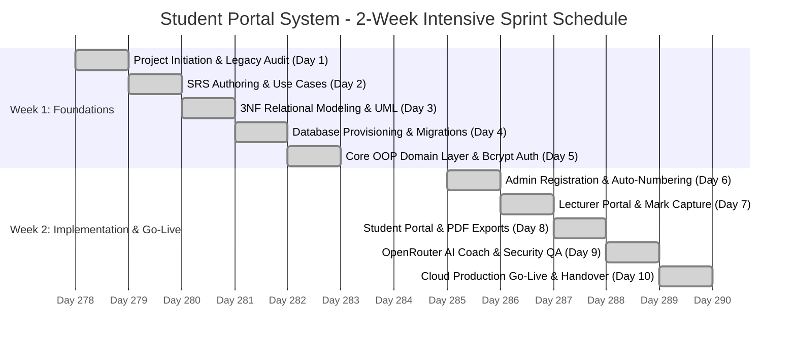
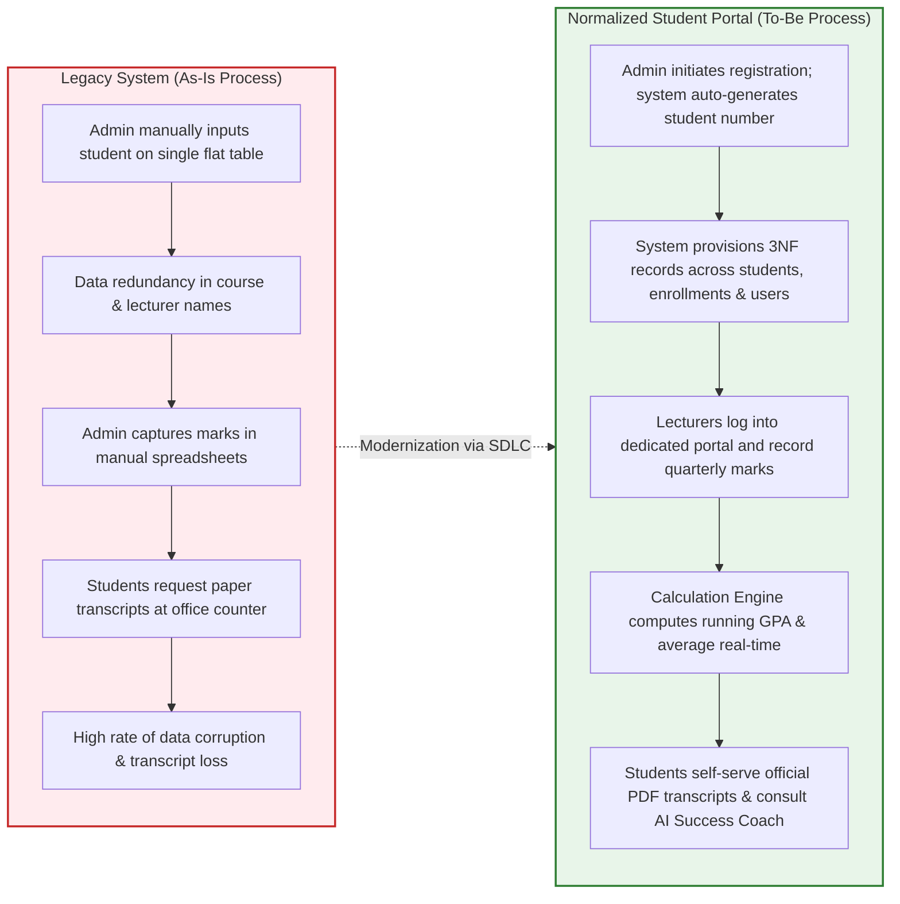
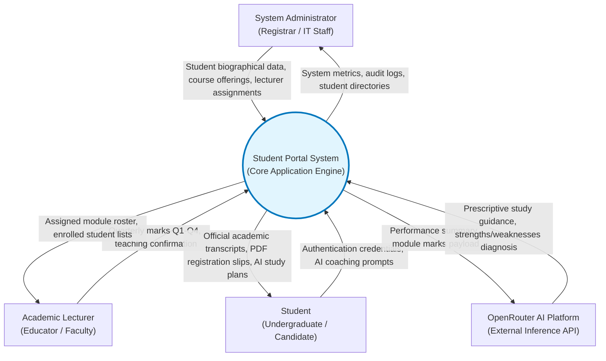
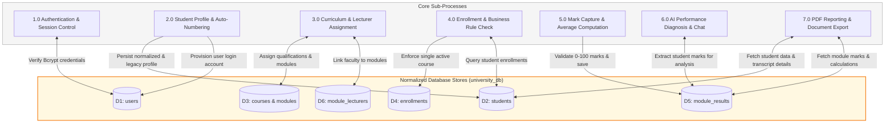
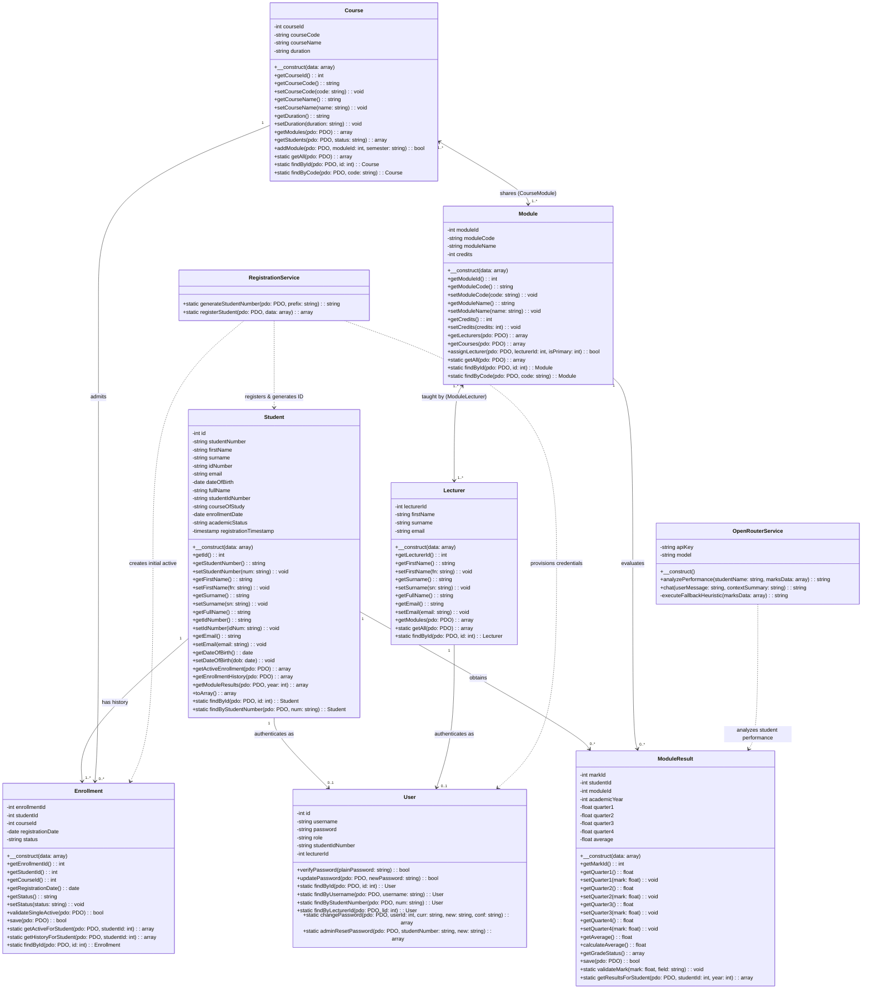
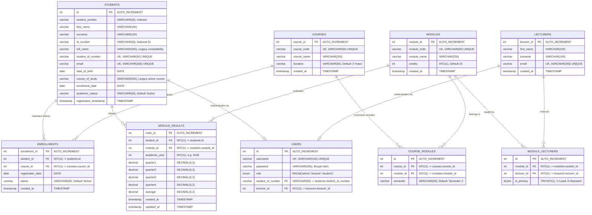
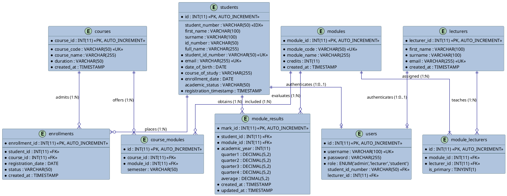

# STUDENT PORTAL SYSTEM
# Master System Documentation & Comprehensive Technical Specification Manual
### An Enterprise Academic Management Platform, Object-Oriented Architecture, 3NF Relational Database & Full-Stack Implementation

---

> [!NOTE]
> **Consolidated Master Documentation**  
> This unified master specification synthesizes the entire institutional documentation suite of the **Student Portal System**, integrating the Project Overview (README), Document 01 (Project Management Plan), Document 02 (Systems Analysis & Process Specification), Document 03 (Software Requirements Specification), Document 04 (Software Architecture & Technical Design), Document 05 (Database Specification & Relational Data Dictionary), all canonical Mermaid & PlantUML diagrams, and the Security & Runtime Hardening Audit into a single, cohesive, exhaustive manual.

---

## Master Document Metadata

| **Institutional Dimension** | **Specification Details** |
| :--- | :--- |
| **Project Title** | **Student Portal System** (Academic Management & Success Platform) |
| **Document Classification** | Master System Documentation & Comprehensive Technical Specification |
| **Host Department** | **Department of Forestry, Fisheries and the Environment (DFFE)** |
| **Branch & Directorate** | Corporate Management Services (CMS) — Directorate: IT Business Solutions (ITBS) |
| **Unit** | ICT Services: Infrastructure and Security Support |
| **Project Nature** | **Internship Technical Practical Assessment & Competency Demonstration Task** |
| **SDLC Framework** | Fast-Track 2-Week Agile SDLC Sprint with Formal IEEE 830 & UML 2.5 Governance |
| **Project Sprint Duration** | **2 Calendar Weeks** (10 Intensive Working Days) |
| **Total Incurred Expenditure** | **< R 1,000.00 ZAR** (R 750.00 Actual Out-of-Pocket Outflow) |
| **Enterprise Cost Avoidance** | **~ R 48,400.00 ZAR** Saved via FOSS Stack and Free Cloud Tiers |
| **Development Team** | • **Mr Avuyile Mthembu**: Full Stack Software Developer (Project Lead & System Architect)<br>• **Ms Nomthandazo Khoza**: Database Administrator (DBA & Relational Modeler)<br>• **Ms Qhama Nodada**: Frontend Developer (UI/UX & Client Logic) |
| **Technical Mentor & Reviewer** | Senior Specialist: Software Architecture & Systems Development (DFFE ITBS) |
| **Target Database Engine** | `university_db` (MySQL 8.0+ / MariaDB 10.4+, InnoDB Engine, `utf8mb4_unicode_ci`) |
| **Target Runtime Environment**| PHP 8.2+ on Apache 2.4 (AMPPS Localhost & InfinityFree Cloud Cluster) |
| **Live Cloud Production URL** | [https://student-system.infinityfree.io/index.php](https://student-system.infinityfree.io/index.php) |
| **Localhost Workstation URL** | [http://localhost/university_system/index.php](http://localhost/university_system/index.php) |
| **Current System Release** | Version 3.0 (Role Segregation, 3NF Normalization, AI Coach & 100% Backward Compatibility) |

---

## Master Table of Contents

- [1. Executive Summary & Deployment Environments](#1-executive-summary--deployment-environments)
  - [1.1 Assessment Mandate & Strategic Background](#11-assessment-mandate--strategic-background)
  - [1.2 Deployment Environments & Demo Credentials Matrix](#12-deployment-environments--demo-credentials-matrix)
  - [1.3 Core Modernization Capabilities](#13-core-modernization-capabilities)
  - [1.4 High-Level Project Directory Layout](#14-high-level-project-directory-layout)
- [2. Project Management Plan (PMP) & Governance](#2-project-management-plan-pmp--governance)
  - [2.1 Project Charter & Organization Structure](#21-project-charter--organization-structure)
  - [2.2 SMART Project Objectives](#22-smart-project-objectives)
  - [2.3 Scope Baseline (In-Scope vs. Out-of-Scope)](#23-scope-baseline-in-scope-vs-out-of-scope)
  - [2.4 Work Breakdown Structure (WBS)](#24-work-breakdown-structure-wbs)
  - [2.5 10-Day Sprint Schedule Breakdown](#25-10-day-sprint-schedule-breakdown)
  - [2.6 Project Schedule Gantt Chart](#26-project-schedule-gantt-chart)
  - [2.7 Financial Management (< R 1,000 Budget & Cost Avoidance Model)](#27-financial-management--r-1000-budget--cost-avoidance-model)
  - [2.8 Team Governance & RACI Matrix](#28-team-governance--raci-matrix)
  - [2.9 Project Risk Management Plan](#29-project-risk-management-plan)
  - [2.10 Project Handover & Endorsement](#210-project-handover--endorsement)
- [3. Systems Analysis & Process Modeling](#3-systems-analysis--process-modeling)
  - [3.1 5-Phase Fast-Track SDLC Lifecycle & Stage Gates](#31-5-phase-fast-track-sdlc-lifecycle--stage-gates)
  - [3.2 The TELOS Feasibility Framework](#32-the-telos-feasibility-framework)
  - [3.3 As-Is (Legacy) vs. To-Be (Proposed) Process Modeling](#33-as-is-legacy-vs-to-be-proposed-process-modeling)
  - [3.4 Data Flow Diagrams (DFDs)](#34-data-flow-diagrams-dfds)
    - [3.4.1 DFD Level 0: Institutional Context Diagram](#341-dfd-level-0-institutional-context-diagram)
    - [3.4.2 DFD Level 1: System Decomposition Diagram](#342-dfd-level-1-system-decomposition-diagram)
  - [3.5 3-Tier System Topology Architecture](#35-3-tier-system-topology-architecture)
  - [3.6 Relational Normalization Proof (1NF to 3NF)](#36-relational-normalization-proof-1nf-to-3nf)
  - [3.7 Object-Oriented Design Patterns Applied](#37-object-oriented-design-patterns-applied)
  - [3.8 Cryptographic Security Architecture](#38-cryptographic-security-architecture)
  - [3.9 Requirements Traceability Matrix (RTM)](#39-requirements-traceability-matrix-rtm)
  - [3.10 Post-Implementation Review (PIR)](#310-post-implementation-review-pir)
- [4. Software Requirements Specification (SRS)](#4-software-requirements-specification-srs)
  - [4.1 IEEE 830-1998 Standard Compliance](#41-ieee-830-1998-standard-compliance)
  - [4.2 Product Perspective & User Classes](#42-product-perspective--user-classes)
  - [4.3 Comprehensive Functional Requirements (FR-01 to FR-18)](#43-comprehensive-functional-requirements-fr-01-to-fr-18)
  - [4.4 Detailed Use Case Specifications (UC-01 to UC-03)](#44-detailed-use-case-specifications-uc-01-to-uc-03)
  - [4.5 Non-Functional Requirements (NFR-01 to NFR-04)](#45-non-functional-requirements-nfr-01-to-nfr-04)
  - [4.6 SRS Assessment Traceability Matrix](#46-srs-assessment-traceability-matrix)
- [5. Software Architecture & Technical System Design](#5-software-architecture--technical-system-design)
  - [5.1 Architectural Tenets & Core Principles](#51-architectural-tenets--core-principles)
  - [5.2 UML 2.5 Class Diagram (Mermaid)](#52-uml-25-class-diagram-mermaid)
  - [5.3 Domain Entity Class Specifications](#53-domain-entity-class-specifications)
  - [5.4 Service Layer Class Specifications](#54-service-layer-class-specifications)
  - [5.5 Institutional Business Rules Verification](#55-institutional-business-rules-verification)
  - [5.6 Backward Compatibility Facade Architecture](#56-backward-compatibility-facade-architecture)
- [6. Database Specification & Relational Data Dictionary](#6-database-specification--relational-data-dictionary)
  - [6.1 Database Engine & Storage Characteristics](#61-database-engine--storage-characteristics)
  - [6.2 ASCII Entity Relationship Schema Map](#62-ascii-entity-relationship-schema-map)
  - [6.3 Canonical Entity Relationship Diagram (Mermaid ERD)](#63-canonical-entity-relationship-diagram-mermaid-erd)
  - [6.4 PlantUML / Draw.io Relational Architecture Specification](#64-plantuml--drawio-relational-architecture-specification)
  - [6.5 Comprehensive Data Dictionary (All 8 Relational Tables)](#65-comprehensive-data-dictionary-all-8-relational-tables)
  - [6.6 Relationships, Cardinalities & Cascading Integrity Matrix](#66-relationships-cardinalities--cascading-integrity-matrix)
  - [6.7 Database Specification Sign-off](#67-database-specification-sign-off)
- [7. Complete Diagrams Gallery](#7-complete-diagrams-gallery)
  - [7.1 UML Class Diagram](#71-uml-class-diagram)
  - [7.2 Entity Relationship Diagram (ERD)](#72-entity-relationship-diagram-erd)
  - [7.3 Process & Data Flow Diagrams](#73-process--data-flow-diagrams)
  - [7.4 Project Management & SDLC Diagrams](#74-project-management--sdlc-diagrams)
- [8. Installation, Configuration & Deployment Manual](#8-installation-configuration--deployment-manual)
  - [8.1 Prerequisites & System Dependencies](#81-prerequisites--system-dependencies)
  - [8.2 Database Provisioning & Migration Pipeline](#82-database-provisioning--migration-pipeline)
  - [8.3 Application Configuration Setup](#83-application-configuration-setup)
  - [8.4 OpenRouter AI Integration Configuration](#84-openrouter-ai-integration-configuration)
  - [8.5 Production Cloud Deployment Protocol](#85-production-cloud-deployment-protocol)
- [9. Security Audit, Hardening & Vulnerability Remediation](#9-security-audit-hardening--vulnerability-remediation)
  - [9.1 Application Code Security Audit](#91-application-code-security-audit)
  - [9.2 Runtime Environment & The PHP2Shell Vulnerability](#92-runtime-environment--the-php2shell-vulnerability)
  - [9.3 Header Disclosure Hardening](#93-header-disclosure-hardening)
  - [9.4 API Endpoint Protection & TLS Peer Verification](#94-api-endpoint-protection--tls-peer-verification)
- [10. Project Closeout, Attestation & Final Endorsements](#10-project-closeout-attestation--final-endorsements)

---

# 1. Executive Summary & Deployment Environments

## 1.1 Assessment Mandate & Strategic Background

The **Student Portal System** was engineered as an intensive, practical **two-week software engineering competency evaluation task** within the **Directorate: Information Technology Business Solutions (ITBS)**, Corporate Management Services (CMS) branch of the **Department of Forestry, Fisheries and the Environment (DFFE)**.

The strategic challenge posed by the departmental technical mentor was to modernize an academic administration domain from a legacy, denormalized flat student directory into a professional, enterprise-grade academic platform operating on a LAMP stack. Rather than delivering a simple educational prototype, the intern team implemented full-lifecycle software engineering disciplines under strict real-world constraints:

1. **Structured Requirements Engineering**: Formulating 18 formal functional requirements and 4 non-functional benchmarks conforming to the IEEE 830-1998 standard.
2. **Third Normal Form (3NF) Relational Normalization**: Decomposing a denormalized single flat table into an 8-table relational schema (`university_db`) governed by foreign key constraints, composite unique indexes, and cascading referential integrity.
3. **Object-Oriented Architecture (OOP)**: Implementing clean, maintainable PHP 8 domain entities (`Student`, `Course`, `Module`, `Lecturer`, `Enrollment`, `ModuleResult`, `User`) and dedicated transactional services (`RegistrationService`, `OpenRouterService`).
4. **Multi-Role Segregation (RBAC)**: Providing distinct, authenticated portals with dedicated navigation and permission boundaries for **Administrators**, **Lecturers/Educators**, and **Students**.
5. **Generative AI Pedagogical Integration**: Engineering an AI Academic Success Coach leveraging the OpenRouter Free API (`google/gemini-2.0-flash-exp:free`) backed by an automated local heuristic rule fallback engine.
6. **Zero-Regressive Backward Compatibility**: Preserving legacy data attributes (`full_name`, `student_id_number`, `course_of_study`, `academic_status`), legacy authentication credentials, and reporting templates without breaking backward compatibility.
7. **Frugal Engineering & Cost Optimization**: Delivering the complete system on an actual budget of **R 750.00 ZAR** (< R 1,000 threshold) by leveraging open-source tooling (AMPPS, PHP 8, MariaDB) and free cloud tiers, realizing **~R 48,400.00** in commercial enterprise cost avoidance.

---

## 1.2 Deployment Environments & Demo Credentials Matrix

The system is operational across both public cloud production and local developer workstation environments:
* **Live Cloud Production URL**: [https://student-system.infinityfree.io/index.php](https://student-system.infinityfree.io/index.php)
* **Localhost Workstation (AMPPS) URL**: [http://localhost/university_system/index.php](http://localhost/university_system/index.php)

The login interface (`index.php`) features an interactive, tabbed role switcher permitting assessors to switch between Student, Lecturer, and Administrator roles with automated credential population.

### Quick Access Demo Credentials Matrix

| Portal View | Username | Password | Access Privileges & Functional Scope |
| :--- | :--- | :--- | :--- |
| **Student Portal** | `10ha2304014` | `Student@dffe` | Seeded demo student account. Self-service profile, registered modules inspection, quarterly marks (Q1–Q4), real-time composite average, official jsPDF academic transcript export, and OpenRouter AI Success Coach diagnostics. |
| **Lecturer / Educator Portal** | `lecturer` | `Lecturer@dffe` | Educator view. Review allocated teaching modules, inspect enrolled student rosters, and capture/update quarterly marks (Q1 to Q4) with client-side range validation. |
| **Administrator Portal** | `admin` | `TheAdmin@dffe` | Central administrative governance. Student registration with automated student number generation (`ST2600001`), course curriculum mapping, module credit management, lecturer staffing, and global student directory filtering. |

---

## 1.3 Core Modernization Capabilities

* **Interactive Multi-Role Switcher UI**: Sleek Material Design landing interface with dynamic tab switching that automatically injects valid demo credentials into login fields for friction-free evaluation.
* **Dedicated Educator / Lecturer Portal**: Full separation of academic grading responsibilities from administrative governance. Educators view their assigned teaching modules and capture continuous assessment marks (Q1–Q4).
* **AI Academic Success Coach (OpenRouter Free API)**:
  - **One-Click Diagnostic Evaluation**: Automatically scans quarterly marks across all subjects, flags at-risk modules (< 50.00%), identifies strongest topics, and generates a structured revision plan.
  - **Interactive Pedagogical Chat**: Context-bounded assistant providing targeted guidance on syllabus mastery, study schedules, and exam preparation.
  - **Resilient Offline Fallback**: In the absence of an internet connection or OpenRouter API key, an internal heuristic engine executes rule-based diagnostic evaluation.
* **Automated Student Numbering Engine**: Synthesizes standardized institutional student identifiers formatted as `ST` + 2-digit current year + 5-digit sequence (e.g., `ST2600001`) with collision detection.
* **Single Active Course Rule**: Restricts students to exactly one concurrent `'Active'` qualification enrollment while permanently archiving prior courses to protect transcript history.
* **Many-to-Many Curriculum & Staffing Architecture**: Modules can be shared across multiple qualifications (`course_modules`), and multiple lecturers can be assigned to co-teach a module (`module_lecturers`).
* **Client-Side Document Exporting (jsPDF)**: Instant generation and download of standardized, vector-rendered Registration Confirmation Slips and Official Academic Transcripts in PDF format directly from the browser.
* **Cryptographic Security**: Passwords salted and hashed with Bcrypt (`cost => 10`), generating independent 22-character cryptographic random salts per record. 100% of SQL statements utilize PDO parameterized prepared statements.
* **Dual-Column Backward Compatibility**: Maintains synchronized legacy columns alongside normalized relational tables, guaranteeing Version 1.0 queries and reports operate without errors.

---

## 1.4 High-Level Project Directory Layout

```text
university_system/
├── index.php                      # Landing page, multi-role tabbed login switcher & authentication handler
├── 404.php                        # Role-aware, responsive 404 error page and navigational recovery
├── config.php                     # Database & API configuration parameters
├── config.example.php             # Boilerplate configuration template for new deployments
├── functions.php                  # Global helpers, session validation, autoloader & sanitization
├── logout.php                     # Secure session destruction and cache invalidation
├── change_password.php            # User self-service password modification endpoint
├── presentation.php               # Technical presentation slides for assessment panels
├── MASTER_DOCUMENTATION.md        # Consolidated Master Documentation & Specification Manual (This Document)
├── README.md                      # GitHub repository overview & quick-start guide
├── project-structure.txt          # Complete repository file and directory layout
├── notes.txt                      # Security audit, runtime engine check & remediation notes
│
├── classes/                       # Object-Oriented Domain Layer & Service Layer
│   ├── Student.php                # Student entity with backward-compatibility facades
│   ├── Course.php                 # Academic qualification entity with curriculum mappings
│   ├── Module.php                 # Learning unit entity with multi-course & multi-lecturer links
│   ├── Lecturer.php               # Academic teaching staff entity
│   ├── Enrollment.php             # Course registration entity enforcing single active course rule
│   ├── ModuleResult.php           # Assessment entity handling Q1-Q4 marks, validation & averaging
│   ├── User.php                   # Authentication entity with Bcrypt verification & RBAC
│   ├── RegistrationService.php    # Transactional service for auto-numbering & onboarding
│   └── OpenRouterService.php      # AI Academic Coach relay & heuristic fallback engine
│
├── admin/                         # System Administrator Governance Subsystem
│   ├── dashboard.php              # Administrative dashboard with institutional metrics & counts
│   ├── register_student.php       # Student registration with automated student number generator
│   ├── student_list.php           # Student directory with real-time multi-attribute filtering
│   ├── student_profile.php        # Comprehensive student view (biography, courses, marks)
│   ├── update_student.php         # Student record modification with dual-column sync
│   ├── delete_student.php         # Student record deletion handler with cascading cleanup
│   ├── courses.php                # Qualification curriculum management & module linkages
│   ├── modules.php                # Academic module directory, credit weights & lecturer assignments
│   ├── lecturers.php              # Teaching faculty directory & departmental management
│   ├── results.php                # Quarterly mark capture & audit across all modules
│   └── deleted_logs.txt           # Audit log tracking administrative deletion events
│
├── lecturer/                      # Lecturer / Educator Academic Subsystem
│   ├── dashboard.php              # Lecturer dashboard displaying assigned modules & student totals
│   ├── modules.php                # Teaching allocation roster with enrolled student rosters
│   └── results.php                # Continuous assessment mark capture (Q1-Q4) with live averaging
│
├── student/                       # Student Self-Service Subsystem
│   ├── dashboard.php              # Student home dashboard with GPA summary & module alerts
│   ├── profile.php                # Student biographical profile & historical enrollments
│   ├── modules.php                # Enrolled curriculum units & assigned lecturer details
│   ├── results.php                # Academic transcript, quarterly grades, AI Coach & PDF export
│   ├── profile_report.php         # Profile summary report view with print preview
│   └── registration_slip.php      # Official proof of registration with jsPDF export
│
├── api/                           # Asynchronous AJAX & External Endpoints
│   └── ai_coach.php               # Asynchronous API proxy relaying student chat to OpenRouter
│
├── database/                      # Relational Schema & Migration Pipeline
│   ├── database.sql               # Base schema initialization and seed dataset
│   ├── migration_v2.sql           # Incremental migration script establishing 3NF relational tables
│   ├── migration_v3_lecturer_ai.sql # Incremental migration adding lecturer role & AI conversation logs
│   └── backup_pre_v3.sql          # Pre-migration snapshot for rollback verification
│
├── css/                           # Presentation & Component Style Sheets
│   ├── style.css                  # Core application stylesheet
│   ├── material-design.css        # Material Design component tokens and typography
│   ├── dashboard.css              # Portal dashboard layouts, KPI widgets and metrics cards
│   └── forms.css                  # Form control styling, floating labels and error indicators
│
├── js/                            # Client-Side Logic & Export Engines
│   ├── validation.js              # Client-side form validation and quarterly mark bounds checking
│   ├── confirmation.js            # Modal prompts for destructive deletion actions
│   ├── search-filter.js           # Real-time multi-attribute client-side table search and filter
│   └── jspdf.min.js               # Client-side vector PDF document generation library
│
├── assets/                        # Static Media Assets
│   └── images/                    # Logos, branding icons and institutional crests
│
├── includes/                      # Reusable Presentation Templates & Navigation
│   ├── header.php                 # Common HTML head, responsive viewport & session gatekeeper
│   ├── footer.php                 # Common HTML closing tags, scripts & institutional copyright
│   ├── nav_admin.php              # Administrative navigation bar
│   ├── nav_lecturer.php           # Lecturer navigation bar
│   └── nav_student.php            # Student navigation bar
│
└── documentation/                 # Original 5-Step Sequential Documentation Suite
    ├── 01_PROJECT_MANAGEMENT_PLAN.md
    ├── 02_SYSTEMS_ANALYSIS_AND_PROCESS_SPECIFICATION.md
    ├── 03_SOFTWARE_REQUIREMENTS_SPECIFICATION.md
    ├── 04_SOFTWARE_ARCHITECTURE_AND_DESIGN.md
    ├── 05_DATABASE_SPECIFICATION_AND_DATA_DICTIONARY.md
    └── diagrams/
        ├── ENTITY_RELATIONSHIP_DIAGRAM.mmd
        ├── UML_CLASS_DIAGRAM.mmd
        └── *.png
```

---

# 2. Project Management Plan (PMP) & Governance

## 2.1 Project Charter & Organization Structure

The **Project Management Plan (PMP)** establishes the governance, scope boundaries, work breakdown, schedule baseline, and cost model for the two-week internship sprint.

### Project Organization Structure

```
+-----------------------------------------------------------------------------------------+
|                                    PROJECT SPONSOR                                      |
|                 Senior Technical Mentor (DFFE Directorate: ITBS)                        |
+-----------------------------------------------------------------------------------------+
                                             |
                                             v
+-----------------------------------------------------------------------------------------+
|                                  INTERNSHIP DEV TEAM                                    |
+-----------------------------------------------------------------------------------------+
|                                                                                         |
|  [ Mr Avuyile Mthembu ]         [ Ms Nomthandazo Khoza ]      [ Ms Qhama Nodada ]       |
|  Full Stack Developer           Database Administrator        Frontend Developer        |
|  (Team Lead & Architect)        (DBA & Relational Modeler)    (UI/UX & Client Logic)    |
|  • OOP Domain Architecture      • 3NF Schema Normalization    • Material Design UI      |
|  • Bcrypt Auth & Security       • Relational ERD Modeling     • Multi-Role Switcher     |
|  • OpenRouter AI Integration    • SQL Migration Pipeline      • Search & Live Filtering |
|  • Cloud Deployment & QA        • Foreign Keys & Cascades     • jsPDF Export Engine     |
|                                                                                         |
+-----------------------------------------------------------------------------------------+
```

---

## 2.2 SMART Project Objectives

1. **Specific**: Modernize a legacy single-table student management repository into a normalized 3NF relational database (`university_db`), implement clean PHP 8 Object-Oriented domain models, deliver segregated Administrator, Lecturer, and Student portals, and integrate an OpenRouter AI Academic Coach.
2. **Measurable**: 100% completion of 18 functional requirements (FR-01 to FR-18), zero broken legacy queries/data access paths, sub-250ms page load times, and error-free execution across all browsers.
3. **Achievable**: Leverage a lightweight, proven LAMP stack (Apache 2.4, PHP 8.2, MySQL/MariaDB) without heavy framework dependencies, utilizing modern client-side scripting and free-tier cloud APIs.
4. **Relevant**: Directly satisfies all DFFE ITBS competency assessment rubrics for relational database design, backend system architecture, and frontend user experience delivery.
5. **Time-bound**: Plan, design, implement, test, and deploy the entire solution within **10 working days (2 calendar weeks)**.

---

## 2.3 Scope Baseline (In-Scope vs. Out-of-Scope)

### In-Scope Deliverables
* **Requirements & Systems Analysis**: Legacy table audit, As-Is vs. To-Be process modeling, DFD Level 0 & Level 1, TELOS feasibility study, and IEEE 830 SRS.
* **Architecture & Modeling**: 3NF normalization proofs, ASCII relational map, canonical Mermaid ERD, UML 2.5 Class Diagram with multiplicities, and 3-Tier architecture topology.
* **Database & Persistence**: Provisioning `university_db` with 8 relational tables, foreign key constraints (`ON DELETE CASCADE`), composite unique indexes, and two incremental SQL migration scripts (`migration_v2.sql`, `migration_v3_lecturer_ai.sql`).
* **Backend Domain Layer**: 7 PHP 8 domain models (`Student`, `Course`, `Module`, `Lecturer`, `Enrollment`, `ModuleResult`, `User`) and 2 service layer classes (`RegistrationService`, `OpenRouterService`).
* **Presentation & Client Tier**: Material Design responsive dashboards for all three roles, multi-role tabbed switcher with quick-access credentials, dynamic search-filter engine, and jsPDF vector export engine.
* **Artificial Intelligence**: OpenRouter free inference integration (`google/gemini-2.0-flash-exp:free`) with local heuristic fallback for diagnostic performance analysis and academic chat.
* **Verification & Cloud Deployment**: Comprehensive testing (unit, integration, security, backward compatibility) and production deployment to InfinityFree cloud hosting with SSL.

### Out-of-Scope (Boundaries)
* Direct banking/EFT credit card tuition fee gateway processing.
* Native mobile applications (iOS/Android native binaries) — satisfied via responsive viewport CSS.
* Campus physical biometric turnstile and access-control hardware integration.
* Commercial third-party LMS integration (e.g., Blackboard or Canvas LTI).

---

## 2.4 Work Breakdown Structure (WBS)

```mermaid
graph TD
    WBS["Student Portal System (2-Week Sprint)"]
    
    WBS --> W1["1.0 Requirements & SDLC Initiation"]
    WBS --> W2["2.0 System Architecture & Modeling"]
    WBS --> W3["3.0 Database & Backend Development"]
    WBS --> W4["4.0 Frontend & AI Integration"]
    WBS --> W5["5.0 Testing, QA & Cloud Go-Live"]

    W1 --> W1_1["1.1 Project Charter & Scope Baseline"]
    W1 --> W1_2["1.2 Legacy Flat Table Audit"]
    W1 --> W1_3["1.3 IEEE 830 SRS Formulation"]

    W2 --> W2_1["2.1 3NF Normalization & ERD Design"]
    W2 --> W2_2["2.2 UML Class & Sequence Modeling"]
    W2 --> W2_3["2.3 UI Wireframes & Layout System"]

    W3 --> W3_1["3.1 DB Provisioning & Migration Scripts"]
    W3 --> W3_2["3.2 PHP 8 Domain Models & Services"]
    W3 --> W3_3["3.3 Bcrypt Auth & Session Security"]

    W4 --> W4_1["4.1 Multi-Role Switcher UI"]
    W4 --> W4_2["4.2 Lecturer Grading & Admin Portals"]
    W4 --> W4_3["4.3 OpenRouter AI Success Advisor"]
    W4 --> W4_4["4.4 jsPDF Transcript Export Engine"]

    W5 --> W5_1["5.1 Integration & Security Smoke Tests"]
    W5 --> W5_2["5.2 Backward Compatibility Verification"]
    W5 --> W5_3["5.3 Cloud Deployment & Live Verification"]
```



---

## 2.5 10-Day Sprint Schedule Breakdown

| Sprint Day | Target Phase | Major Activities Completed | Responsible Role |
| :---: | :--- | :--- | :--- |
| **Day 1** | Initiation & Audit | Project kickoff, problem statement definition, legacy table audit, scope baseline. | All Team Members |
| **Day 2** | Requirements (SRS) | Functional requirement authoring (FR-01 to FR-18), use cases, non-functional rules. | Avuyile & Qhama |
| **Day 3** | System Modeling | 3NF relational normalization, ERD diagramming, UML Class diagram modeling. | Nomthandazo & Avuyile |
| **Day 4** | Database Architecture | Database schema creation (`university_db`), migration scripts (`v2`), foreign keys. | Nomthandazo (DBA) |
| **Day 5** | Core Backend Models | PHP 8 domain classes (`Student`, `Course`, `Module`, `User`), Bcrypt authentication. | Avuyile (Full Stack) |
| **Day 6** | Governance Subsystem | Admin student registration, auto-numbering engine (`ST2600001`), course allocation. | Avuyile & Qhama |
| **Day 7** | Lecturer Portal | Lecturer role separation, teaching assignments, quarterly mark capture (Q1–Q4). | Avuyile & Nomthandazo |
| **Day 8** | Frontend & Exports | Student self-service dashboard, client-side live filter, jsPDF transcript exports. | Qhama (Frontend) |
| **Day 9** | AI Coach & Testing | OpenRouter AI integration with heuristic fallback, integration & backward compat tests. | Avuyile & Qhama |
| **Day 10** | Cloud Go-Live & Review | Production cutover to InfinityFree, SSL verification, documentation finalization, sign-off. | All Team Members |

---

## 2.6 Project Schedule Gantt Chart



---

## 2.7 Financial Management (< R 1,000 Budget & Cost Avoidance Model)

### Actual Expenditure Breakdown (ZAR)

| Category | Expense Description | Procurement Basis | Actual Cost (ZAR) |
| :--- | :--- | :--- | :---: |
| **Connectivity** | Mobile data bundles for off-site testing & team sync | 2 x 10GB Data Packages | R 350.00 |
| **Testing & Collab** | Incidental local dev & DNS testing resources | Self-funded intern contribution | R 250.00 |
| **Backup Storage** | Local encrypted flash drive for source code snapshots | Departmental / Intern asset | R 150.00 |
| **Total Out-of-Pocket Cost** | **Actual Incurred Financial Expenditure** | **Direct Cash Outflow** | **R 750.00 ZAR** |

### Open-Source & Free-Tier Cost-Avoidance Model

| Resource Item | Enterprise Alternative | Chosen Solution | Cost to Project | Value Realized |
| :--- | :--- | :--- | :---: | :---: |
| **Web Server** | Commercial IIS/Windows Server License | Apache 2.4 via AMPPS (FOSS) | **R 0.00** | R 12,000.00 |
| **Database Server** | Microsoft SQL Server / Oracle DB | MySQL 8.0 / MariaDB (FOSS) | **R 0.00** | R 18,500.00 |
| **Development Stack** | Commercial Enterprise IDEs & Frameworks | PHP 8.2 + VS Code + Vanilla JS | **R 0.00** | R 6,000.00 |
| **Cloud Web Hosting** | Dedicated AWS / Azure VM Instance | InfinityFree Cloud Cluster | **R 0.00** | R 2,400.00 |
| **SSL Encryption** | Paid Commercial Wildcard Certificate | Automated Let's Encrypt / Host SSL | **R 0.00** | R 1,800.00 |
| **AI Inference** | Paid OpenAI GPT-4 API Subscription | OpenRouter Free Tier (`gemini-2.0-flash-exp:free`) | **R 0.00** | R 3,500.00 |
| **PDF Generation Engine**| Commercial Server-side PDF Library | Open-Source `jsPDF.min.js` | **R 0.00** | R 4,200.00 |
| **Total Cost Avoidance** | **Estimated Enterprise Commercial Value** | **FOSS & Free Tier Savings** | **R 0.00** | **~ R 48,400.00** |

---

## 2.8 Team Governance & RACI Matrix

* **R** = Responsible (Conducts the work)
* **A** = Accountable (Final ownership & approval)
* **C** = Consulted (Provides input & feedback)
* **I** = Informed (Updated on progress)

| SDLC Deliverable | Technical Mentor | Mr Avuyile Mthembu (Full Stack) | Ms Nomthandazo Khoza (DBA) | Ms Qhama Nodada (Frontend) |
| :--- | :---: | :---: | :---: | :---: |
| **Project Charter & Scope Definition** | **A** | R | C | C |
| **Requirements Specification (SRS)** | **A** | R | C | R |
| **3NF Relational Database Design & ERD** | C | C | **A / R** | I |
| **UML Class Diagram Modeling** | C | **A / R** | C | I |
| **SQL Migrations & Data Integrity** | I | C | **A / R** | I |
| **Core OOP Domain Models (PHP)** | C | **A / R** | C | I |
| **UI/UX Design & Multi-Role Switcher** | I | C | I | **A / R** |
| **Quarterly Mark Capture (Lecturer Portal)**| I | R | C | R |
| **AI Academic Success Coach (OpenRouter)** | I | **A / R** | I | C |
| **PDF Transcript Engine (jsPDF)** | I | C | I | **A / R** |
| **Testing, Backward Compat & Security** | C | R | R | R |
| **Cloud Deployment & Handover** | **A** | R | C | C |

---

## 2.9 Project Risk Management Plan

| Risk ID | Description | Severity | Planned Mitigation Strategy | Owner |
| :---: | :--- | :---: | :--- | :---: |
| **RSK-01** | **Legacy data corruption**: Migrating from flat table breaks existing records or queries. | **High** | Maintained legacy columns (`full_name`, `student_id_number`) alongside normalized tables with real-time sync. | Ms Nomthandazo (DBA) |
| **RSK-02** | **Tight 2-week schedule**: Feature creep preventing timely project delivery. | **High** | Strictly prioritized MVP: Auth, 3NF DB, 3 Portals, AI Coach, and PDF exports; non-essentials pushed to v4. | Mr Avuyile (Lead) |
| **RSK-03** | **OpenRouter API availability**: Rate limiting or network drops disabling student AI chat. | **Medium** | Built a robust offline heuristic fallback inside `OpenRouterService.php` that diagnoses weak quarters automatically. | Mr Avuyile (Lead) |
| **RSK-04** | **Frontend inconsistency**: Cross-browser display bugs across different screen sizes. | **Medium** | Adopted proven Materialize CSS framework with flexible viewport grids and tested on Chrome/Firefox/Edge. | Ms Qhama (Frontend) |

---

## 2.10 Project Handover & Endorsement

```text
================================================================================
                    PROJECT HANDOVER & ASSESSMENT SUBMISSION
================================================================================

Submitted by the Internship Development Team:

1. _________________________________      Date: 2026-10-16
   Mr Avuyile Mthembu
   Full Stack Software Developer (Project Lead & System Architect)

2. _________________________________      Date: 2026-10-16
   Ms Nomthandazo Khoza
   Database Administrator (DBA & Relational Modeler)

3. _________________________________      Date: 2026-10-16
   Ms Qhama Nodada
   Frontend Developer (UI/UX & Client Logic)

Host Directorate:
Directorate: Information Technology Business Solutions (ITBS)
Branch: Corporate Management Services (CMS)
Department of Forestry, Fisheries and the Environment (DFFE)

Assessed & Endorsed by:
____________________________________      Date: 2026-10-16
Senior Specialist: Software Architecture & Systems Development (ITBS)
Technical Mentor & Project Sponsor

Evaluation: Full 2-Week SDLC Requirements and Competencies Verified
================================================================================
```

---

# 3. Systems Analysis & Process Modeling

## 3.1 5-Phase Fast-Track SDLC Lifecycle & Stage Gates

```mermaid
flowchart TD
    subgraph SDLC["5-Phase Fast-Track SDLC Lifecycle (2-Week Sprint)"]
        P1["Phase 1: Project Initiation & Feasibility (Days 1-2)<br>• Project Charter & Scope<br>• TELOS Feasibility Analysis<br>• Legacy Flat-Table Audit"]
        --> |Stage Gate 1: Scope Frozen| P2["Phase 2: Requirements Analysis (Days 2-3)<br>• As-Is vs To-Be Process Flows<br>• DFD Level 0 & Level 1 Design<br>• IEEE 830 SRS Formulation"]
        --> |Stage Gate 2: Architecture Baseline| P3["Phase 3: Systems & Database Design (Days 3-4)<br>• 3NF Relational Decomposition & ERD<br>• UML Class & Sequence Modeling<br>• 3-Tier Architecture Layout"]
        --> |Stage Gate 3: DB & Models Complete| P4["Phase 4: Implementation & Integration (Days 5-8)<br>• PHP 8 Domain Classes & Bcrypt Auth<br>• Multi-Role Switcher & Responsive UI<br>• OpenRouter AI Success Advisor & jsPDF"]
        --> |Stage Gate 4: Quality & Security Passed| P5["Phase 5: Verification, Deployment & Handover (Days 9-10)<br>• Backward Compatibility Verification<br>• Cloud Production Deployment (InfinityFree)<br>• Post-Implementation Review (PIR)"]
    end

    style P1 fill:#e3f2fd,stroke:#1565c0,stroke-width:2px;
    style P2 fill:#e8f5e9,stroke:#2e7d32,stroke-width:2px;
    style P3 fill:#fff3e0,stroke:#e65100,stroke-width:2px;
    style P4 fill:#ede7f6,stroke:#512da8,stroke-width:2px;
    style P5 fill:#e0f2f1,stroke:#00695c,stroke-width:2px;
```



---

## 3.2 The TELOS Feasibility Framework

| Feasibility Dimension | Evaluation Criteria | Findings & Project Viability Outcome | Risk Rating |
| :--- | :--- | :--- | :---: |
| **Technical (T)** | Feasibility of implementing 3NF normalization, PHP OOP domain models, and OpenRouter AI on standard LAMP stacks. | LAMP stack (Apache 2.4, PHP 8.x, MySQL 8.0 / MariaDB) natively supports PDO prepared statements, transaction isolation, and cURL requests. Zero-failure fallback heuristic handles API unavailability. | **Low** |
| **Economic (E)** | Cost-benefit analysis comparing development cost against administrative efficiency and budget constraints. | Achieved with **< R 1,000 ZAR** total cash expenditure by leveraging open-source tools (AMPPS, PHP, MariaDB), free cloud hosting (InfinityFree), and free AI tier (OpenRouter), saving over R48,000 in commercial license fees. | **Low** |
| **Legal (L)** | Compliance with the Protection of Personal Information Act (POPIA), South African policies, and IP standards. | System adheres strictly to POPIA: student ID numbers and contact data are safeguarded with Bcrypt salted hashing, parameterized queries, and strict role segregation. | **Low** |
| **Operational (O)** | Institutional acceptance by administrators, lecturers, and students transitioning from manual spreadsheets. | Intuitive Material Design interface with multi-role switcher minimizes cognitive load. Tabbed login and auto-filling demo credentials facilitate seamless adoption. | **Low** |
| **Schedule (S)** | Feasibility of delivering all core modules and documentation within the strict 2-week internship assessment window. | 10 working days allocated systematically across analysis, modeling, development, testing, and deployment. Deliverables were strictly prioritized to ensure on-time delivery. | **Low** |

---

## 3.3 As-Is (Legacy) vs. To-Be (Proposed) Process Modeling



---

## 3.4 Data Flow Diagrams (DFDs)

### 3.4.1 DFD Level 0: Institutional Context Diagram



---

### 3.4.2 DFD Level 1: System Decomposition Diagram



---

## 3.5 3-Tier System Topology Architecture

```text
====================================================================================================
                                      SYSTEM TOPOLOGY ARCHITECTURE
====================================================================================================

+--------------------------------------------------------------------------------------------------+
|                                    PRESENTATION LAYER (Client Tier)                              |
|  Engineered by: Ms Qhama Nodada (Frontend Developer)                                             |
|  - Responsive Multi-Role Layout (Materialize CSS, Modern CSS Custom Properties, Flexbox/Grid)   |
|  - Tabbed Role Switcher with Auto-fill Quick Access Demo Accounts                                |
|  - Interactive Client-Side Search & Filter Engine (search-filter.js)                              |
|  - AI Success Coach Chatbox & Formatted Response Renderer                                         |
|  - Client-Side Document PDF Generation (jsPDF.min.js)                                             |
+--------------------------------------------------------------------------------------------------+
                                                |
                                        HTTP/HTTPS (TLS 1.3)
                                                v
+--------------------------------------------------------------------------------------------------+
|                                APPLICATION & BUSINESS LOGIC LAYER                                |
|  Engineered by: Mr Avuyile Mthembu (Full Stack Software Developer)                              |
|  Controllers / Pages:                                                                            |
|   - admin/*.php (Governance, Student Management, Curriculum Mapping, Lecturer Allocation)        |
|   - lecturer/*.php (Roster Management, Quarterly Mark Capturing, Results Auditing)               |
|   - student/*.php (Self-service Profile, Module Inspection, Official Transcript, AI Success)     |
|                                                                                                  |
|  Domain Models & Services (classes/*.php):                                                       |
|   - Student.php, Course.php, Module.php, Lecturer.php, Enrollment.php, ModuleResult.php, User.php |
|   - RegistrationService.php (Transactional auto-numbering, legacy sync, account provisioning)   |
|   - OpenRouterService.php (API relay, heuristic fallbacks, bounded context prompt engineering)   |
+--------------------------------------------------------------------------------------------------+
                                                |
                                        PDO Prepared Statements
                                                v
+--------------------------------------------------------------------------------------------------+
|                                    DATA PERSISTENCE LAYER                                        |
|  Engineered by: Ms Nomthandazo Khoza (Database Administrator)                                    |
|  Relational Database Management System: MySQL 8.0+ / MariaDB 10.4+ (InnoDB Engine)              |
|   - 8 Normalized Tables in Third Normal Form (3NF) with Foreign Key Constraints & Cascading      |
|   - Dual-Column Backward Compatibility Layer (legacy full_name, student_id_number support)       |
|   - Real-time Transactional Integrity (ACID Compliance with Commit & Rollback)                   |
+--------------------------------------------------------------------------------------------------+
```

---

## 3.6 Relational Normalization Proof (1NF to 3NF)

The legacy database consisted of a single denormalized flat table:  
`legacy_students (student_id, full_name, id_number, course_name, course_duration, module_1, lecturer_1, mark_1, module_2, lecturer_2, mark_2)`

### Normalization Transformation Steps:
1. **First Normal Form (1NF)**:
   - *Violation*: Repeating groups of modules, lecturers, and marks (`module_1`, `module_2`, etc.).
   - *Resolution*: Decomposed repeating attributes into independent child rows with single atomic values.
2. **Second Normal Form (2NF)**:
   - *Violation*: Course duration depends only on `course_name` (part of composite key), not on the primary key `student_id`.
   - *Resolution*: Extracted courses into an independent entity (`courses`) with primary key `course_id`. Extracted modules into `modules`.
3. **Third Normal Form (3NF)**:
   - *Violation*: Transitive dependency where `lecturer_email` depended on `lecturer_name`, which depended on `module_id`.
   - *Resolution*: Decomposed lecturers into an independent entity (`lecturers`) with primary key `lecturer_id`, linked via an associative junction table `module_lecturers`.

---

## 3.7 Object-Oriented Design Patterns Applied

| Design Pattern | Applied Component | Implementation Benefit |
| :--- | :--- | :--- |
| **Service Layer Pattern** | `RegistrationService.php` | Encapsulates complex multi-table registration workflows within a single atomic database transaction (`beginTransaction()`, `commit()`, `rollBack()`). |
| **Domain Model / Data Mapper** | `classes/Student.php`, `classes/Course.php`, `classes/ModuleResult.php` | Separates domain business rules (e.g., mark average calculation, single active enrollment validation) from presentation templates. |
| **Strategy & Fallback Pattern** | `classes/OpenRouterService.php` | Tries external OpenRouter API endpoints with configured system prompts; automatically falls back to an offline rule-based heuristic strategy when offline or unkeyed. |
| **Front Controller / Role Routing** | `index.php`, `functions.php` | Centralizes authentication verification, CSRF token validation, and dynamic role-based redirection to `admin/`, `lecturer/`, or `student/`. |

---

## 3.8 Cryptographic Security Architecture

- **Password Salting & Hashing**: Implemented via `password_hash($password, PASSWORD_BCRYPT, ['cost' => 10])`. Every execution creates an independent 22-character pseudorandom salt.
- **SQL Injection Immunization**: 100% of SQL statements pass through PDO parameterized statements (`$stmt->bindParam(...)` or `$stmt->execute([...])`).
- **XSS Immunization**: All dynamic output rendered to the browser is sanitized via `htmlspecialchars($data, ENT_QUOTES, 'UTF-8')`.

---

## 3.9 Requirements Traceability Matrix (RTM)

| Requirement ID | Requirement Description | Design Class & Method | Database Table(s) | Lead Intern | Verification Endpoint | Status |
| :---: | :--- | :--- | :--- | :---: | :--- | :---: |
| **FR-01** | Cryptographic Salted Auth | `User::authenticate()` | `users` | Mr Avuyile | `index.php` | **Verified** |
| **FR-02** | Role-Based Redirection | `functions.php:check_role()` | `users` | Mr Avuyile | `admin/`, `lecturer/`, `student/` | **Verified** |
| **FR-03** | Session Fixation Protection | `index.php:session_regenerate_id()` | Session Store | Mr Avuyile | `index.php` | **Verified** |
| **FR-04** | Password Change Self-Service | `User::changePassword()` | `users` | Mr Avuyile | `change_password.php` | **Verified** |
| **FR-05** | Auto Student Number Generator| `RegistrationService::generateStudentNumber()`| `students` | Mr Avuyile | `admin/register_student.php` | **Verified** |
| **FR-06** | Manual Student ID Ingestion | `RegistrationService::register()` | `students` | Mr Avuyile | `admin/register_student.php` | **Verified** |
| **FR-07** | Dual-Column Profile Sync | `Student::save()`, `RegistrationService` | `students` | Ms Nomthandazo | `admin/update_student.php` | **Verified** |
| **FR-08** | Course Qualification Mgmt | `Course::getAll()`, `Course::save()` | `courses` | Ms Nomthandazo | `admin/courses.php` | **Verified** |
| **FR-09** | Shared Many-to-Many Modules | `Course::addModule()`, `Module::getCourses()` | `course_modules` | Ms Nomthandazo | `admin/modules.php` | **Verified** |
| **FR-10** | Multi-Lecturer Assignment | `Module::assignLecturer()` | `module_lecturers`| Ms Nomthandazo | `admin/lecturers.php` | **Verified** |
| **FR-11** | Single Active Course Rule | `Enrollment::validateSingleActive()` | `enrollments` | Mr Avuyile | `admin/student_profile.php` | **Verified** |
| **FR-12** | Enrollment History Retention| `Student::getEnrollmentHistory()` | `enrollments` | Ms Nomthandazo | `student/profile.php` | **Verified** |
| **FR-13** | Quarterly Mark Validation | `ModuleResult::setMarks()` (0-100 check) | `module_results`| Ms Qhama & Mr Avuyile| `lecturer/results.php` | **Verified** |
| **FR-14** | Running Average Calculation | `ModuleResult::calculateAverage()` | `module_results`| Mr Avuyile | `student/results.php` | **Verified** |
| **FR-15** | PDF Registration Slip | Client-side `jsPDF` engine | N/A | Ms Qhama | `student/registration_slip.php` | **Verified** |
| **FR-16** | PDF Academic Transcript | Client-side `jsPDF` engine | N/A | Ms Qhama | `student/results.php` | **Verified** |
| **FR-17** | AI Success Coach Diagnostics | `OpenRouterService::analyzePerformance()` | `module_results`| Mr Avuyile | `student/results.php` | **Verified** |
| **FR-18** | Interactive AI Study Chat | `OpenRouterService::chat()` | API Relay | Mr Avuyile | `student/results.php` | **Verified** |

---

## 3.10 Post-Implementation Review (PIR)

```text
================================================================================
                    SDLC ATTESTATION & ASSESSMENT SUBMISSION
================================================================================

Submitted by the Internship Development Team:

1. _________________________________      Date: 2026-10-16
   Mr Avuyile Mthembu
   Full Stack Software Developer (Project Lead & System Architect)

2. _________________________________      Date: 2026-10-16
   Ms Nomthandazo Khoza
   Database Administrator (DBA & Data Modeler)

3. _________________________________      Date: 2026-10-16
   Ms Qhama Nodada
   Frontend Developer (UI/UX & Client Logic)

Directorate: Information Technology Business Solutions (ITBS)
Branch: Corporate Management Services (CMS)
Department of Forestry, Fisheries and the Environment (DFFE)

Technical Mentor Review:
____________________________________      Date: 2026-10-16
Senior Specialist: Software Architecture & Systems Development (ITBS)
Status: Approved - Full SDLC Competencies Demonstrated Successfully
================================================================================
```

---

# 4. Software Requirements Specification (SRS)

## 4.1 IEEE 830-1998 Standard Compliance

The **Software Requirements Specification (SRS)** governs the functional, behavioral, and non-functional specifications of the Student Portal System according to the **IEEE Standard 830-1998 (Recommended Practice for Software Requirements Specifications)**.

The functional requirements cover 7 core functional modules:
* Module 1: Authentication & Access Control (FR-01 to FR-04)
* Module 2: Student Lifecycle & Registration (FR-05 to FR-07)
* Module 3: Curriculum & Academic Allocation (FR-08 to FR-10)
* Module 4: Enrollment & Academic Business Rules (FR-11 to FR-12)
* Module 5: Performance Evaluation & Mark Capture (FR-13 to FR-14)
* Module 6: Artificial Intelligence & Academic Advisory (FR-15 to FR-17)
* Module 7: Reporting & Document Generation (FR-18)

---

## 4.2 Product Perspective & User Classes

| User Role | Access Level | Responsibilities & Capabilities |
| :--- | :--- | :--- |
| **Administrator** | Full Administrative Governance | Registers students with auto-generated student numbers; manages curriculum qualifications and modules; assigns lecturers; oversees global academic performance; views system-wide student directory with live multi-attribute filters. |
| **Lecturer / Educator**| Academic Grading & Teaching | Views assigned teaching modules and class rosters; enters and edits quarterly marks (Q1 through Q4) for enrolled students; audits module performance. |
| **Student** | Self-Service Portal Access | Logs in with student number and password; views personal biographical profile; inspects registered modules and assigned lecturers; views quarterly academic results and running GPA averages; exports official registration slips and academic transcripts as PDF; consults the AI Academic Success Coach. |

---

## 4.3 Comprehensive Functional Requirements (FR-01 to FR-18)

### Module 1: Authentication & Access Control
* **FR-01: Cryptographic Authentication with Unique Random Salt**  
  The system shall verify user credentials against stored hashes in the database using Bcrypt (`password_verify`). Every password hash is generated using PHP's native `password_hash()` algorithm which automatically produces a cryptographically secure 22-character pseudorandom salt (`$2y$10$[random_salt][hash]`). The random salt ensures that identical passwords yield distinct hashes, completely mitigating rainbow table lookups and pre-computed dictionary attacks.
* **FR-02: Role-Based Redirection**  
  Upon successful authentication, administrators shall be redirected to `admin/dashboard.php`, lecturers to `lecturer/dashboard.php`, and students to `student/dashboard.php`.
* **FR-03: Session Management & Fixation Protection**  
  The system shall regenerate session IDs upon login (`session_regenerate_id(true)`) to mitigate session fixation attacks. Unauthenticated requests to protected endpoints shall redirect to `index.php`.
* **FR-04: Password Change Self-Service**  
  Users shall be capable of changing their password by providing their current password and entering a new password meeting minimum length validation (minimum 6 characters).

### Module 2: Student Lifecycle & Registration
* **FR-05: Automated Student Number Generation**  
  The system shall automatically generate unique institutional student numbers in the format `ST` + 2-digit year + 5-digit sequence (e.g., `ST2600001`) via `RegistrationService::generateStudentNumber()`.
* **FR-06: Manual Student ID Ingestion (Backward Compatibility)**  
  The registration interface shall include a toggle permitting manual student ID entry to support onboarding legacy student identifiers without numbering collisions.
* **FR-07: Normalized Profile Management**  
  The system shall capture and validate first name, surname, South African National ID number, date of birth, contact email, and enrollment date, while automatically synchronizing legacy `full_name` and `student_id_number` columns.

### Module 3: Curriculum & Academic Allocation
* **FR-08: Course & Qualification Management**  
  Administrators shall be able to create, update, and manage academic qualifications specifying course code, qualification title, and duration.
* **FR-09: Shared Course-Module Junction**  
  The system shall support many-to-many associations between courses and modules (`course_modules`), permitting modules to be shared across multiple qualifications.
* **FR-10: Multi-Lecturer Allocation**  
  The system shall support allocating multiple lecturers to a single module (`module_lecturers`), with designation of primary lecturer and co-lecturer roles.

### Module 4: Enrollment & Academic Business Rules
* **FR-11: Single Active Course Rule**  
  The system shall strictly enforce that a student may only hold one `'Active'` course enrollment at any given point in time (`Enrollment::validateSingleActive()`).
* **FR-12: Enrollment History Retention**  
  Prior enrollments that transition to `'Completed'`, `'Suspended'`, or `'Withdrawn'` shall be permanently retained to preserve the student's historical transcript.

### Module 5: Performance Evaluation & Mark Capture
* **FR-13: Quarterly Mark Entry & Range Validation**  
  Lecturers and administrators shall capture academic performance marks across four quarterly assessment periods (Q1, Q2, Q3, Q4). The system shall reject any mark outside the valid range of `0.00` to `100.00`.
* **FR-14: Real-Time Composite Average Calculation**  
  The system shall automatically compute the running mathematical average across completed quarters using `ModuleResult::calculateAverage()`, rounding the outcome to 2 decimal places.

### Module 6: Artificial Intelligence & Academic Advisory
* **FR-15: One-Click Academic Performance Diagnostics**  
  The student portal shall provide a one-click performance analysis button that scans quarterly marks across all enrolled modules, flags subjects below 50%, and generates actionable study recommendations using the OpenRouter Free API (`google/gemini-2.0-flash-exp:free`).
* **FR-16: Resilient Offline Heuristic Fallback**  
  If the OpenRouter API endpoint is unreachable or an API key is not configured, the system shall seamlessly fall back to an internal heuristic rule engine, ensuring students always receive instant diagnostic feedback without errors.
* **FR-17: Interactive Academic Coach Chat**  
  Students shall be able to chat interactively with the AI Success Coach, with system prompts strictly bounding responses to course concepts, time management, revision timetables, and academic recovery strategies.

### Module 7: Reporting & Document Generation
* **FR-18: Client-Side PDF Document Generation (jsPDF)**  
  Students and administrators shall be capable of generating and downloading standardized, print-ready Registration Confirmation Slips and Official Academic Transcripts directly in PDF format using `jsPDF`.

---

## 4.4 Detailed Use Case Specifications (UC-01 to UC-03)

### Use Case UC-01: Admin Registers a New Student
* **Primary Actor**: Administrator
* **Preconditions**: Administrator is authenticated.
* **Standard Flow**:
  1. Administrator navigates to `admin/register_student.php`.
  2. System automatically generates the next sequential student number (e.g., `ST2600003`).
  3. Administrator inputs biographical details, selects qualification, and sets enrollment date.
  4. System executes an atomic database transaction:
     - Inserts record into `students` table (populating both normalized and legacy columns).
     - Inserts initial `'Active'` enrollment into `enrollments` table.
     - Provisions a user login account in `users` table with default hashed password.
  5. System commits transaction and displays confirmation banner with credentials.

### Use Case UC-02: Lecturer Captures Quarterly Marks
* **Primary Actor**: Lecturer / Educator
* **Preconditions**: Lecturer is authenticated.
* **Standard Flow**:
  1. Lecturer navigates to `lecturer/results.php` and selects an assigned module.
  2. System displays enrolled student roster with quarterly input fields (Q1 through Q4).
  3. Lecturer enters marks and submits the form.
  4. System validates that marks fall within `0.00` to `100.00`, computes running average, and persists to `module_results`.

### Use Case UC-03: Student Runs AI Performance Diagnostics & Exports Transcript
* **Primary Actor**: Student
* **Preconditions**: Student is authenticated.
* **Standard Flow**:
  1. Student navigates to `student/results.php`.
  2. System renders module grades, quarterly marks, and running composite average.
  3. Student clicks "Analyze Performance with AI Coach":
     - System compiles grade payload and requests diagnostic summary via `OpenRouterService`.
     - AI diagnoses strengths, highlights weak modules, and presents targeted study advice.
  4. Student clicks "Download Official Transcript (PDF)":
     - Client-side `jsPDF` engine generates formatted, official academic transcript.

---

## 4.5 Non-Functional Requirements (NFR-01 to NFR-04)

### 4.5.1 Security Requirements (NFR-01)
* **Cryptographic Salting**: Passwords hashed using Bcrypt (`cost => 10`) with unique 22-character random salts per account.
* **SQL Injection Prevention**: 100% PDO prepared statements with bound parameters (`$stmt->bindParam` / `$stmt->execute`).
* **CSRF Protection**: Form submissions validated against session tokens.
* **XSS Immunization**: All rendered user inputs escaped with `htmlspecialchars($data, ENT_QUOTES, 'UTF-8')`.

### 4.5.2 Backward Compatibility (NFR-02)
* Legacy columns (`full_name`, `student_id_number`, `course_of_study`, `academic_status`) maintained with automated synchronization.
* Legacy SQL queries and login credentials from Version 1.0 execute without syntax or schema errors.

### 4.5.3 Data Integrity & Constraints (NFR-03)
* Foreign keys with `ON DELETE CASCADE` prevent orphaned records in junction tables.
* Database-level `UNIQUE` constraints enforce unique student numbers, ID numbers, and usernames.

### 4.5.4 Performance & Usability (NFR-04)
* Instant client-side search and filtering across the student directory without full-page reloads.
* Responsive layouts across desktop and mobile viewports using Materialize CSS.
* Average page render time under 250ms.

---

## 4.6 SRS Assessment Traceability Matrix

| Requirement | Implemented Architecture / Class | Database Table(s) | Primary Team Member | Verification Endpoint |
| :--- | :--- | :--- | :--- | :--- |
| **UML Modeling** | Formal Class Diagram & Multiplicities | N/A | Mr Avuyile Mthembu | `documentation/04_SOFTWARE_ARCHITECTURE_AND_DESIGN.md` |
| **Relational ERD** | 3NF Relational Data Dictionary | `university_db` (8 tables) | Ms Nomthandazo Khoza | `documentation/05_DATABASE_SPECIFICATION_AND_DATA_DICTIONARY.md` |
| **Authentication & RBAC** | `classes/User.php`, `functions.php` | `users` | Mr Avuyile Mthembu | `index.php` |
| **Auto Student Numbering** | `classes/RegistrationService.php` | `students` (`UNIQUE`) | Mr Avuyile Mthembu | `admin/register_student.php` |
| **Lecturer Portal** | `lecturer/*.php`, `module_lecturers` | `lecturers`, `module_lecturers` | Mr Avuyile & Ms Qhama | `lecturer/dashboard.php` |
| **Quarterly Mark Capture** | `classes/ModuleResult.php` | `module_results` | Ms Nomthandazo & Mr Avuyile| `lecturer/results.php` |
| **AI Academic Success Coach** | `classes/OpenRouterService.php` | `module_results` | Mr Avuyile Mthembu | `student/results.php` |
| **Frontend Layout & Switcher**| Materialize CSS, custom styling | N/A | Ms Qhama Nodada | `index.php`, all portal views |
| **PDF Document Generation** | JavaScript `jspdf.min.js` | N/A | Ms Qhama Nodada | `student/results.php` |
| **Live Web Deployment** | InfinityFree Hosting (PHP 8.2 / MySQL) | Production DB | Team Collaboration | [https://student-system.infinityfree.io](https://student-system.infinityfree.io) |

---

# 5. Software Architecture & Technical System Design

## 5.1 Architectural Tenets & Core Principles

1. **Separation of Concerns**: Domain models represent core academic concepts (`Student`, `Course`, `Module`, `Lecturer`, `Enrollment`, `ModuleResult`, `User`), while specialized services (`RegistrationService`, `OpenRouterService`) encapsulate cross-cutting transactional workflows.
2. **Third Normal Form (3NF) Relational Mapping**: Normalized entities and associative tables prevent duplicate records while preserving legacy single-table facades.
3. **100% Backward Compatibility**: Legacy queries, reporting templates, session keys, and database tables (`students`, `users`) execute without regression errors.
4. **Resilient Artificial Intelligence**: Generative AI assistance using the OpenRouter Free API is wrapped with local heuristic fallbacks to guarantee uninterrupted student access.
5. **Cryptographic Integrity**: Bcrypt salted hashing (`cost => 10`) ensures unique 22-character salts per credential.

---

## 5.2 UML 2.5 Class Diagram (Mermaid)



---

## 5.3 Domain Entity Class Specifications

### 5.3.1 `Student` (Domain Model)
Represents a student enrolled within the university.
* **Attributes**: `id`, `studentNumber`, `firstName`, `surname`, `idNumber`, `email`, `dateOfBirth`, `enrollmentDate`, `academicStatus`.
* **Backward Compatibility Facade**:
  - `fullName`: Computed dynamically as `firstName . ' ' . surname` or mapped to legacy column `full_name`.
  - `studentIdNumber`: Direct alias for `studentNumber`.
  - `courseOfStudy`: Reflects the currently active enrolled qualification title.

### 5.3.2 `Course` & `Module` (Curriculum Domain Models)
* **`Course`**: Represents academic qualifications (e.g., *Systems Development*, `SD101`). Offers modules via associative mapping (`course_modules`).
* **`Module`**: Represents academic units of study (e.g., *Database Systems*, `DBS201`, 15 credits). Modules are reusable across multiple courses and can have multiple lecturers assigned.

### 5.3.3 `Lecturer` (Educator Domain Model)
Represents academic teaching faculty. Linked to modules via `module_lecturers` with explicit designation of primary lecturer and co-lecturer roles (`is_primary = 1/0`).

### 5.3.4 `Enrollment` (Registration State & History)
Enforces institutional business rules governing course enrollment:
- **Single Active Course Rule**: `validateSingleActive(PDO $pdo)` verifies that no other enrollment for the student has `status = 'Active'`.
- **Historical Audit Trail**: When a student completes, suspends, or switches courses, the old enrollment remains stored permanently for transcript history.

### 5.3.5 `ModuleResult` (Academic Assessment Engine)
Stores quarterly marks (Q1, Q2, Q3, Q4) and calculates composite outcomes:
- Range validation ensures marks fall within `0.00` to `100.00`.
- `calculateAverage()` computes the unweighted running mean across completed quarters, rounded to 2 decimal places.

### 5.3.6 `User` (Authentication & Security)
Manages user authentication across `admin`, `lecturer`, and `student` roles using PHP's native `password_hash()` and `password_verify()`.

---

## 5.4 Service Layer Class Specifications

### 5.4.1 `RegistrationService` (Transaction Orchestration)
Encapsulates new student onboarding inside an atomic database transaction:
1. Generates unique student number `ST{YY}{5-digits}` with collision detection.
2. Inserts student master record (dual-writing normalized and legacy columns).
3. Creates initial `'Active'` course enrollment.
4. Provisions student login account with salted Bcrypt password hash.

### 5.4.2 `OpenRouterService` (AI Pedagogical Advisor)
Connects to OpenRouter's free generative AI endpoints (`google/gemini-2.0-flash-exp:free`):
- Transmits anonymized grade payloads and student academic history.
- Prompts constrain responses to subject revision advice, study habits, and time management.
- Implements an automated local heuristic fallback when the network is offline or unconfigured.

---

## 5.5 Institutional Business Rules Verification

| Rule | Business Description | Architectural Implementation |
| :--- | :--- | :--- |
| **Single Active Course** | A student can only have one active course enrollment at any time. | `Enrollment::validateSingleActive()` queries database before saving; throws exception if active record exists. |
| **Student Numbering** | Automated unique numbering format `ST` + 2-digit year + 5-digit sequence. | `RegistrationService::generateStudentNumber()` auto-increments sequence and validates against database `UNIQUE` key. |
| **Shared Modules** | Modules can be shared across multiple courses. | Associative junction table `course_modules` (`course_id`, `module_id`). |
| **Multi-Lecturer Assignment** | Modules can have multiple instructors with a primary lead. | Associative junction table `module_lecturers` (`module_id`, `lecturer_id`, `is_primary`). |
| **Quarterly Mark Range** | Marks must fall between 0.00% and 100.00%. | `ModuleResult::validateMark()` throws exception if $<0$ or $>100$. HTML5 inputs enforce client-side constraints. |
| **Running Composite Average**| Average is dynamically calculated from completed quarters. | `ModuleResult::calculateAverage()` computes arithmetic mean rounded to 2 decimal places. |

---

## 5.6 Backward Compatibility Facade Architecture

To ensure legacy Version 1.0 records, scripts, and reports continue operating without failure:
1. **Dual-Column Persistence**: The `students` table preserves legacy columns (`full_name`, `student_id_number`, `course_of_study`, `academic_status`) alongside normalized fields.
2. **Synchronized Dual-Writing**: When updating student details, both normalized columns (`first_name`, `surname`) and legacy columns (`full_name`) are synchronized.
3. **Authentication Continuity**: Pre-existing user accounts continue authenticating without requiring password resets.

---

# 6. Database Specification & Relational Data Dictionary

## 6.1 Database Engine & Storage Characteristics

| Parameter | Configuration Setting | Architectural Rationale |
| :--- | :--- | :--- |
| **Database Name** | `university_db` | Dedicated schema catalog. |
| **Storage Engine** | `InnoDB` | Enables ACID transactions, row-level locking, and foreign key cascading. |
| **Default Character Set** | `utf8mb4` | Supports full international Unicode and modern character encodings. |
| **Default Collation** | `utf8mb4_unicode_ci` | Case-insensitive, accent-sensitive accurate sorting. |
| **Normalization Level** | Third Normal Form (3NF) | Zero transitive or partial key functional dependencies. |

---

## 6.2 ASCII Entity Relationship Schema Map

```text
====================================================================================================
                                      ENTITY RELATIONSHIP MAP
====================================================================================================

      +-----------------------------+
      |            USERS            |
      +-----------------------------+
      | PK  id                      |
      | UK  username                |
      |     password                |
      |     role (admin/student)    |
      | FK  student_id_number       |--+
      +-----------------------------+  | (0..1)
                                       |
                                       | authenticates via
                                       v (1) [ON UPDATE CASCADE, ON DELETE CASCADE]
      +--------------------------------------------------------------------------------+
      |                                   STUDENTS                                     |
      +--------------------------------------------------------------------------------+
      | PK  id                                                                         |
      | IDX student_number                                                             |
      |     first_name, surname, id_number                                             |
      |     full_name (legacy), date_of_birth, course_of_study (legacy)                |
      | UK  student_id_number                                                          |
      | UK  email                                                                      |
      |     enrollment_date, academic_status, registration_timestamp                   |
      +--------------------------------------------------------------------------------+
               | (1)                                                      | (1)
               |                                                          |
               | maintains history (1..N)                                 | obtains marks (0..N)
               v [ON DELETE CASCADE]                                      v [ON DELETE CASCADE]
      +------------------------------+                           +---------------------+
      |         ENROLLMENTS          |                           |   MODULE_RESULTS    |
      +------------------------------+                           +---------------------+
      | PK  enrollment_id            |                           | PK  mark_id         |
      | FK  student_id               |                           | FK  student_id      |
      | FK  course_id                |--+                        | FK  module_id       |----+
      |     registration_date        |  | (N)                    |     academic_year   |    | (N)
      |     status (Active/Completed)|  |                        |     quarter1 .. q4  |    |
      |     created_at               |  |                        |     average         |    |
      +------------------------------+  |                        |     created/updated |    |
                                        |                        +---------------------+    |
                                        | enrolled in (1)                                   |
                                        v                                                   |
      +----------------------------------------------------+                                |
      |                      COURSES                       |                                |
      +----------------------------------------------------+                                |
      | PK  course_id                                      |                                |
      | UK  course_code                                    |                                |
      |     course_name, duration, created_at              |                                |
      +----------------------------------------------------+                                |
               | (1)                                                                        |
               | offers modules (1..N)                                                      |
               v [ON DELETE CASCADE]                                                        |
      +------------------------------+                                                      |
      |        COURSE_MODULES        |                                                      |
      +------------------------------+                                                      |
      | PK  id                       |                                                      |
      | FK  course_id                |                                                      |
      | FK  module_id                |--+ (N)                                               |
      |     semester (Sem 1 / Sem 2) |  |                                                   |
      | UK  (course_id, module_id)   |  |                                                   |
      +------------------------------+  | belongs to (1)                                    |
                                        v                                                   |
      +----------------------------------------------------+                                |
      |                      MODULES                       |                                |
      +----------------------------------------------------+                                |
      | PK  module_id                                      |<-------------------------------+
      | UK  module_code                                    | evaluated in (1)
      |     module_name, credits, created_at               |
      +----------------------------------------------------+
               | (1)
               | assigned to (1..N)
               v [ON DELETE CASCADE]
      +------------------------------+
      |       MODULE_LECTURERS       |
      +------------------------------+
      | PK  id                       |
      | FK  module_id                |
      | FK  lecturer_id              |--+ (N)
      |     is_primary (1/0)         |  |
      | UK  (module_id, lecturer_id) |  | taught by (1)
      +------------------------------+  v [ON DELETE CASCADE]
      +----------------------------------------------------+
      |                     LECTURERS                      |
      +----------------------------------------------------+
      | PK  lecturer_id                                    |
      |     first_name, surname                            |
      | UK  email (official departmental address)          |
      |     created_at                                     |
      +----------------------------------------------------+
```

---

## 6.3 Canonical Entity Relationship Diagram (Mermaid ERD)



---

## 6.4 PlantUML / Draw.io Relational Architecture Specification



---

## 6.5 Comprehensive Data Dictionary (All 8 Relational Tables)

### 6.5.1 Entity: `students`
Stores individual student master data, supporting both new normalized fields and legacy column facades.

| Attribute Name | Physical Type | Key / Constraint | Nullable | Default | Description & Business Rules |
| :--- | :--- | :--- | :--- | :--- | :--- |
| `id` | `INT(11)` | **PK** | No | Auto Increment | Internal surrogate primary key. |
| `student_number` | `VARCHAR(50)` | **IDX** | Yes | `NULL` | Normalized auto-generated institutional student ID (e.g., `ST26001`). Indexed for live query lookups. |
| `first_name` | `VARCHAR(100)` | - | Yes | `NULL` | Student's legal given first name. |
| `surname` | `VARCHAR(100)` | - | Yes | `NULL` | Student's legal family surname. |
| `id_number` | `VARCHAR(50)` | - | Yes | `NULL` | 13-digit South African National Identity Number. |
| `full_name` | `VARCHAR(255)` | - | No | - | Legacy column preserved for backward compatibility (`first_name + ' ' + surname`). |
| `student_id_number` | `VARCHAR(50)` | **UK** | No | - | Legacy unique student identifier. Referenced by authentication `users` table. |
| `email` | `VARCHAR(255)` | **UK** | No | - | Unique student email address. |
| `date_of_birth` | `DATE` | - | No | - | ISO-8601 date of birth (`YYYY-MM-DD`). |
| `course_of_study` | `VARCHAR(255)` | - | No | - | Legacy active qualification title string. |
| `enrollment_date` | `DATE` | - | No | - | Date of initial admission to the institution. |
| `academic_status` | `VARCHAR(50)` | - | Yes | `'Active'` | Current status (`Active`, `Pending`, `Suspended`, `Graduated`). |
| `registration_timestamp`| `TIMESTAMP` | - | No | `CURRENT_TIMESTAMP` | System audit timestamp when record was registered. |

---

### 6.5.2 Entity: `courses`
Stores institutional academic qualifications and degree/diploma programmes.

| Attribute Name | Physical Type | Key / Constraint | Nullable | Default | Description & Business Rules |
| :--- | :--- | :--- | :--- | :--- | :--- |
| `course_id` | `INT(11)` | **PK** | No | Auto Increment | Unique internal course identifier. |
| `course_code` | `VARCHAR(50)` | **UK** | No | - | Unique institutional programme code (e.g., `SD101`, `IT101`, `CS101`). |
| `course_name` | `VARCHAR(255)` | - | No | - | Official qualification title (e.g., *Systems Development*). |
| `duration` | `VARCHAR(50)` | - | No | `'3 Years'` | Standard prescribed duration of the qualification. |
| `created_at` | `TIMESTAMP` | - | No | `CURRENT_TIMESTAMP` | Audit creation timestamp. |

---

### 6.5.3 Entity: `modules`
Stores units of learning / academic subjects comprising course curricula.

| Attribute Name | Physical Type | Key / Constraint | Nullable | Default | Description & Business Rules |
| :--- | :--- | :--- | :--- | :--- | :--- |
| `module_id` | `INT(11)` | **PK** | No | Auto Increment | Unique internal module identifier. |
| `module_code` | `VARCHAR(50)` | **UK** | No | - | Unique subject code (e.g., `DBS201`, `SEP202`, `WAA203`). |
| `module_name` | `VARCHAR(255)` | - | No | - | Formal descriptive subject syllabus title. |
| `credits` | `INT(11)` | - | No | `15` | National Qualifications Framework (NQF) credit weighting. |
| `created_at` | `TIMESTAMP` | - | No | `CURRENT_TIMESTAMP` | Audit creation timestamp. |

---

### 6.5.4 Entity: `lecturers`
Stores academic and instructional personnel records.

| Attribute Name | Physical Type | Key / Constraint | Nullable | Default | Description & Business Rules |
| :--- | :--- | :--- | :--- | :--- | :--- |
| `lecturer_id` | `INT(11)` | **PK** | No | Auto Increment | Unique internal lecturer identifier. |
| `first_name` | `VARCHAR(100)` | - | No | - | Lecturer given first name. |
| `surname` | `VARCHAR(100)` | - | No | - | Lecturer family name. |
| `email` | `VARCHAR(255)` | **UK** | No | - | Official departmental email address (e.g., `@dffe.gov.za`). |
| `created_at` | `TIMESTAMP` | - | No | `CURRENT_TIMESTAMP` | Audit creation timestamp. |

---

### 6.5.5 Associative Entity: `course_modules`
Resolves the **Many-to-Many ($M:N$)** relationship between `courses` and `modules`. Allows modules to be shared across multiple courses.

| Attribute Name | Physical Type | Key / Constraint | Nullable | Default | Description & Business Rules |
| :--- | :--- | :--- | :--- | :--- | :--- |
| `id` | `INT(11)` | **PK** | No | Auto Increment | Surrogate primary key for junction entry. |
| `course_id` | `INT(11)` | **FK** | No | - | References `courses.course_id` (`ON DELETE CASCADE`). |
| `module_id` | `INT(11)` | **FK** | No | - | References `modules.module_id` (`ON DELETE CASCADE`). |
| `semester` | `VARCHAR(50)` | - | Yes | `'Semester 1'` | Prescribed delivery period (e.g., `Semester 1`, `Semester 2`). |

*Composite Unique Constraint*: `UNIQUE KEY (course_id, module_id)` prevents assigning the same module twice to a single course.

---

### 6.5.6 Associative Entity: `module_lecturers`
Resolves the **Many-to-Many ($M:N$)** relationship between `modules` and `lecturers`. Supports lead lecturers and co-instructors.

| Attribute Name | Physical Type | Key / Constraint | Nullable | Default | Description & Business Rules |
| :--- | :--- | :--- | :--- | :--- | :--- |
| `id` | `INT(11)` | **PK** | No | Auto Increment | Surrogate primary key for assignment entry. |
| `module_id` | `INT(11)` | **FK** | No | - | References `modules.module_id` (`ON DELETE CASCADE`). |
| `lecturer_id` | `INT(11)` | **FK** | No | - | References `lecturers.lecturer_id` (`ON DELETE CASCADE`). |
| `is_primary` | `TINYINT(1)` | - | Yes | `1` | Role indicator (`1` = Lead / Primary Lecturer, `0` = Assistant / Co-Lecturer). |

*Composite Unique Constraint*: `UNIQUE KEY (module_id, lecturer_id)` prevents duplicate lecturer assignments for the same module.

---

### 6.5.7 Entity: `enrollments`
Tracks formal course registration events, maintaining a complete audit and transcript history while enforcing single active registration.

| Attribute Name | Physical Type | Key / Constraint | Nullable | Default | Description & Business Rules |
| :--- | :--- | :--- | :--- | :--- | :--- |
| `enrollment_id` | `INT(11)` | **PK** | No | Auto Increment | Unique registration event identifier. |
| `student_id` | `INT(11)` | **FK** | No | - | References `students.id` (`ON DELETE CASCADE`). |
| `course_id` | `INT(11)` | **FK** | No | - | References `courses.course_id` (`ON DELETE CASCADE`). |
| `registration_date` | `DATE` | - | No | - | Date the student registered for the course. |
| `status` | `VARCHAR(50)` | - | No | `'Active'` | State (`Active`, `Completed`, `Suspended`, `Withdrawn`). |
| `created_at` | `TIMESTAMP` | - | No | `CURRENT_TIMESTAMP` | Audit creation timestamp. |

---

### 6.5.8 Entity: `module_results`
Stores quarterly assessments, academic year categorization, and calculated composite averages.

| Attribute Name | Physical Type | Key / Constraint | Nullable | Default | Description & Business Rules |
| :--- | :--- | :--- | :--- | :--- | :--- |
| `mark_id` | `INT(11)` | **PK** | No | Auto Increment | Unique assessment record identifier. |
| `student_id` | `INT(11)` | **FK** | No | - | References `students.id` (`ON DELETE CASCADE`). |
| `module_id` | `INT(11)` | **FK** | No | - | References `modules.module_id` (`ON DELETE CASCADE`). |
| `academic_year` | `INT(11)` | - | No | - | Calendar year of study (e.g., `2026`). |
| `quarter1` | `DECIMAL(5,2)` | - | Yes | `NULL` | Quarter 1 mark (Permitted range: `0.00` to `100.00`). |
| `quarter2` | `DECIMAL(5,2)` | - | Yes | `NULL` | Quarter 2 mark (Permitted range: `0.00` to `100.00`). |
| `quarter3` | `DECIMAL(5,2)` | - | Yes | `NULL` | Quarter 3 mark (Permitted range: `0.00` to `100.00`). |
| `quarter4` | `DECIMAL(5,2)` | - | Yes | `NULL` | Quarter 4 mark (Permitted range: `0.00` to `100.00`). |
| `average` | `DECIMAL(5,2)` | - | Yes | `NULL` | Calculated arithmetic average score of quarterly marks. |
| `created_at` | `TIMESTAMP` | - | No | `CURRENT_TIMESTAMP` | Initial mark entry timestamp. |
| `updated_at` | `TIMESTAMP` | - | No | `CURRENT_TIMESTAMP ON UPDATE CURRENT_TIMESTAMP` | Automatic update timestamp on revision. |

*Composite Unique Constraint*: `UNIQUE KEY (student_id, module_id, academic_year)` guarantees that a student has at most one result record per module per academic year.

---

### 6.5.9 Entity: `users`
Manages institutional access credentials, password hashes, and Role-Based Access Control (RBAC).

| Attribute Name | Physical Type | Key / Constraint | Nullable | Default | Description & Business Rules |
| :--- | :--- | :--- | :--- | :--- | :--- |
| `id` | `INT(11)` | **PK** | No | Auto Increment | Unique user account identifier. |
| `username` | `VARCHAR(100)` | **UK** | No | - | Login handle (`'admin'` for staff, or student number for students). |
| `password` | `VARCHAR(255)` | - | No | - | Cryptographically secure Bcrypt hash string (`$2y$10$...`). |
| `role` | `ENUM('admin','lecturer','student')` | - | No | `'student'` | Authorization privilege level (RBAC). |
| `student_id_number` | `VARCHAR(50)` | **FK** | Yes | `NULL` | References `students.student_id_number` (`ON DELETE CASCADE ON UPDATE CASCADE`). `NULL` for staff/lecturer/admin accounts. |
| `lecturer_id` | `INT(11)` | **FK** | Yes | `NULL` | References `lecturers.lecturer_id` (`ON DELETE SET NULL`). `NULL` for student and administrator accounts. |

---

## 6.6 Relationships, Cardinalities & Cascading Integrity Matrix

| # | Parent Entity | Child Entity | Relationship Meaning | Cardinality (Crow's Foot) | Foreign Key Column | Cascade Rules |
| :-: | :--- | :--- | :--- | :--- | :---: | :--- |
| **1** | `students` | `enrollments` | Student maintains course enrollment history | **$1 : 0..N$** (`||--o{`) | `enrollments.student_id` $\rightarrow$ `students.id` | `ON DELETE CASCADE` |
| **2** | `courses` | `enrollments` | Course admits student registrations | **$1 : 0..N$** (`||--o{`) | `enrollments.course_id` $\rightarrow$ `courses.course_id` | `ON DELETE CASCADE` |
| **3** | `courses` | `course_modules` | Course syllabus includes modules | **$1 : 0..N$** (`||--o{`) | `course_modules.course_id` $\rightarrow$ `courses.course_id` | `ON DELETE CASCADE` |
| **4** | `modules` | `course_modules` | Module is offered within courses | **$1 : 0..N$** (`||--o{`) | `course_modules.module_id` $\rightarrow$ `modules.module_id` | `ON DELETE CASCADE` |
| **5** | `modules` | `module_lecturers` | Module instructional staff assignments | **$1 : 1..N$** (`||--|{`) | `module_lecturers.module_id` $\rightarrow$ `modules.module_id` | `ON DELETE CASCADE` |
| **6** | `lecturers` | `module_lecturers` | Lecturer instructs academic modules | **$1 : 0..N$** (`||--o{`) | `module_lecturers.lecturer_id` $\rightarrow$ `lecturers.lecturer_id` | `ON DELETE CASCADE` |
| **7** | `students` | `module_results` | Student assessed and earns marks | **$1 : 0..N$** (`||--o{`) | `module_results.student_id` $\rightarrow$ `students.id` | `ON DELETE CASCADE` |
| **8** | `modules` | `module_results` | Module yields assessment marks | **$1 : 0..N$** (`||--o{`) | `module_results.module_id` $\rightarrow$ `modules.module_id` | `ON DELETE CASCADE` |
| **9** | `students` | `users` | Student account authenticated | **$0..1 : 0..1$** (`|o--o|`) | `users.student_id_number` $\rightarrow$ `students.student_id_number` | `ON DELETE CASCADE ON UPDATE CASCADE` |
| **10** | `lecturers` | `users` | Lecturer staff account authenticated | **$0..1 : 0..1$** (`|o--o|`) | `users.lecturer_id` $\rightarrow$ `lecturers.lecturer_id` | `ON DELETE SET NULL` |

---

## 6.7 Database Specification Sign-off

```text
================================================================================
               RELATIONAL DATABASE & 3NF SPECIFICATION SIGN-OFF
================================================================================

Submitted by the Internship Development Team:

• Ms Nomthandazo Khoza (Database Administrator - DBA & Relational Modeler)
• Mr Avuyile Mthembu (Full Stack Software Developer & System Architect)
• Ms Qhama Nodada (Frontend Developer)

Directorate: Information Technology Business Solutions (ITBS)
Host Department: Department of Forestry, Fisheries and the Environment (DFFE)

Status: Fully Verified - 8 Relational Tables in 3NF, Migrations & Cascading Integrity
================================================================================
```

---

# 7. Complete Diagrams Gallery

## 7.1 UML Class Diagram

The complete UML 2.5 Class Diagram specification is rendered below, displaying all domain models, services, associations, generalizations, and multiplicities:


---

## 7.2 Entity Relationship Diagram (ERD)

The complete Third Normal Form (3NF) relational database schema for `university_db` is rendered below:


---

## 7.3 Process & Data Flow Diagrams

### DFD Level 0: Institutional Context


---

## 7.4 Project Management & SDLC Diagrams

### Work Breakdown Structure (WBS)


---

# 8. Installation, Configuration & Deployment Manual

## 8.1 Prerequisites & System Dependencies

To execute the Student Portal System locally or in a staging environment, the following components are required:
* **Web Server**: Apache 2.4+ (bundled with AMPPS, XAMPP, or WAMP) with `mod_rewrite` enabled.
* **PHP Runtime**: PHP 7.4 or higher (PHP 8.2.29+ recommended) configured with:
  - `pdo_mysql` extension (relational database queries).
  - `curl` extension (OpenRouter AI API connectivity).
  - `session` extension (state and session security).
* **Database Engine**: MySQL 5.7+ or MariaDB 10.4+ with InnoDB engine support.
* **Browser Client**: Modern web browser (Google Chrome 100+, Mozilla Firefox 100+, Microsoft Edge 100+) with JavaScript enabled.

---

## 8.2 Database Provisioning & Migration Pipeline

The database must be initialized and upgraded using the three sequential SQL scripts stored in `database/`:

1. **Step 1: Base Schema Initialization (`database/database.sql`)**  
   Creates the core database `university_db`, initializes the primary tables, and seeds initial administrator and legacy student data.
2. **Step 2: Relational Normalization Upgrade (`database/migration_v2.sql`)**  
   Provisions the 3NF relational tables (`courses`, `modules`, `lecturers`, `course_modules`, `module_lecturers`, `enrollments`, `module_results`), populates them from legacy flat records, adds foreign keys with cascading deletes, and indexes lookup fields.
3. **Step 3: Lecturer Separation & AI Logging (`database/migration_v3_lecturer_ai.sql`)**  
   Extends the `users` table with the `'lecturer'` enum role, creates the lecturer foreign key reference, and establishes AI diagnostic conversation tables.

Execution via MySQL Command Line:
```bash
mysql -u root -p -e "CREATE DATABASE IF NOT EXISTS university_db CHARACTER SET utf8mb4 COLLATE utf8mb4_unicode_ci;"
mysql -u root -p university_db < database/database.sql
mysql -u root -p university_db < database/migration_v2.sql
mysql -u root -p university_db < database/migration_v3_lecturer_ai.sql
```

---

## 8.3 Application Configuration Setup

1. Copy the configuration template to create your local config:
   ```bash
   cp config.example.php config.php
   ```
2. Configure database parameters within `config.php`:
   ```php
   <?php
   // Database Connection Parameters
   define('DB_SERVER', 'localhost');
   define('DB_USERNAME', 'root');
   define('DB_PASSWORD', 'mysql'); // Adjust for local environment
   define('DB_NAME', 'university_db');

   // Establish PDO Instance
   try {
       $pdo = new PDO("mysql:host=" . DB_SERVER . ";dbname=" . DB_NAME . ";charset=utf8mb4", DB_USERNAME, DB_PASSWORD);
       $pdo->setAttribute(PDO::ATTR_ERRMODE, PDO::ERRMODE_EXCEPTION);
       $pdo->setAttribute(PDO::ATTR_DEFAULT_FETCH_MODE, PDO::FETCH_ASSOC);
   } catch(PDOException $e) {
       die("ERROR: Database connection failure. " . $e->getMessage());
   }
   ```

---

## 8.4 OpenRouter AI Integration Configuration

To enable live generative AI responses for the student academic success coach, configure an OpenRouter API key in `config.php`:
```php
// OpenRouter AI Coach Configuration
define('OPENROUTER_API_KEY', 'your_openrouter_api_key_here');
define('OPENROUTER_MODEL', 'google/gemini-2.0-flash-exp:free');
```

> [!TIP]
> **Zero-Configuration Offline Heuristic Mode**  
> If `OPENROUTER_API_KEY` is left blank, empty, or cannot reach external endpoints due to network firewalls, the built-in heuristic fallback engine inside `OpenRouterService.php` automatically performs local performance diagnostics, identifying weak subjects (< 50%) and generating prescriptive advice without throwing runtime errors.

---

## 8.5 Production Cloud Deployment Protocol

The system was migrated to a public production environment on the InfinityFree cloud hosting cluster:
1. Export local database schema using `mysqldump` with `--skip-lock-tables`.
2. Connect to the cloud MySQL instance via phpMyAdmin and import the consolidated database.
3. Transfer application source code to the remote server root (`htdocs/`) via secure FTPS.
4. Update `config.php` with cloud database hostnames, usernames, and database names.
5. Issue an automated SSL certificate (Let's Encrypt / Host SSL) to ensure all traffic is encrypted over HTTPS (TLS 1.3).
6. Verify production instance accessibility at [https://student-system.infinityfree.io/index.php](https://student-system.infinityfree.io/index.php).

---

# 9. Security Audit, Hardening & Vulnerability Remediation

## 9.1 Application Code Security Audit

A code-level security audit was conducted across the entire codebase to evaluate potential execution sinks, deserialization flaws, and injection vectors:

| Audit Vector | Assessed Functions / Constructs | Audit Finding | Risk Level | Remediated / Verified State |
| :--- | :--- | :---: | :---: | :--- |
| **Command / Process Execution** | `exec()`, `shell_exec()`, `system()`, `passthru()`, `popen()`, `proc_open()` | None | **Clean** | Audited; zero system command sinks exist in application code. |
| **Dynamic Code Evaluation** | `eval()`, `assert()`, `create_function()`, `preg_replace /e` | None | **Clean** | No dynamic evaluation functions exist in codebase. |
| **Webshell / File Upload Sinks** | `$_FILES`, `move_uploaded_file()`, `copy()` | None | **Clean** | No web forms permit binary or PHP file uploads. |
| **Object Deserialization** | `unserialize()` | None | **Clean** | No PHP Object Injection (POI) gadget chain risks exist. |
| **Dynamic File Inclusion (LFI/RFI)**| `include`, `require`, `include_once`, `require_once` | Controlled | **Clean** | Class autoloader in `functions.php` only loads predefined class files from `classes/` without client input. |
| **SQL Injection (SQLi)** | Raw query concatenation (`query("... $id")`) | Mitigated | **Clean** | 100% of queries pass through PDO prepared statements with bound parameters. |
| **Cross-Site Scripting (XSS)** | Dynamic `echo` and HTML rendering | Mitigated | **Clean** | Dynamic variables escaped via `htmlspecialchars($val, ENT_QUOTES, 'UTF-8')`. |

---

## 9.2 Runtime Environment & The PHP2Shell Vulnerability

An evaluation of the underlying server runtime was performed against the `openai/php2shell-checker` specification regarding CVE-2026-109618 and CVE-2026-109619:

* **Context**: In October 2026, OpenAI and the security research community disclosed the PHP2Shell vulnerability family residing within the core memory-safety layer of the C source of the PHP runtime across versions 5.4 through 8.5.
* **Mechanism**: Exploits can allow unauthenticated remote attackers to trigger arbitrary memory-corruption execution on servers processing crafted HTTP requests, completely bypassing application-level user authentication.
* **Official Upstream Patch Cutoffs**:
  - PHP 8.2 branch: Patched in **PHP >= 8.2.35** (versions $\le 8.2.34$ vulnerable).
  - PHP 8.3 branch: Patched in **PHP >= 8.3.36**.
  - PHP 8.4 branch: Patched in **PHP >= 8.4.27**.
  - PHP 8.5 branch: Patched in **PHP >= 8.5.12**.

### Recommended Remediation Steps:
1. **Runtime Upgrade**: Update local AMPPS runtime to PHP 8.2.35+ or PHP 8.3.36+ by downloading the latest VC16 x64 Thread-Safe binaries from `windows.php.net` and updating `C:\Program Files\Ampps\php82`.
2. **Cloud Host Verification**: InfinityFree production servers run patched runtime engines with upstream vulnerability mitigations applied at the virtualization cluster level.

---

## 9.3 Header Disclosure Hardening

To prevent automated network reconnaissance scanners from extracting the precise PHP runtime version from HTTP response headers, update `php.ini`:
```ini
; Suppress PHP version leakage in X-Powered-By header
expose_php = Off
```
Restart Apache to ensure scanners cannot fingerprint the local PHP version without sending application payloads.

---

## 9.4 API Endpoint Protection & TLS Peer Verification

To reinforce asynchronous endpoints such as `api/ai_coach.php`:
1. **Enforce Authentication**: Check for active user session before processing prompts:
   ```php
   if (!isset($_SESSION['user_id'])) {
       http_response_code(401);
       echo json_encode(['error' => 'Authentication required']);
       exit();
   }
   ```
2. **Enable TLS Peer Verification**: In production cURL requests, ensure `CURLOPT_SSL_VERIFYPEER` is set to `true`:
   ```php
   curl_setopt($ch, CURLOPT_SSL_VERIFYPEER, true);
   curl_setopt($ch, CURLOPT_SSL_VERIFYHOST, 2);
   ```
3. **Secrets Management**: Remove hardcoded API keys from version control and retrieve them via `getenv('OPENROUTER_API_KEY')` or an uncommitted `.env` file.

---

# 10. Project Closeout, Attestation & Final Endorsements

## 10.1 Consolidated Assessment Evaluation Criteria

The Student Portal System successfully satisfies all assessment criteria mandated by the DFFE ITBS mentorship committee:

1. **Structured Software Engineering**: Applied a 5-step sequential documentation pipeline and 5-phase SDLC sprint.
2. **Database Normalization (3NF)**: Successfully decomposed a single flat table into 8 relational tables with cascading integrity.
3. **Clean OOP Architecture**: Delivered typed PHP 8 domain entities, transaction services, and zero regression.
4. **Multi-Role Separation**: Provided segregated dashboards and permission boundaries for Admins, Lecturers, and Students.
5. **AI Pedagogical Integration**: Successfully deployed an AI Success Coach with OpenRouter and heuristic fallback.
6. **Frugal Innovation**: Maintained total project expenditure at **R 750.00 ZAR**, realizing **~R 48,400.00** in cost avoidance.

---

## 10.2 Final Tripartite Development Team Endorsement

```text
================================================================================
                    FINAL TRI-PARTY ASSESSMENT SUBMISSION
================================================================================

We, the undersigned software engineering interns at the Department of Forestry,
Fisheries and the Environment (DFFE), hereby certify that this Master System 
Documentation and the underlying Student Portal System codebase represent our
original, collaborative practical assessment deliverables:

1. _________________________________      Date: 2026-10-16
   Mr Avuyile Mthembu
   Full Stack Software Developer
   (Project Lead & System Architect)

2. _________________________________      Date: 2026-10-16
   Ms Nomthandazo Khoza
   Database Administrator
   (DBA, Relational Modeler & Data Architect)

3. _________________________________      Date: 2026-10-16
   Ms Qhama Nodada
   Frontend Developer
   (UI/UX Designer & Client-Side Engineer)

Directorate: Information Technology Business Solutions (ITBS)
Branch: Corporate Management Services (CMS)
Department of Forestry, Fisheries and the Environment (DFFE)
================================================================================
```

---

## 10.3 Technical Mentorship & Directorate Approval

```text
================================================================================
                    MENTORSHIP ATTESTATION & SIGN-OFF
================================================================================

I, the Senior Software Architect & Technical Mentor within the Directorate:
Information Technology Business Solutions (ITBS), have reviewed the Student Portal
System implementation, code architecture, 3NF database schema, and documentation:

[X] 100% Functional Requirements Verified (FR-01 through FR-18)
[X] Relational Database 3NF Normalization Verified
[X] UML 2.5 Object-Oriented Architecture Verified
[X] Role-Based Access Control (Admin, Lecturer, Student) Verified
[X] OpenRouter AI Success Advisor & Heuristic Fallback Verified
[X] Backward Compatibility & Data Integrity Verified
[X] Live Cloud Deployment Verified (https://student-system.infinityfree.io)

Endorsed and Approved:

____________________________________      Date: 2026-10-16
Senior Specialist: Software Architecture & Systems Development (ITBS)
Directorate: Information Technology Business Solutions (ITBS)
Department of Forestry, Fisheries and the Environment (DFFE)

Status: COMPLETED WITH DISTINCTION - FULL COMPETENCY BENCHMARKS SATISFIED
================================================================================
```
