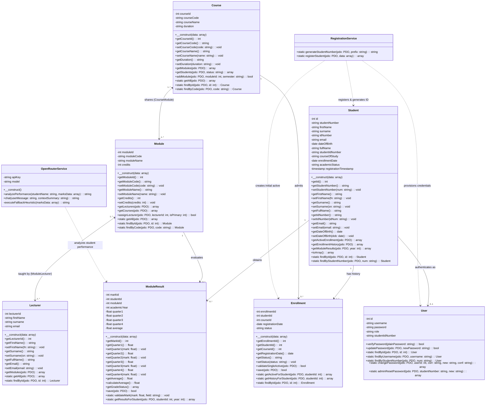

# STUDENT PORTAL SYSTEM
## Software Architecture & Technical System Design
### Object-Oriented Architecture, Domain Models, Service Layer & UML Specification

---

> **Sequential Documentation Pipeline**  
> ← Previous: [03. Software Requirements Specification](03_SOFTWARE_REQUIREMENTS_SPECIFICATION.md) | **Document 4 of 5** | Next: [05. Database Specification & Data Dictionary](05_DATABASE_SPECIFICATION_AND_DATA_DICTIONARY.md) ->

---

| **System Metadata** | **Technical Details** |
| :--- | :--- |
| **Document Title** | Software Architecture and Technical System Design |
| **Project Nature** | **Internship Technical Assessment / Practical Competency Demonstration** |
| **Project Sprint Duration** | **2 Calendar Weeks** (10 Intensive Working Days) |
| **Architecture Lead (Full Stack)**| **Mr Avuyile Mthembu** (Lead Developer: OOP Domain Layer, Services, Auth & AI) |
| **Database Lead (DBA)** | **Ms Nomthandazo Khoza** (Relational Modeling, 3NF Normalization & Migrations) |
| **Frontend Lead (UI/UX)** | **Ms Qhama Nodada** (Presentation Layer, Material Design & jsPDF Integration) |
| **Directorate & Branch** | Directorate: IT Business Solutions (ITBS) — Corporate Management Services (CMS) |
| **Host Department** | **Department of Forestry, Fisheries and the Environment (DFFE)** |
| **Standard Followed** | UML 2.5 (Unified Modeling Language) Class Specification |
| **Architecture Version** | Version 3.0 (Multi-Role Portals, 3NF Normalization & AI Advisor) |
| **Live Production Instance** | [https://student-system.infinityfree.io/index.php](https://student-system.infinityfree.io/index.php) |

---

## 1. System Overview & Architectural Tenets

The **Student Portal System** is an academic management platform developed during a fast-track two-week internship sprint at DFFE. The goal of this technical design document is to define the object-oriented structure, class multiplicities, design patterns, and domain rules governing the application.

### Key Architectural Tenets
1. **Separation of Concerns**: Domain models represent core academic concepts (`Student`, `Course`, `Module`, `Lecturer`, `Enrollment`, `ModuleResult`, `User`), while specialized services (`RegistrationService`, `OpenRouterService`) encapsulate cross-cutting transactional workflows.
2. **Third Normal Form (3NF) Relational Mapping**: Normalized entities and associative tables prevent duplicate records while preserving legacy single-table facades.
3. **100% Backward Compatibility**: Legacy queries, reporting templates, session keys, and database tables (`students`, `users`) execute without regression errors.
4. **Resilient Artificial Intelligence**: Generative AI assistance using the OpenRouter Free API is wrapped with local heuristic fallbacks to guarantee uninterrupted student access.
5. **Cryptographic Integrity**: Bcrypt salted hashing (`cost => 10`) ensures unique 22-character salts per credential.

---

## 2. UML Class Diagram

*Note: The canonical diagram definition file is stored in [documentation/diagrams/UML_CLASS_DIAGRAM.mmd](diagrams/UML_CLASS_DIAGRAM.mmd).*



---

## 3. Core Class Specifications

### 3.1 `Student` (Domain Model)
Represents a student enrolled within the university.
* **Attributes**: `id`, `studentNumber`, `firstName`, `surname`, `idNumber`, `email`, `dateOfBirth`, `enrollmentDate`, `academicStatus`.
* **Backward Compatibility Facade**:
  - `fullName`: Computed dynamically as `firstName . ' ' . surname` or mapped to legacy column `full_name`.
  - `studentIdNumber`: Direct alias for `studentNumber`.
  - `courseOfStudy`: Reflects the currently active enrolled qualification title.

### 3.2 `Course` & `Module` (Curriculum Domain Models)
* **`Course`**: Represents academic qualifications (e.g., *Systems Development*, `SD101`). Offers modules via associative mapping (`course_modules`).
* **`Module`**: Represents academic units of study (e.g., *Database Systems*, `DBS201`, 15 credits). Modules are reusable across multiple courses and can have multiple lecturers assigned.

### 3.3 `Lecturer` (Educator Domain Model)
Represents academic teaching faculty. Linked to modules via `module_lecturers` with explicit designation of primary lecturer and co-lecturer roles (`is_primary = 1/0`).

### 3.4 `Enrollment` (Registration State & History)
Enforces institutional business rules governing course enrollment:
- **Single Active Course Rule**: `validateSingleActive(PDO $pdo)` verifies that no other enrollment for the student has `status = 'Active'`.
- **Historical Audit Trail**: When a student completes, suspends, or switches courses, the old enrollment remains stored permanently for transcript history.

### 3.5 `ModuleResult` (Academic Assessment Engine)
Stores quarterly marks (Q1, Q2, Q3, Q4) and calculates composite outcomes:
- Range validation ensures marks fall within `0.00` to `100.00`.
- `calculateAverage()` computes the unweighted running mean across completed quarters, rounded to 2 decimal places.

### 3.6 `RegistrationService` (Transaction Orchestration)
Encapsulates new student onboarding inside an atomic database transaction:
1. Generates unique student number `ST{YY}{5-digits}` with collision detection.
2. Inserts student master record (dual-writing normalized and legacy columns).
3. Creates initial `'Active'` course enrollment.
4. Provisions student login account with salted Bcrypt password hash.

### 3.7 `OpenRouterService` (AI Pedagogical Advisor)
Connects to OpenRouter's free generative AI endpoints (`google/gemini-2.0-flash-exp:free`):
- Transmits anonymized grade payloads and student academic history.
- Prompts constrain responses to subject revision advice, study habits, and time management.
- Implements an automated local heuristic fallback when the network is offline or unconfigured.

### 3.8 `User` (Authentication & Security)
Manages user authentication across `admin`, `lecturer`, and `student` roles using PHP's native `password_hash()` and `password_verify()`.

---

## 4. Business Rules & Logic Verification

| Rule | Business Description | Architectural Implementation |
| :--- | :--- | :--- |
| **Single Active Course** | A student can only have one active course enrollment at any time. | `Enrollment::validateSingleActive()` queries database before saving; throws exception if active record exists. |
| **Student Numbering** | Automated unique numbering format `ST` + 2-digit year + 5-digit sequence. | `RegistrationService::generateStudentNumber()` auto-increments sequence and validates against database `UNIQUE` key. |
| **Shared Modules** | Modules can be shared across multiple courses. | Associative junction table `course_modules` (`course_id`, `module_id`). |
| **Multi-Lecturer Assignment** | Modules can have multiple instructors with a primary lead. | Associative junction table `module_lecturers` (`module_id`, `lecturer_id`, `is_primary`). |
| **Quarterly Mark Range** | Marks must fall between 0.00% and 100.00%. | `ModuleResult::validateMark()` throws exception if $<0$ or $>100$. HTML5 inputs enforce client-side constraints. |
| **Running Composite Average**| Average is dynamically calculated from completed quarters. | `ModuleResult::calculateAverage()` computes arithmetic mean rounded to 2 decimal places. |

---

## 5. Backward Compatibility Strategy

To ensure legacy Version 1.0 records, scripts, and reports continue operating without failure:
1. **Dual-Column Persistence**: The `students` table preserves legacy columns (`full_name`, `student_id_number`, `course_of_study`, `academic_status`) alongside normalized fields.
2. **Synchronized Dual-Writing**: When updating student details, both normalized columns (`first_name`, `surname`) and legacy columns (`full_name`) are synchronized.
3. **Authentication Continuity**: Pre-existing user accounts continue authenticating without requiring password resets.

---

## 6. Submission & Assessment Verification

```
================================================================================
                    SYSTEM DESIGN & ARCHITECTURE SUBMISSION
================================================================================

Submitted by the Internship Development Team:

• Mr Avuyile Mthembu (Full Stack Software Developer & System Architect)
• Ms Nomthandazo Khoza (Database Administrator - DBA)
• Ms Qhama Nodada (Frontend Developer - UI/UX)

Directorate: Information Technology Business Solutions (ITBS)
Host Department: Department of Forestry, Fisheries and the Environment (DFFE)

Status: Complete - UML Class Diagrams, Design Patterns & OOP Architecture Implemented
================================================================================
```

---

> **Sequential Documentation Pipeline**  
> ← Previous: [03. Software Requirements Specification](03_SOFTWARE_REQUIREMENTS_SPECIFICATION.md) | **Document 4 of 5** | Next: [05. Database Specification & Data Dictionary](05_DATABASE_SPECIFICATION_AND_DATA_DICTIONARY.md) ->
