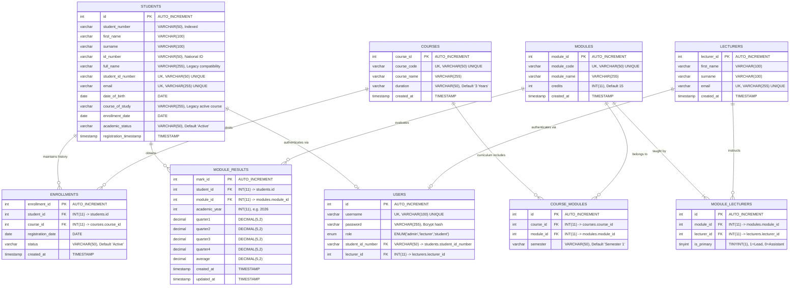
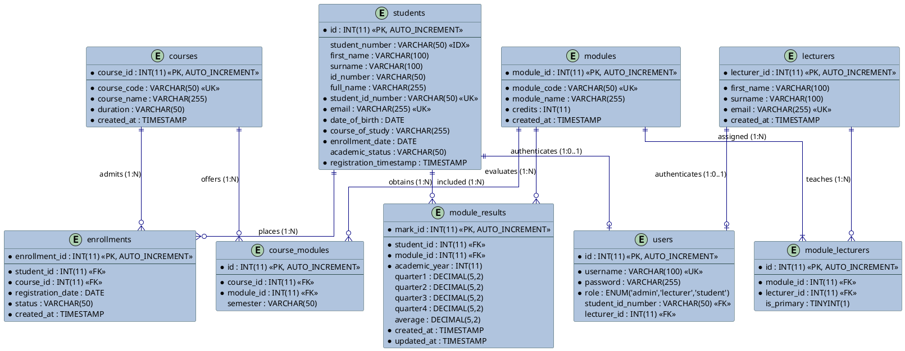

# STUDENT PORTAL SYSTEM
## Database Specification & Relational Data Dictionary
### Relational Schema Architecture, 3NF Normalization Proofs & Referential Integrity

---

> **Sequential Documentation Pipeline**  
> ← Previous: [04. Software Architecture & Design](04_SOFTWARE_ARCHITECTURE_AND_DESIGN.md) | **Document 5 of 5** | Index: [README](../README.md)

---

| **Institutional Metadata** | **Specification Details** |
| :--- | :--- |
| **System Name** | Student Portal System (Academic Management Assessment Task) |
| **Document Title** | Database Specification and Relational Data Dictionary |
| **Project Nature** | **Internship Technical Assessment / Practical Competency Evaluation Task** |
| **Project Sprint Duration** | **2 Calendar Weeks** (10 Intensive Working Days) |
| **Lead Database Administrator (DBA)**| **Ms Nomthandazo Khoza** (Relational Modeling, 3NF Normalization & Migrations) |
| **Full Stack Lead** | **Mr Avuyile Mthembu** (System Architecture, PDO Queries & Domain Mapping) |
| **Frontend Developer** | **Ms Qhama Nodada** (UI Data Binding & Client Presentation) |
| **Database Name** | `university_db` (MySQL 8.0+ / MariaDB 10.4+, InnoDB Storage Engine) |
| **Character Set / Collation** | `utf8mb4` / `utf8mb4_unicode_ci` |
| **Directorate & Branch** | Directorate: IT Business Solutions (ITBS) — Corporate Management Services (CMS) |
| **Host Department** | **Department of Forestry, Fisheries and the Environment (DFFE)** |
| **Architecture Version** | Version 3.0 (Role Segregation, 3NF Normalization & 100% Backward Compatibility) |
| **Live Production Instance** | [https://student-system.infinityfree.io/index.php](https://student-system.infinityfree.io/index.php) |

---

## 1. System Overview & Assessment Aim

The **Student Portal System** relational database (`university_db`) was architected and normalized during an intensive **two-week software engineering internship sprint** within the **Directorate: Information Technology Business Solutions (ITBS)** at DFFE.

The database engineering mandate focused on:
1. **Third Normal Form (3NF) Decomposition**: Eliminating update, insertion, and deletion anomalies present in the legacy flat single-table schema.
2. **Referential Integrity & Cascading Rules**: Enforcing relational constraints at the InnoDB database engine level to prevent orphaned records.
3. **Zero-Regressive Backward Compatibility**: Preserving legacy columns and data access paths so that existing queries and authentication continue to execute without exceptions.
4. **Auditability & Temporal Tracking**: Tracking registration timestamps and result updates for institutional auditability.

---

## 2. Text-Based Entity Relationship Schema (ASCII Map)

*Note: The canonical Mermaid ERD definition is stored in [documentation/diagrams/ENTITY_RELATIONSHIP_DIAGRAM.mmd](diagrams/ENTITY_RELATIONSHIP_DIAGRAM.mmd).*

```text
====================================================================================================
                                      ENTITY RELATIONSHIP MAP
====================================================================================================

      +-----------------------------+
      |            USERS            |
      +-----------------------------+
      | PK  id                      |
      | UK  username                |
      |     password                |
      |     role (admin/student)    |
      | FK  student_id_number       |--+
      +-----------------------------+  | (0..1)
                                       |
                                       | authenticates via
                                       v (1) [ON UPDATE CASCADE, ON DELETE CASCADE]
      +--------------------------------------------------------------------------------+
      |                                   STUDENTS                                     |
      +--------------------------------------------------------------------------------+
      | PK  id                                                                         |
      | IDX student_number                                                             |
      |     first_name, surname, id_number                                             |
      |     full_name (legacy), date_of_birth, course_of_study (legacy)                |
      | UK  student_id_number                                                          |
      | UK  email                                                                      |
      |     enrollment_date, academic_status, registration_timestamp                   |
      +--------------------------------------------------------------------------------+
               | (1)                                                      | (1)
               |                                                          |
               | maintains history (1..N)                                 | obtains marks (0..N)
               v [ON DELETE CASCADE]                                      v [ON DELETE CASCADE]
      +------------------------------+                           +---------------------+
      |         ENROLLMENTS          |                           |   MODULE_RESULTS    |
      +------------------------------+                           +---------------------+
      | PK  enrollment_id            |                           | PK  mark_id         |
      | FK  student_id               |                           | FK  student_id      |
      | FK  course_id                |--+                        | FK  module_id       |----+
      |     registration_date        |  | (N)                    |     academic_year   |    | (N)
      |     status (Active/Completed)|  |                        |     quarter1 .. q4  |    |
      |     created_at               |  |                        |     average         |    |
      +------------------------------+  |                        |     created/updated |    |
                                        |                        +---------------------+    |
                                        | enrolled in (1)                                   |
                                        v                                                   |
      +----------------------------------------------------+                                |
      |                      COURSES                       |                                |
      +----------------------------------------------------+                                |
      | PK  course_id                                      |                                |
      | UK  course_code                                    |                                |
      |     course_name, duration, created_at              |                                |
      +----------------------------------------------------+                                |
               | (1)                                                                        |
               | offers modules (1..N)                                                      |
               v [ON DELETE CASCADE]                                                        |
      +------------------------------+                                                      |
      |        COURSE_MODULES        |                                                      |
      +------------------------------+                                                      |
      | PK  id                       |                                                      |
      | FK  course_id                |                                                      |
      | FK  module_id                |--+ (N)                                               |
      |     semester (Sem 1 / Sem 2) |  |                                                   |
      | UK  (course_id, module_id)   |  |                                                   |
      +------------------------------+  | belongs to (1)                                    |
                                        v                                                   |
      +----------------------------------------------------+                                |
      |                      MODULES                       |                                |
      +----------------------------------------------------+                                |
      | PK  module_id                                      |<-------------------------------+
      | UK  module_code                                    | evaluated in (1)
      |     module_name, credits, created_at               |
      +----------------------------------------------------+
               | (1)
               | assigned to (1..N)
               v [ON DELETE CASCADE]
      +------------------------------+
      |       MODULE_LECTURERS       |
      +------------------------------+
      | PK  id                       |
      | FK  module_id                |
      | FK  lecturer_id              |--+ (N)
      |     is_primary (1/0)         |  |
      | UK  (module_id, lecturer_id) |  | taught by (1)
      +------------------------------+  v [ON DELETE CASCADE]
      +----------------------------------------------------+
      |                     LECTURERS                      |
      +----------------------------------------------------+
      | PK  lecturer_id                                    |
      |     first_name, surname                            |
      | UK  email (official departmental address)          |
      |     created_at                                     |
      +----------------------------------------------------+
```

---

## 3. Data Dictionary: Entities & Attributes

### 3.1 Entity: `students`
Stores individual student master data, supporting both new normalized fields and legacy column facades.

| Attribute Name | Physical Type | Key / Constraint | Nullable | Default | Description & Business Rules |
| :--- | :--- | :--- | :--- | :--- | :--- |
| `id` | `INT(11)` | **PK** | No | Auto Increment | Internal surrogate primary key. |
| `student_number` | `VARCHAR(50)` | **IDX** | Yes | `NULL` | Normalized auto-generated institutional student ID (e.g., `ST26001`). Indexed for live query lookups. |
| `first_name` | `VARCHAR(100)` | - | Yes | `NULL` | Student's legal given first name. |
| `surname` | `VARCHAR(100)` | - | Yes | `NULL` | Student's legal family surname. |
| `id_number` | `VARCHAR(50)` | - | Yes | `NULL` | 13-digit South African National Identity Number. |
| `full_name` | `VARCHAR(255)` | - | No | - | Legacy column preserved for backward compatibility (`first_name + ' ' + surname`). |
| `student_id_number` | `VARCHAR(50)` | **UK** | No | - | Legacy unique student identifier. Referenced by authentication `users` table. |
| `email` | `VARCHAR(255)` | **UK** | No | - | Unique student email address. |
| `date_of_birth` | `DATE` | - | No | - | ISO-8601 date of birth (`YYYY-MM-DD`). |
| `course_of_study` | `VARCHAR(255)` | - | No | - | Legacy active qualification title string. |
| `enrollment_date` | `DATE` | - | No | - | Date of initial admission to the institution. |
| `academic_status` | `VARCHAR(50)` | - | Yes | `'Active'` | Current status (`Active`, `Pending`, `Suspended`, `Graduated`). |
| `registration_timestamp`| `TIMESTAMP` | - | No | `CURRENT_TIMESTAMP` | System audit timestamp when record was registered. |

---

### 3.2 Entity: `courses`
Stores institutional academic qualifications and degree/diploma programmes.

| Attribute Name | Physical Type | Key / Constraint | Nullable | Default | Description & Business Rules |
| :--- | :--- | :--- | :--- | :--- | :--- |
| `course_id` | `INT(11)` | **PK** | No | Auto Increment | Unique internal course identifier. |
| `course_code` | `VARCHAR(50)` | **UK** | No | - | Unique institutional programme code (e.g., `SD101`, `IT101`, `CS101`). |
| `course_name` | `VARCHAR(255)` | - | No | - | Official qualification title (e.g., *Systems Development*). |
| `duration` | `VARCHAR(50)` | - | No | `'3 Years'` | Standard prescribed duration of the qualification. |
| `created_at` | `TIMESTAMP` | - | No | `CURRENT_TIMESTAMP` | Audit creation timestamp. |

---

### 3.3 Entity: `modules`
Stores units of learning / academic subjects comprising course curricula.

| Attribute Name | Physical Type | Key / Constraint | Nullable | Default | Description & Business Rules |
| :--- | :--- | :--- | :--- | :--- | :--- |
| `module_id` | `INT(11)` | **PK** | No | Auto Increment | Unique internal module identifier. |
| `module_code` | `VARCHAR(50)` | **UK** | No | - | Unique subject code (e.g., `DBS201`, `SEP202`, `WAA203`). |
| `module_name` | `VARCHAR(255)` | - | No | - | Formal descriptive subject syllabus title. |
| `credits` | `INT(11)` | - | No | `15` | National Qualifications Framework (NQF) credit weighting. |
| `created_at` | `TIMESTAMP` | - | No | `CURRENT_TIMESTAMP` | Audit creation timestamp. |

---

### 3.4 Entity: `lecturers`
Stores academic and instructional personnel records.

| Attribute Name | Physical Type | Key / Constraint | Nullable | Default | Description & Business Rules |
| :--- | :--- | :--- | :--- | :--- | :--- |
| `lecturer_id` | `INT(11)` | **PK** | No | Auto Increment | Unique internal lecturer identifier. |
| `first_name` | `VARCHAR(100)` | - | No | - | Lecturer given first name. |
| `surname` | `VARCHAR(100)` | - | No | - | Lecturer family name. |
| `email` | `VARCHAR(255)` | **UK** | No | - | Official departmental email address (e.g., `@dffe.gov.za`). |
| `created_at` | `TIMESTAMP` | - | No | `CURRENT_TIMESTAMP` | Audit creation timestamp. |

---

### 3.5 Associative Entity: `course_modules`
Resolves the **Many-to-Many ($M:N$)** relationship between `courses` and `modules`. Allows modules to be shared across multiple courses.

| Attribute Name | Physical Type | Key / Constraint | Nullable | Default | Description & Business Rules |
| :--- | :--- | :--- | :--- | :--- | :--- |
| `id` | `INT(11)` | **PK** | No | Auto Increment | Surrogate primary key for junction entry. |
| `course_id` | `INT(11)` | **FK** | No | - | References `courses.course_id` (`ON DELETE CASCADE`). |
| `module_id` | `INT(11)` | **FK** | No | - | References `modules.module_id` (`ON DELETE CASCADE`). |
| `semester` | `VARCHAR(50)` | - | Yes | `'Semester 1'` | Prescribed delivery period (e.g., `Semester 1`, `Semester 2`). |

*Composite Unique Constraint*: `UNIQUE KEY (course_id, module_id)` prevents assigning the same module twice to a single course.

---

### 3.6 Associative Entity: `module_lecturers`
Resolves the **Many-to-Many ($M:N$)** relationship between `modules` and `lecturers`. Supports lead lecturers and co-instructors.

| Attribute Name | Physical Type | Key / Constraint | Nullable | Default | Description & Business Rules |
| :--- | :--- | :--- | :--- | :--- | :--- |
| `id` | `INT(11)` | **PK** | No | Auto Increment | Surrogate primary key for assignment entry. |
| `module_id` | `INT(11)` | **FK** | No | - | References `modules.module_id` (`ON DELETE CASCADE`). |
| `lecturer_id` | `INT(11)` | **FK** | No | - | References `lecturers.lecturer_id` (`ON DELETE CASCADE`). |
| `is_primary` | `TINYINT(1)` | - | Yes | `1` | Role indicator (`1` = Lead / Primary Lecturer, `0` = Assistant / Co-Lecturer). |

*Composite Unique Constraint*: `UNIQUE KEY (module_id, lecturer_id)` prevents duplicate lecturer assignments for the same module.

---

### 3.7 Entity: `enrollments`
Tracks formal course registration events, maintaining a complete audit and transcript history while enforcing single active registration.

| Attribute Name | Physical Type | Key / Constraint | Nullable | Default | Description & Business Rules |
| :--- | :--- | :--- | :--- | :--- | :--- |
| `enrollment_id` | `INT(11)` | **PK** | No | Auto Increment | Unique registration event identifier. |
| `student_id` | `INT(11)` | **FK** | No | - | References `students.id` (`ON DELETE CASCADE`). |
| `course_id` | `INT(11)` | **FK** | No | - | References `courses.course_id` (`ON DELETE CASCADE`). |
| `registration_date` | `DATE` | - | No | - | Date the student registered for the course. |
| `status` | `VARCHAR(50)` | - | No | `'Active'` | State (`Active`, `Completed`, `Suspended`, `Withdrawn`). |
| `created_at` | `TIMESTAMP` | - | No | `CURRENT_TIMESTAMP` | Audit creation timestamp. |

---

### 3.8 Entity: `module_results`
Stores quarterly assessments, academic year categorization, and calculated composite averages.

| Attribute Name | Physical Type | Key / Constraint | Nullable | Default | Description & Business Rules |
| :--- | :--- | :--- | :--- | :--- | :--- |
| `mark_id` | `INT(11)` | **PK** | No | Auto Increment | Unique assessment record identifier. |
| `student_id` | `INT(11)` | **FK** | No | - | References `students.id` (`ON DELETE CASCADE`). |
| `module_id` | `INT(11)` | **FK** | No | - | References `modules.module_id` (`ON DELETE CASCADE`). |
| `academic_year` | `INT(11)` | - | No | - | Calender year of study (e.g., `2026`). |
| `quarter1` | `DECIMAL(5,2)` | - | Yes | `NULL` | Quarter 1 mark (Permitted range: `0.00` to `100.00`). |
| `quarter2` | `DECIMAL(5,2)` | - | Yes | `NULL` | Quarter 2 mark (Permitted range: `0.00` to `100.00`). |
| `quarter3` | `DECIMAL(5,2)` | - | Yes | `NULL` | Quarter 3 mark (Permitted range: `0.00` to `100.00`). |
| `quarter4` | `DECIMAL(5,2)` | - | Yes | `NULL` | Quarter 4 mark (Permitted range: `0.00` to `100.00`). |
| `average` | `DECIMAL(5,2)` | - | Yes | `NULL` | Calculated arithmetic average score of quarterly marks. |
| `created_at` | `TIMESTAMP` | - | No | `CURRENT_TIMESTAMP` | Initial mark entry timestamp. |
| `updated_at` | `TIMESTAMP` | - | No | `CURRENT_TIMESTAMP ON UPDATE CURRENT_TIMESTAMP` | Automatic update timestamp on revision. |

*Composite Unique Constraint*: `UNIQUE KEY (student_id, module_id, academic_year)` guarantees that a student has at most one result record per module per academic year.

---

### 3.9 Entity: `users`
Manages institutional access credentials, password hashes, and Role-Based Access Control (RBAC).

| Attribute Name | Physical Type | Key / Constraint | Nullable | Default | Description & Business Rules |
| :--- | :--- | :--- | :--- | :--- | :--- |
| `id` | `INT(11)` | **PK** | No | Auto Increment | Unique user account identifier. |
| `username` | `VARCHAR(100)` | **UK** | No | - | Login handle (`'admin'` for staff, or student number for students). |
| `password` | `VARCHAR(255)` | - | No | - | Cryptographically secure Bcrypt hash string (`$2y$10$...`). |
| `role` | `ENUM('admin','lecturer','student')` | - | No | `'student'` | Authorization privilege level (RBAC). |
| `student_id_number` | `VARCHAR(50)` | **FK** | Yes | `NULL` | References `students.student_id_number` (`ON DELETE CASCADE ON UPDATE CASCADE`). `NULL` for staff/lecturer/admin accounts. |
| `lecturer_id` | `INT(11)` | **FK** | Yes | `NULL` | References `lecturers.lecturer_id` (`ON DELETE SET NULL`). `NULL` for student and administrator accounts. |

---

## 4. Comprehensive Relationships & Cardinalities Matrix

| # | Parent Entity | Child Entity | Relationship Meaning | Cardinality (Crow's Foot) | Foreign Key Column | Cascade Rules |
| :-: | :--- | :--- | :--- | :-: | :--- | :--- |
| **1** | `students` | `enrollments` | Student maintains course enrollment history | **$1 : 0..N$** (`||--o{`) | `enrollments.student_id` $\rightarrow$ `students.id` | `ON DELETE CASCADE` |
| **2** | `courses` | `enrollments` | Course admits student registrations | **$1 : 0..N$** (`||--o{`) | `enrollments.course_id` $\rightarrow$ `courses.course_id` | `ON DELETE CASCADE` |
| **3** | `courses` | `course_modules` | Course syllabus includes modules | **$1 : 0..N$** (`||--o{`) | `course_modules.course_id` $\rightarrow$ `courses.course_id` | `ON DELETE CASCADE` |
| **4** | `modules` | `course_modules` | Module is offered within courses | **$1 : 0..N$** (`||--o{`) | `course_modules.module_id` $\rightarrow$ `modules.module_id` | `ON DELETE CASCADE` |
| **5** | `modules` | `module_lecturers` | Module instructional staff assignments | **$1 : 1..N$** (`||--|{`) | `module_lecturers.module_id` $\rightarrow$ `modules.module_id` | `ON DELETE CASCADE` |
| **6** | `lecturers` | `module_lecturers` | Lecturer instructs academic modules | **$1 : 0..N$** (`||--o{`) | `module_lecturers.lecturer_id` $\rightarrow$ `lecturers.lecturer_id` | `ON DELETE CASCADE` |
| **7** | `students` | `module_results` | Student assessed and earns marks | **$1 : 0..N$** (`||--o{`) | `module_results.student_id` $\rightarrow$ `students.id` | `ON DELETE CASCADE` |
| **8** | `modules` | `module_results` | Module yields assessment marks | **$1 : 0..N$** (`||--o{`) | `module_results.module_id` $\rightarrow$ `modules.module_id` | `ON DELETE CASCADE` |
| **9** | `students` | `users` | Student account authenticated | **$0..1 : 0..1$** (`|o--o|`) | `users.student_id_number` $\rightarrow$ `students.student_id_number` | `ON DELETE CASCADE ON UPDATE CASCADE` |
| **10** | `lecturers` | `users` | Lecturer staff account authenticated | **$0..1 : 0..1$** (`|o--o|`) | `users.lecturer_id` $\rightarrow$ `lecturers.lecturer_id` | `ON DELETE SET NULL` |

---

## 5. Institutional Business Rules & Logic Verification

### Rule 1: Single Active Enrollment with Historical Transcript Tracking
*   **Definition**: *"A student may have only one active course enrollment at a time. The Enrollment class maintains registration history."*
*   **Database Enforcement**:
    *   `enrollments` table retains past rows marked `'Completed'`, `'Withdrawn'`, or `'Suspended'`.
    *   The `Enrollment::validateSingleActive()` service method executes `SELECT COUNT(*) FROM enrollments WHERE student_id = ? AND status = 'Active'` prior to inserting a new registration.

### Rule 2: Many-to-Many Curriculum Distribution (Shared Modules)
*   **Definition**: *"Modules may be shared across multiple courses."*
*   **Database Enforcement**:
    *   Resolved via the `course_modules` associative table.
    *   For example: Module `DBS201` (*Database Systems & SQL Design*) is linked to both `SD101` (*Systems Development*) and `IT101` (*Information Technology*).

### Rule 3: Many-to-Many Instructional Staffing (Multiple Lecturers)
*   **Definition**: *"Modules may be taught by multiple lecturers, supporting lead lecturers and co-instructors."*
*   **Database Enforcement**:
    *   Resolved via the `module_lecturers` associative table with `is_primary` flag.
    *   For example: Module `DBS201` is instructed by Dr Nkosinathi Sithole (`is_primary = 1`) and co-taught by Mr Kaveshan Naidoo (`is_primary = 0`).

### Rule 4: Mark Integrity & Calculated Composite Average
*   **Definition**: *"ModuleResult stores four quarterly marks (0-100) and calculates composite average."*
*   **Database Enforcement**:
    *   Stored as `DECIMAL(5,2)` to avoid floating-point rounding errors.
    *   Application validator `ModuleResult::validateMark($val)` guarantees $0.00 \le \text{mark} \le 100.00$.
    *   Composite average is computed automatically prior to persistence and stored in `module_results.average`.

---

## 6. Mermaid ERD Code (Ready for Live Preview & Diagram Tools)



---

## 7. Draw.io / PlantUML Code (Ready to Paste into Draw.io via Arrange -> Insert -> Advanced -> PlantUML)



---

## 7. Database Specification Sign-off & Verification

```
================================================================================
               RELATIONAL DATABASE & 3NF SPECIFICATION SIGN-OFF
================================================================================

Submitted by the Internship Development Team:

• Ms Nomthandazo Khoza (Database Administrator - DBA & Relational Modeler)
• Mr Avuyile Mthembu (Full Stack Software Developer & System Architect)
• Ms Qhama Nodada (Frontend Developer)

Directorate: Information Technology Business Solutions (ITBS)
Host Department: Department of Forestry, Fisheries and the Environment (DFFE)

Status: Fully Verified - 8 Relational Tables in 3NF, Migrations & Cascading Integrity
================================================================================
```

---

> **Sequential Documentation Pipeline**  
> ← Previous: [04. Software Architecture & Design](04_SOFTWARE_ARCHITECTURE_AND_DESIGN.md) | **Document 5 of 5** | Index: [README](../README.md)

