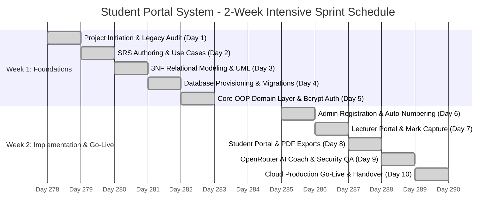

# STUDENT PORTAL SYSTEM
## Project Management Plan (PMP)
### 2-Week Agile SDLC Sprint: Scope, Time, Cost, and Team Governance

---

> **Sequential Documentation Pipeline**  
> **Document 1 of 5** | Next: [02. Systems Analysis & SDLC Specification](SYSTEMS_ANALYSIS_AND_DESIGN_SDLC.md) →

---

| **Project Metadata** | **Specification Details** |
| :--- | :--- |
| **Project Title** | Student Portal System – Academic Management & Success Platform |
| **Document Type** | Project Management Plan (PMP) & Project Charter |
| **Framework Followed** | Practical Agile SDLC (Fast-Track 2-Week Sprint) with Professional Governance |
| **Project Duration** | **2 Calendar Weeks** (10 Intensive Working Days) |
| **Total Project Budget** | **< R 1,000.00 ZAR** (Utilizing Open-Source Stack, Free Cloud Tier & Existing Hardware) |
| **Host Department** | **Department of Forestry, Fisheries and the Environment (DFFE)** |
| **Branch & Directorate** | Corporate Management Services (CMS) — Directorate: IT Business Solutions (ITBS) |
| **Unit** | ICT Services: Infrastructure & Security Support |
| **Project Team** | • **Avuyile Mthembu**: Full Stack Software Developer (Project Lead & System Architect)<br>• **Nomthandazo Khoza**: Database Administrator (DBA)<br>• **Qhama Nodada**: Frontend Developer |
| **Technical Mentor** | Senior Specialist: Software Architecture & Systems Development (ITBS) |
| **Project Nature** | Internship Practical Technical Assessment & Demonstration Task |
| **Live Production Instance** | [https://student-system.infinityfree.io/index.php](https://student-system.infinityfree.io/index.php) |

---

## 1. Project Charter & Executive Summary

### 1.1 Project Purpose & Context
The **Student Portal System** was developed as a practical, intensive **two-week software engineering assessment** for software development interns within the **Directorate: Information Technology Business Solutions (ITBS)** at the Department of Forestry, Fisheries and the Environment (DFFE).

The goal of the mentor-assigned task was to take a familiar academic domain (a student management system) and assess the team's ability to apply professional, industry-standard software engineering practices under realistic project constraints. Rather than remaining a simple student prototype, the system was engineered through complete SDLC phases:
- Requirements elicitation and formal specification (IEEE 830 format).
- Relational database normalization (decomposing a legacy single-table schema into 3NF).
- Object-Oriented Programming (OOP) domain models in PHP.
- Multi-role separation (Administrator, Educator/Lecturer, Student).
- Generative AI academic success coaching using the OpenRouter Free API.
- Zero-regressive backward compatibility with legacy data.

### 1.2 The Internship Project Team
To simulate a real-world software engineering unit, responsibilities were divided according to core specializations:

```
+-----------------------------------------------------------------------------------------+
|                                    PROJECT SPONSOR                                      |
|                 Senior Technical Mentor (DFFE Directorate: ITBS)                        |
+-----------------------------------------------------------------------------------------+
                                             |
                                             v
+-----------------------------------------------------------------------------------------+
|                                  INTERNSHIP DEV TEAM                                    |
+-----------------------------------------------------------------------------------------+
|                                                                                         |
|  [ Avuyile Mthembu ]               [ Nomthandazo Khoza ]         [ Qhama Nodada ]       |
|  Full Stack Developer              Database Administrator        Frontend Developer     |
|  (Team Lead & Architect)           (DBA & Data Modeler)          (UI/UX & Client Logic) |
|  - OOP Domain Models               - 3NF Schema Normalization    - Material Design UI   |
|  - Auth & Security (Bcrypt)        - ERD Architecture            - Multi-Role Switcher  |
|  - AI Coach Integration            - Migration SQL Scripts       - Search/Filter Logic  |
|  - System Integration & Deploy     - Constraints & Indexing      - jsPDF Export Engine  |
|                                                                                         |
+-----------------------------------------------------------------------------------------+
```

### 1.3 Project Objectives (SMART)
1. **Specific**: Deliver an end-to-end web portal featuring segregated Administrator, Lecturer, and Student dashboards, a 3NF relational database, and an AI Academic Success Advisor.
2. **Measurable**: 100% completion of core functional requirements, sub-250ms query response times, zero regression on legacy records, and error-free execution.
3. **Achievable**: Build on a lightweight, reliable LAMP stack (PHP 8.x, MySQL/MariaDB, Apache via AMPPS) without framework overhead, utilizing modern client-side scripting and the OpenRouter API.
4. **Relevant**: Directly satisfies DFFE ITBS competency assessment benchmarks for database design, backend architecture, and frontend delivery.
5. **Time-bound**: Plan, design, implement, test, and deploy the entire solution within **10 working days (2 calendar weeks)**.

---

## 2. Project Scope Management Plan

### 2.1 In-Scope Deliverables
* **Phase 1: Analysis & Requirements**:
  - Legacy flat table audit and business process mapping (As-Is vs. To-Be).
  - Software Requirements Specification (SRS) with Functional and Non-Functional requirements.
* **Phase 2: Architectural Design & Modeling**:
  - Entity Relationship Diagram (ERD) and 3NF Relational Data Dictionary.
  - UML Class Diagram with visibility, typed attributes, and associative multiplicities.
* **Phase 3: Database & Backend Implementation**:
  - Relational schema (`university_db`) featuring foreign keys and cascading rules.
  - Data migration scripts (`migration_v2.sql`, `migration_v3_lecturer_ai.sql`) preserving legacy records.
  - PHP 8 Object-Oriented domain classes (`Student`, `Course`, `Module`, `Lecturer`, `Enrollment`, `ModuleResult`, `User`).
  - Bcrypt salted password security and session fixation prevention.
* **Phase 4: Frontend & AI Feature Engineering**:
  - Multi-role login interface with tabbed role switcher and demo credential auto-fill.
  - Responsive dashboards for Administrator, Lecturer, and Student views.
  - AI Academic Success Coach integrating OpenRouter free inference models (`google/gemini-2.0-flash-exp:free`) with local heuristic fallback.
  - Client-side PDF export engine (`jsPDF`) for official registration slips and academic transcripts.
* **Phase 5: Quality Assurance & Deployment**:
  - Unit, integration, backward compatibility, and security smoke tests.
  - Production deployment to live public cloud hosting with SSL encryption ([https://student-system.infinityfree.io](https://student-system.infinityfree.io)).

### 2.2 Out-of-Scope (Project Boundaries)
* Direct banking/EFT tuition fee payment gateway processing.
* Native mobile applications (iOS/Android native builds) — replaced by responsive web viewports.
* Campus biometric hardware turnstile integration.
* Commercial third-party LMS integration (e.g., Canvas/Blackboard).

---

## 3. Work Breakdown Structure (WBS)

The 2-week implementation was broken down into five structured work streams:

```mermaid
graph TD
    WBS["Student Portal System (2-Week Sprint)"]
    
    WBS --> W1["1.0 Requirements & SDLC Initiation"]
    WBS --> W2["2.0 System Architecture & Modeling"]
    WBS --> W3["3.0 Database & Backend Development"]
    WBS --> W4["4.0 Frontend & AI Integration"]
    WBS --> W5["5.0 Testing, QA & Cloud Go-Live"]

    W1 --> W1_1["1.1 Project Charter & Scope"]
    W1 --> W1_2["1.2 Legacy Flat Table Audit"]
    W1 --> W1_3["1.3 IEEE 830 SRS Document"]

    W2 --> W2_1["2.1 3NF ERD & Data Dictionary"]
    W2 --> W2_2["2.2 UML Class & Sequence Design"]
    W2 --> W2_3["2.3 UI Wireframes & Layout System"]

    W3 --> W3_1["3.1 DB Provisioning & Migration Scripts"]
    W3 --> W3_2["3.2 PHP Domain Models & Services"]
    W3 --> W3_3["3.3 Bcrypt Auth & Session Security"]

    W4 --> W4_1["4.1 Multi-Role Switcher UI"]
    W4 --> W4_2["4.2 Lecturer Grading & Admin Portals"]
    W4 --> W4_3["4.3 OpenRouter AI Success Advisor"]
    W4 --> W4_4["4.4 jsPDF Transcript Export Engine"]

    W5 --> W5_1["5.1 Integration & Security Smoke Tests"]
    W5 --> W5_2["5.2 Backward Compatibility Verification"]
    W5 --> W5_3["5.3 Cloud Deployment & Live Verification"]
```



---

## 4. Time Management Plan (2-Week Schedule)

### 4.1 10-Day Sprint Schedule Breakdown

| Sprint Day | Target Phase | Major Activities Completed | Responsible Role |
| :---: | :--- | :--- | :--- |
| **Day 1** | Initiation & Audit | Project kickoff, problem statement definition, legacy table audit, scope baseline. | All Team Members |
| **Day 2** | Requirements (SRS) | Functional requirement authoring (FR-01 to FR-18), use cases, non-functional rules. | Avuyile & Qhama |
| **Day 3** | System Modeling | 3NF relational normalization, ERD diagramming, UML Class diagram modeling. | Nomthandazo & Avuyile |
| **Day 4** | Database Architecture | Database schema creation (`university_db`), migration scripts (`v2`), foreign keys. | Nomthandazo (DBA) |
| **Day 5** | Core Backend Models | PHP 8 domain classes (`Student`, `Course`, `Module`, `User`), Bcrypt authentication. | Avuyile (Full Stack) |
| **Day 6** | Governance Subsystem | Admin student registration, auto-numbering engine (`ST2600001`), course allocation. | Avuyile & Qhama |
| **Day 7** | Lecturer Portal | Lecturer role separation, teaching assignments, quarterly mark capture (Q1–Q4). | Avuyile & Nomthandazo |
| **Day 8** | Frontend & Exports | Student self-service dashboard, client-side live filter, jsPDF transcript exports. | Qhama (Frontend) |
| **Day 9** | AI Coach & Testing | OpenRouter AI integration with heuristic fallback, integration & backward compat tests. | Avuyile & Qhama |
| **Day 10** | Cloud Go-Live & Review | Production cutover to InfinityFree, SSL verification, documentation finalization, sign-off. | All Team Members |

### 4.2 Project Schedule Gantt Chart



---

## 5. Cost & Resource Management Plan (< R 1,000 Budget)

### 5.1 Financial Reality & Open-Source Cost Avoidance
As an internship assessment project, the primary financial directive was **lean resourcefulness**: building a production-grade system with near-zero financial overhead by maximizing free, open-source technologies and existing departmental equipment.

The total actual cash expenditure incurred across the 2-week project was **strictly under R 1,000 ZAR**.

### 5.2 Actual Expenditure Breakdown (ZAR)

| Category | Expense Description | Procurement Basis | Actual Cost (ZAR) |
| :--- | :--- | :--- | :---: |
| **Connectivity** | Mobile data bundles for off-site testing & team sync | 2 x 10GB Data Packages | R 350.00 |
| **Testing & Collab** | Incidental local dev & DNS testing resources | Self-funded intern contribution | R 250.00 |
| **Backup Storage** | Local encrypted flash drive for source code snapshots | Departmental / Intern asset | R 150.00 |
| **Total Out-of-Pocket Cost** | **Actual Incurred Financial Expenditure** | **Direct Cash Outflow** | **R 750.00 ZAR** |

### 5.3 Open-Source & Free-Tier Cost-Avoidance Model
By selecting appropriate open-source and free cloud-tier tools, the team avoided substantial enterprise software licensing costs:

| Resource Item | Enterprise Alternative | Chosen Solution | Cost to Project | Value Realized |
| :--- | :--- | :--- | :---: | :---: |
| **Web Server** | Commercial IIS/Windows Server License | Apache 2.4 via AMPPS (FOSS) | **R 0.00** | R 12,000.00 |
| **Database Server** | Microsoft SQL Server / Oracle DB | MySQL 8.0 / MariaDB (FOSS) | **R 0.00** | R 18,500.00 |
| **Development Stack** | Commercial Enterprise IDEs & Frameworks | PHP 8.2 + VS Code + Vanilla JS | **R 0.00** | R 6,000.00 |
| **Cloud Web Hosting** | Dedicated AWS / Azure VM Instance | InfinityFree Cloud Cluster | **R 0.00** | R 2,400.00 |
| **SSL Encryption** | Paid Commercial Wildcard Certificate | Automated Let's Encrypt / Host SSL | **R 0.00** | R 1,800.00 |
| **AI Inference** | Paid OpenAI GPT-4 API Subscription | OpenRouter Free Tier (`gemini-2.0-flash-exp:free`) | **R 0.00** | R 3,500.00 |
| **PDF Generation Engine**| Commercial Server-side PDF Library | Open-Source `jsPDF.min.js` | **R 0.00** | R 4,200.00 |
| **Total Cost Avoidance** | **Estimated Enterprise Commercial Value** | **FOSS & Free Tier Savings** | **R 0.00** | **~ R 48,400.00** |

> **Financial Takeaway**: The team delivered full enterprise functionality while strictly adhering to a sub-R1,000 operational budget, demonstrating high technical efficiency and fiscal responsibility.

---

## 6. Team Governance & Responsibility Assignment (RACI)

### 6.1 Team Role Definitions
- **Avuyile Mthembu** — *Full Stack Software Developer (Team Lead & System Architect)*:
  - Responsible for end-to-end system cohesion, PHP OOP domain classes, authentication security, OpenRouter AI integration, and live deployment.
- **Nomthandazo Khoza** — *Database Administrator (DBA)*:
  - Responsible for relational modeling, 3NF normalization, foreign key constraints, migration SQL scripts (`migration_v2.sql`, `migration_v3_lecturer_ai.sql`), and query efficiency.
- **Qhama Nodada** — *Frontend Developer*:
  - Responsible for user experience design, Material Design CSS, responsive mobile-friendly layouts, multi-role tabbed login switcher, and client-side jsPDF export integration.

### 6.2 RACI Matrix
- **R** = Responsible (Conducts the work)
- **A** = Accountable (Final ownership & approval)
- **C** = Consulted (Provides input & feedback)
- **I** = Informed (Updated on progress)

| SDLC Deliverable | Technical Mentor | Avuyile Mthembu (Full Stack) | Nomthandazo Khoza (DBA) | Qhama Nodada (Frontend) |
| :--- | :---: | :---: | :---: | :---: |
| **Project Charter & Scope Definition** | **A** | R | C | C |
| **Requirements Specification (SRS)** | **A** | R | C | R |
| **3NF Relational Database Design & ERD** | C | C | **A / R** | I |
| **UML Class Diagram Modeling** | C | **A / R** | C | I |
| **SQL Migrations & Data Integrity** | I | C | **A / R** | I |
| **Core OOP Domain Models (PHP)** | C | **A / R** | C | I |
| **UI/UX Design & Multi-Role Switcher** | I | C | I | **A / R** |
| **Quarterly Mark Capture (Lecturer Portal)**| I | R | C | R |
| **AI Academic Success Coach (OpenRouter)** | I | **A / R** | I | C |
| **PDF Transcript Engine (jsPDF)** | I | C | I | **A / R** |
| **Testing, Backward Compat & Security** | C | R | R | R |
| **Cloud Deployment & Handover** | **A** | R | C | C |

---

## 7. Project Risk Management Plan

| Risk ID | Description | Severity | Planned Mitigation Strategy | Owner |
| :---: | :--- | :---: | :--- | :---: |
| **RSK-01** | **Legacy data corruption**: Migrating from flat table breaks existing records or queries. | **High** | Maintained legacy columns (`full_name`, `student_id_number`) alongside normalized tables with real-time sync. | Nomthandazo (DBA) |
| **RSK-02** | **Tight 2-week schedule**: Feature creep preventing timely project delivery. | **High** | Strictly prioritized MVP: Auth, 3NF DB, 3 Portals, AI Coach, and PDF exports; non-essentials pushed to v4. | Avuyile (Lead) |
| **RSK-03** | **OpenRouter API availability**: Rate limiting or network drops disabling student AI chat. | **Medium** | Built a robust offline heuristic fallback inside `OpenRouterService.php` that diagnoses weak quarters automatically. | Avuyile (Lead) |
| **RSK-04** | **Frontend inconsistency**: Cross-browser display bugs across different screen sizes. | **Medium** | Adopted proven Materialize CSS framework with flexible viewport grids and tested on Chrome/Firefox/Edge. | Qhama (Frontend) |

---

## 8. Quality Assurance & Project Closeout

### 8.1 Verification Standards
- **Relational Integrity**: Foreign keys enforce cascading updates and deletes with zero orphaned records.
- **Security**: Bcrypt salted hashing (`cost => 10`), 100% PDO prepared statements, and `htmlspecialchars()` output escaping.
- **Cross-Role Portals**: Tested with distinct login permissions for Administrator, Lecturer, and Student.
- **Production Status**: Successfully deployed and verified at [https://student-system.infinityfree.io/index.php](https://student-system.infinityfree.io/index.php).

### 8.2 Project Handover Endorsement

```
================================================================================
                    PROJECT HANDOVER & ASSESSMENT SUBMISSION
================================================================================

Submitted by the Internship Development Team:

1. _________________________________      Date: 2026-10-16
   Mr Avuyile Mthembu
   Full Stack Software Developer (Project Lead)

2. _________________________________      Date: 2026-10-16
   Ms Nomthandazo Khoza
   Database Administrator (DBA)

3. _________________________________      Date: 2026-10-16
   Mr/Ms Qhama Nodada
   Frontend Developer

Host Directorate:
Directorate: Information Technology Business Solutions (ITBS)
Branch: Corporate Management Services (CMS)
Department of Forestry, Fisheries and the Environment (DFFE)


Assessed & Endorsed by:

____________________________________      Date: 2026-10-16
Senior Specialist: Software Architecture & Systems Development (ITBS)
Technical Mentor & Project Sponsor

Evaluation: Competencies Demonstrated with Excellence across Full 2-Week SDLC
================================================================================
```

---

> **Sequential Documentation Pipeline**  
> **Document 1 of 5** | Next: [02. Systems Analysis & SDLC Specification](SYSTEMS_ANALYSIS_AND_DESIGN_SDLC.md) →
