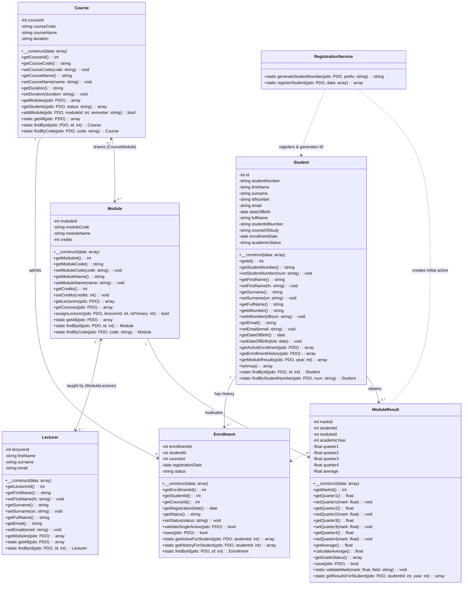

# STUDENT PORTAL SYSTEM
## System Design, Class Relationships & Technical Architecture

---

| **Metadata** | **Details** |
| :--- | :--- |
| **Document Title** | Student Portal System - System Design and Class Relationships |
| **Prepared by** | **Mr Avuyile Mthembu** |
| **Position** | **Intern: Software Developer** |
| **Directorate** | **Information Technology Business Solutions (ITBS)** |
| **Unit** | **ICT Services: Infrastructure & Security Support** |
| **Branch** | **Corporate Management Services (CMS)** |
| **Department** | **Department of Forestry, Fisheries and the Environment (DFFE)** |
| **Version** | 2.0 (With 100% Backward Compatibility) |
| **Status** | Approved & Implemented |

---

## 1. System Overview

The proposed **Student Portal System** is engineered to manage student records, course registrations, academic modules, lecturers, and quarterly performance results. Developed under the Corporate Management Services (CMS) branch within the Directorate: Information Technology Business Solutions (ITBS), this system transitions the institution from a single-tier student directory into an enterprise-grade, relational academic management architecture.

### Key Architectural Tenets
1. **Separation of Concerns**: Domain models represent distinct institutional entities (`Student`, `Course`, `Module`, `Lecturer`, `Enrollment`, `ModuleResult`), coordinated by dedicated services (`RegistrationService`).
2. **Data Normalization with Zero Downtime Migration**: New normalized attributes and junction tables support many-to-many relationships while preserving legacy column access.
3. **100% Backward Compatibility**: All legacy queries, reporting templates, session keys, and database tables (`students`, `users`) continue functioning without breaking existing integrations.
4. **Institutional Security & Integrity**: Role-based access control (RBAC), prepared statements (PDO), cryptographic password hashing (bcrypt), and transactional consistency.

---

## 2. UML Class Diagram

The UML Class Diagram illustrates the structural design of the Student Portal System, detailing main classes, attributes, visibility, methods, multiplicities, and associative relationships.



---

## 3. Main Classes and Attributes

### 3.1 `Student`
Represents an enrolled scholar within the institution.
*   **Attributes**:
    *   `studentNumber` *(string, unique)*: Auto-generated institutional student identifier.
    *   `firstName` *(string)*: Student's legal first name.
    *   `surname` *(string)*: Student's legal family name.
    *   `idNumber` *(string, unique)*: South African National Identification number.
    *   `email` *(string, unique)*: Official contact email address.
    *   `dateOfBirth` *(date)*: Date of birth (ISO YYYY-MM-DD).
*   **Backward-Compatible Facade Attributes**:
    *   `fullName`: Computed dynamically as `firstName . ' ' . surname` or mapped to legacy column `full_name`.
    *   `studentIdNumber`: Direct alias for `studentNumber`.
    *   `courseOfStudy`: Reflects the currently active enrolled course name.
    *   `academicStatus`: Reflects current enrollment/academic status (`Active`, `Pending`, `Graduated`, `Dropped`).

### 3.2 `Course`
Represents an academic qualification / degree programme offered by the department.
*   **Attributes**:
    *   `courseId` *(int, Primary Key)*: Internal identifier.
    *   `courseCode` *(string, unique)*: Official programme code (e.g., `SD101`, `IT101`, `CS101`).
    *   `courseName` *(string)*: Formal qualification title (e.g., *Systems Development*).
    *   `duration` *(string)*: Prescribed time for completion (e.g., `3 Years`).

### 3.3 `Module`
Represents a subject / unit of learning within the institutional curriculum.
*   **Attributes**:
    *   `moduleId` *(int, Primary Key)*: Internal identifier.
    *   `moduleCode` *(string, unique)*: Unique subject code (e.g., `DBS201`, `SEP202`, `WAA203`).
    *   `moduleName` *(string)*: Full descriptive subject title.
    *   `credits` *(int)*: National Qualifications Framework (NQF) credit weight (default: 15).

### 3.4 `Lecturer`
Represents academic staff responsible for course instructional delivery and assessments.
*   **Attributes**:
    *   `lecturerId` *(int, Primary Key)*: Staff identifier.
    *   `firstName` *(string)*: Lecturer's first name.
    *   `surname` *(string)*: Lecturer's family name.
    *   `email` *(string, unique)*: Official institutional departmental email address.

### 3.5 `Enrollment`
Tracks academic course registrations, maintaining active status and registration history.
*   **Attributes**:
    *   `enrollmentId` *(int, Primary Key)*: Unique registration identifier.
    *   `studentId` *(int, Foreign Key)*: Linked to `students.id`.
    *   `courseId` *(int, Foreign Key)*: Linked to `courses.course_id`.
    *   `registrationDate` *(date)*: Date the registration was formalized.
    *   `status` *(string)*: Current state (`Active`, `Completed`, `Suspended`, `Withdrawn`).

### 3.6 `ModuleResult`
Stores quarterly assessments and calculated overall academic outcomes.
*   **Attributes**:
    *   `markId` *(int, Primary Key)*: Unique assessment result identifier.
    *   `studentId` *(int, Foreign Key)*: Student evaluated.
    *   `moduleId` *(int, Foreign Key)*: Module evaluated.
    *   `academicYear` *(int)*: Academic year (e.g., `2026`).
    *   `quarter1` *(decimal 5,2)*: Quarter 1 assessment score (0 - 100%).
    *   `quarter2` *(decimal 5,2)*: Quarter 2 assessment score (0 - 100%).
    *   `quarter3` *(decimal 5,2)*: Quarter 3 assessment score (0 - 100%).
    *   `quarter4` *(decimal 5,2)*: Quarter 4 assessment score (0 - 100%).
    *   `average` *(decimal 5,2)*: Calculated composite average of quarterly marks.

---

## 4. Business Rules and System Logic Verification

### Rule 1: Student Enrollment Rule
> **Rule**: *"A student may have only one active course enrollment at a time. The Enrollment class maintains registration history."*
*   **Implementation & Verification**:
    *   The `Enrollment::validateSingleActive(PDO $pdo)` method performs an atomic query prior to any write. If a record already exists with `status = 'Active'` for that `student_id`, an exception is thrown:
        ```text
        "Business Rule Violation: Student ID X already has an active course enrollment. A student may have only one active course enrollment at a time."
        ```
    *   Prior course registrations transition to `'Completed'`, `'Suspended'`, or `'Withdrawn'`, thereby preserving the student's complete historical transcript.

### Rule 2: Automatic Student Number Generation
> **Rule**: *"RegistrationService generates a unique student number upon successful registration. The database must enforce uniqueness."*
*   **Implementation & Verification**:
    *   `RegistrationService::generateStudentNumber(PDO $pdo, $prefix = 'ST')` calculates the current 2-digit academic year (`date('y')`), inspects existing records, increments the sequence, and runs a collision-detection verification loop against the database.
    *   The database enforces uniqueness through `UNIQUE KEY` constraints on both `student_number` and `student_id_number`.

### Rule 3: Shared Modules and Multiple Lecturers (Many-to-Many)
> **Rule**: *"Modules may be shared across courses and taught by multiple lecturers, supporting many-to-many relationships."*
*   **Implementation & Verification**:
    *   **Course $\leftrightarrow$ Module**: Modeled via `course_modules` junction table (`course_id`, `module_id`, `semester`). Example: `DBS201` is shared between *Systems Development* and *Information Technology*.
    *   **Module $\leftrightarrow$ Lecturer**: Modeled via `module_lecturers` junction table (`module_id`, `lecturer_id`, `is_primary`). Example: `DBS201` has Dr N. Sithole (Primary) and Prof K. Naidoo (Co-Lecturer).

### Rule 4: Quarterly Marks & Average Calculation
> **Rule**: *"ModuleResult stores four quarterly marks for one student, one module, and one academic year. The calculateAverage() method calculates the average of the four marks."*
*   **Implementation & Verification**:
    *   `ModuleResult::calculateAverage()` aggregates the submitted non-null quarterly marks:
        $$\text{Average} = \frac{\sum_{i=1}^{n} \text{Quarter}_i}{n}$$
    *   Invoked automatically prior to persistence in `save()`, ensuring the database always stores exact mathematical outcomes rounded to 2 decimal places.

### Rule 5: Mark Validation Range
> **Rule**: *"Each quarterly mark must fall within the institution's permitted range, typically 0-100."*
*   **Implementation & Verification**:
    *   `ModuleResult::validateMark($mark)` throws an `InvalidArgumentException` if a value $< 0.00$ or $> 100.00$ is provided.
    *   Client-side HTML5 input constraints (`min="0" max="100" step="0.01"`) provide immediate user guidance.

---

## 5. Backward Compatibility Strategy Matrix

To protect existing data and avoid breaking legacy code or reports, the following compatibility layer was engineered:

| Component | Legacy State | Version 2.0 Design | Backward Compatibility Solution |
| :--- | :--- | :--- | :--- |
| **`students` Table** | `full_name`, `student_id_number`, `course_of_study`, `academic_status` | Added `student_number`, `first_name`, `surname`, `id_number` | Preserved all original columns. SQL update script synchronized existing records (`first_name = SUBSTRING_INDEX(full_name, ' ', 1)`). Code writes to both columns. |
| **Authentication (`users`)** | Logged in with `username` & `student_id_number` | Normalized authentication referencing `student_number` | Foreign key references `student_id_number` unchanged; usernames match `student_number`. |
| **Registration Form** | Single "Full Name" and manual "Student ID" input | First Name, Surname, National ID, and Auto-generation toggle | Default toggle runs `RegistrationService`; unchecking allows manual entry for legacy ID migration. |
| **Student List & Search** | Searched only Name and ID | Live search table | Table filters simultaneously across Full Name, Student Number, National ID, and Course. |
| **PDF Slips & Reports** | Relied on `student_id_number` and `full_name` | Enhanced with duration and national ID | Kept exact function signatures; enhanced report cards with official department branding. |

---

## 6. Database Physical Schema (Entity Relationship)

```text
+-----------------------------------------------------------------------------------+
|                                  students                                         |
+-----------------------------------------------------------------------------------+
| PK  id                     INT(11) AUTO_INCREMENT                                 |
|     student_number         VARCHAR(50) NULL                                       |
|     first_name             VARCHAR(100) NULL                                      |
|     surname                VARCHAR(100) NULL                                      |
|     id_number              VARCHAR(50) NULL                                       |
|     full_name              VARCHAR(255) NOT NULL                                  |
| UK  student_id_number      VARCHAR(50) NOT NULL                                   |
| UK  email                  VARCHAR(255) NOT NULL                                  |
|     date_of_birth          DATE NOT NULL                                          |
|     course_of_study        VARCHAR(255) NOT NULL                                  |
|     enrollment_date        DATE NOT NULL                                          |
|     academic_status        VARCHAR(50) DEFAULT 'Active'                           |
|     registration_timestamp TIMESTAMP DEFAULT CURRENT_TIMESTAMP                    |
+-----------------------------------------------------------------------------------+
         |                                           |
         | 1:N                                       | 1:N
         v                                           v
+--------------------------+               +----------------------------------------+
|       enrollments        |               |             module_results             |
+--------------------------+               +----------------------------------------+
| PK  enrollment_id (INT)  |               | PK  mark_id (INT)                      |
| FK  student_id (INT)     |               | FK  student_id (INT)                   |
| FK  course_id (INT)      |               | FK  module_id (INT)                    |
|     registration_date    |               |     academic_year (INT)                |
|     status (Active/...)  |               |     quarter1, quarter2, quarter3, q4   |
+--------------------------+               |     average (DECIMAL 5,2)              |
         ^                                 +----------------------------------------+
         | N:1                                       ^
+--------------------------+                         | N:1
|         courses          |                         |
+--------------------------+                         |
| PK  course_id (INT)      |                         |
| UK  course_code (VARCHAR)|                         |
|     course_name (VARCHAR)|                         |
|     duration (VARCHAR)   |                         |
+--------------------------+                         |
         | 1:N                                       |
         v                                           |
+--------------------------+               +----------------------------------------+
|      course_modules      |               |                modules                 |
+--------------------------+               +----------------------------------------+
| PK  id (INT)             |               | PK  module_id (INT)                    |
| FK  course_id (INT)      |-------------->| UK  module_code (VARCHAR)              |
| FK  module_id (INT)      |               |     module_name (VARCHAR)              |
|     semester (VARCHAR)   |               |     credits (INT)                      |
+--------------------------+               +----------------------------------------+
                                                     | 1:N
                                                     v
                                           +----------------------------------------+
                                           |            module_lecturers            |
                                           +----------------------------------------+
                                           | PK  id (INT)                           |
                                           | FK  module_id (INT)                    |
                                           | FK  lecturer_id (INT)                  |
                                           |     is_primary (TINYINT)               |
                                           +----------------------------------------+
                                                     ^
                                                     | N:1
                                           +----------------------------------------+
                                           |               lecturers                |
                                           +----------------------------------------+
                                           | PK  lecturer_id (INT)                  |
                                           |     first_name (VARCHAR)               |
                                           |     surname (VARCHAR)                  |
                                           | UK  email (VARCHAR)                    |
                                           +----------------------------------------+
```

---

## 7. Sign-off and Institutional Endorsement

This technical design artifact and implementation have been verified against institutional standards and tested for regression resilience, backward compatibility, and mathematical accuracy.

```
Prepared by:
Mr Avuyile Mthembu
Intern: Software Developer
Directorate: Information Technology Business Solutions (ITBS)
Unit: ICT Services: Infrastructure & Security Support
Branch: Corporate Management Services (CMS)
Department of Forestry, Fisheries and the Environment (DFFE)
```
