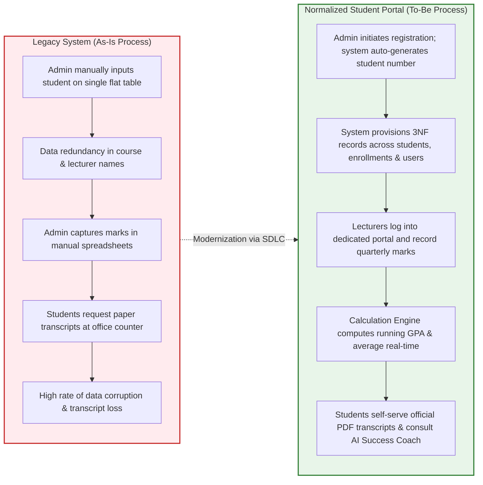
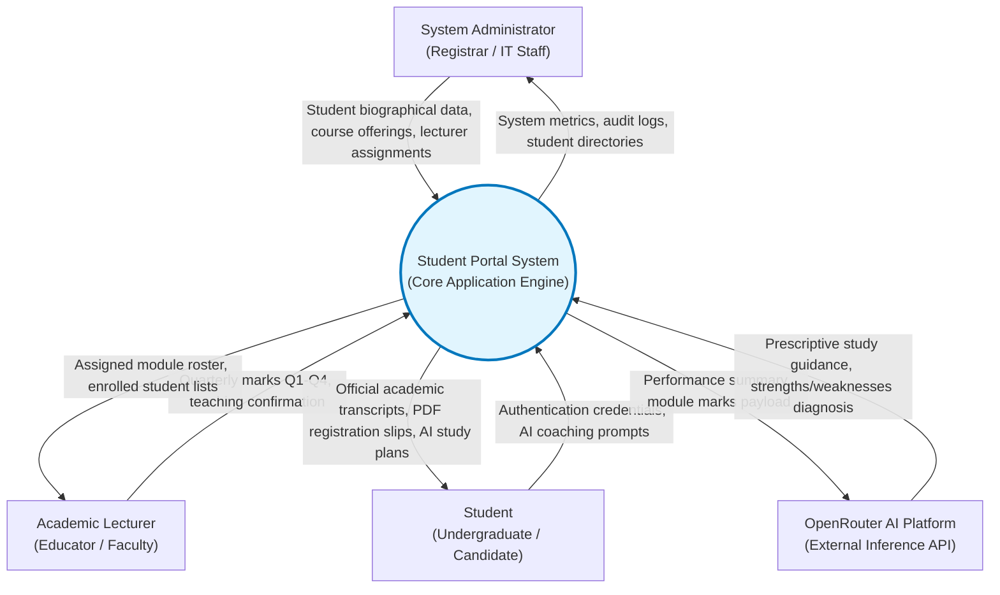
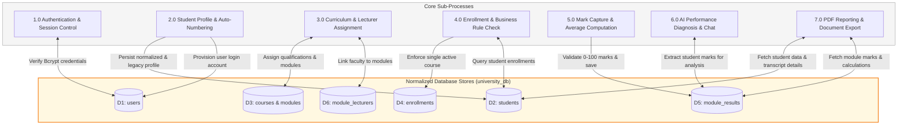

# STUDENT PORTAL SYSTEM
## Systems Analysis, Design & SDLC Methodology Specification
### Fast-Track 2-Week Lifecycle Traceability & Engineering Manual

---

> **Sequential Documentation Pipeline**  
> ← Previous: [01. Project Management Plan](PROJECT_MANAGEMENT_PLAN.md) | **Document 2 of 5** | Next: [03. Software Requirements Specification](SOFTWARE_REQUIREMENTS_SPECIFICATION.md) →

---

| **Institutional Metadata** | **Specification Details** |
| :--- | :--- |
| **System Title** | Student Portal System – Academic Management Platform |
| **Document Type** | Systems Analysis and Design (SA&D) & SDLC Lifecycle Manual |
| **Framework Followed** | 5-Phase Fast-Track SDLC (Structured Analysis & Iterative Sprint Execution) |
| **Lifecycle Duration** | **2 Calendar Weeks** (10 Intensive Working Days) |
| **Development Team** | • **Avuyile Mthembu**: Full Stack Software Developer (Lead & System Architect)<br>• **Nomthandazo Khoza**: Database Administrator (DBA & Data Modeler)<br>• **Qhama Nodada**: Frontend Developer (UI/UX & Client Logic) |
| **Host Department** | **Department of Forestry, Fisheries and the Environment (DFFE)** |
| **Branch & Directorate** | Corporate Management Services (CMS) — Directorate: IT Business Solutions (ITBS) |
| **Technical Reviewer** | Senior Software Architect / Mentorship Lead (ITBS) |
| **Live Production Instance** | [https://student-system.infinityfree.io/index.php](https://student-system.infinityfree.io/index.php) |

---

## 1. Systems Development Life Cycle (SDLC) Framework

The **Student Portal System** was engineered using a structured **Fast-Track 2-Week SDLC Framework**, balancing the rigor of formal requirements analysis, relational modeling, and UML design during the initial days with rapid iterative development and testing during the second week:

```mermaid
flowchart TD
    subgraph SDLC["5-Phase Fast-Track SDLC Lifecycle (2-Week Sprint)"]
        P1["Phase 1: Project Initiation & Feasibility (Days 1-2)<br>• Project Charter & Scope<br>• TELOS Feasibility Analysis<br>• Legacy Flat-Table Audit"]
        --> |Stage Gate 1: Scope Frozen| P2["Phase 2: Requirements Analysis (Days 2-3)<br>• As-Is vs To-Be Process Flows<br>• DFD Level 0 & Level 1 Design<br>• IEEE 830 SRS Formulation"]
        --> |Stage Gate 2: Architecture Baseline| P3["Phase 3: Systems & Database Design (Days 3-4)<br>• 3NF Relational Decomposition & ERD<br>• UML Class & Sequence Modeling<br>• 3-Tier Architecture Layout"]
        --> |Stage Gate 3: DB & Models Complete| P4["Phase 4: Implementation & Integration (Days 5-8)<br>• PHP 8 Domain Classes & Bcrypt Auth<br>• Multi-Role Switcher & Responsive UI<br>• OpenRouter AI Success Advisor & jsPDF"]
        --> |Stage Gate 4: Quality & Security Passed| P5["Phase 5: Verification, Deployment & Handover (Days 9-10)<br>• Backward Compatibility Verification<br>• Cloud Production Deployment (InfinityFree)<br>• Post-Implementation Review (PIR)"]
    end

    style P1 fill:#e3f2fd,stroke:#1565c0,stroke-width:2px;
    style P2 fill:#e8f5e9,stroke:#2e7d32,stroke-width:2px;
    style P3 fill:#fff3e0,stroke:#e65100,stroke-width:2px;
    style P4 fill:#ede7f6,stroke:#512da8,stroke-width:2px;
    style P5 fill:#e0f2f1,stroke:#00695c,stroke-width:2px;
```



---

## 2. Phase 1: Project Initiation & Feasibility Analysis

### 2.1 The TELOS Feasibility Framework
Prior to code implementation, the internship team conducted a formal **TELOS Feasibility Study** to validate that a full modernization could be realistically delivered within the two-week timeframe and tight budget:

| Feasibility Dimension | Evaluation Criteria | Findings & Project Viability Outcome | Risk Rating |
| :--- | :--- | :--- | :---: |
| **Technical (T)** | Feasibility of implementing 3NF normalization, PHP OOP domain models, and OpenRouter AI on standard LAMP stacks. | LAMP stack (Apache 2.4, PHP 8.x, MySQL 8.0 / MariaDB) natively supports PDO prepared statements, transaction isolation, and cURL requests. Zero-failure fallback heuristic handles API unavailability. | **Low** |
| **Economic (E)** | Cost-benefit analysis comparing development cost against administrative efficiency and budget constraints. | Achieved with **< R 1,000 ZAR** total cash expenditure by leveraging open-source tools (AMPPS, PHP, MariaDB), free cloud hosting (InfinityFree), and free AI tier (OpenRouter), saving over R48,000 in commercial license fees. | **Low** |
| **Legal (L)** | Compliance with the Protection of Personal Information Act (POPIA), South African policies, and IP standards. | System adheres strictly to POPIA: student ID numbers and contact data are safeguarded with Bcrypt salted hashing, parameterized queries, and strict role segregation. | **Low** |
| **Operational (O)** | Institutional acceptance by administrators, lecturers, and students transitioning from manual spreadsheets. | Intuitive Material Design interface with multi-role switcher minimizes cognitive load. Tabbed login and auto-filling demo credentials facilitate seamless adoption. | **Low** |
| **Schedule (S)** | Feasibility of delivering all core modules and documentation within the strict 2-week internship assessment window. | 10 working days allocated systematically across analysis, modeling, development, testing, and deployment. Deliverables were strictly prioritized to ensure on-time delivery. | **Low** |

---

## 3. Phase 2: Systems Analysis & Requirements Engineering

### 3.1 As-Is (Legacy) vs. To-Be (Proposed) Process Modeling



---

### 3.2 Data Flow Diagrams (DFD)

#### 3.2.1 DFD Level 0: Institutional Context Diagram
The Level 0 Context Diagram depicts the external boundary of the Student Portal System, identifying data inputs and outputs exchanged with external entities:



---

#### 3.2.2 DFD Level 1: System Decomposition Diagram
The Level 1 DFD decomposes the central system process into primary sub-processes, showing interactions with relational data stores:



---

## 4. Phase 3: Systems Design & Architecture

### 4.1 Architectural Tiering (3-Tier Architecture)

```
====================================================================================================
                                      SYSTEM TOPOLOGY ARCHITECTURE
====================================================================================================

+--------------------------------------------------------------------------------------------------+
|                                    PRESENTATION LAYER (Client Tier)                              |
|  Engineered by: Qhama Nodada (Frontend Developer)                                                |
|  - Responsive Multi-Role Layout (Materialize CSS, Modern CSS Custom Properties, Flexbox/Grid)   |
|  - Tabbed Role Switcher with Auto-fill Quick Access Demo Accounts                                |
|  - Interactive Client-Side Search & Filter Engine (search-filter.js)                              |
|  - AI Success Coach Chatbox & Formatted Response Renderer                                         |
|  - Client-Side Document PDF Generation (jsPDF.min.js)                                             |
+--------------------------------------------------------------------------------------------------+
                                                |
                                        HTTP/HTTPS (TLS 1.3)
                                                v
+--------------------------------------------------------------------------------------------------+
|                                APPLICATION & BUSINESS LOGIC LAYER                                |
|  Engineered by: Avuyile Mthembu (Full Stack Software Developer)                                 |
|  Controllers / Pages:                                                                            |
|   - admin/*.php (Governance, Student Management, Curriculum Mapping, Lecturer Allocation)        |
|   - lecturer/*.php (Roster Management, Quarterly Mark Capturing, Results Auditing)               |
|   - student/*.php (Self-service Profile, Module Inspection, Official Transcript, AI Success)     |
|                                                                                                  |
|  Domain Models & Services (classes/*.php):                                                       |
|   - Student.php, Course.php, Module.php, Lecturer.php, Enrollment.php, ModuleResult.php, User.php |
|   - RegistrationService.php (Transactional auto-numbering, legacy sync, account provisioning)   |
|   - OpenRouterService.php (API relay, heuristic fallbacks, bounded context prompt engineering)   |
+--------------------------------------------------------------------------------------------------+
                                                |
                                        PDO Prepared Statements
                                                v
+--------------------------------------------------------------------------------------------------+
|                                    DATA PERSISTENCE LAYER                                        |
|  Engineered by: Nomthandazo Khoza (Database Administrator)                                       |
|  Relational Database Management System: MySQL 8.0+ / MariaDB 10.4+ (InnoDB Engine)              |
|   - 8 Normalized Tables in Third Normal Form (3NF) with Foreign Key Constraints & Cascading      |
|   - Dual-Column Backward Compatibility Layer (legacy full_name, student_id_number support)       |
|   - Real-time Transactional Integrity (ACID Compliance with Commit & Rollback)                   |
+--------------------------------------------------------------------------------------------------+
```

---

### 4.2 Relational Decomposition & Normalization Proof (1NF to 3NF)

The legacy database consisted of a single denormalized flat table:  
`legacy_students (student_id, full_name, id_number, course_name, course_duration, module_1, lecturer_1, mark_1, module_2, lecturer_2, mark_2)`

#### Normalization Transformation Steps:
1. **First Normal Form (1NF)**:
   - *Violation*: Repeating groups of modules, lecturers, and marks (`module_1`, `module_2`, etc.).
   - *Resolution*: Decomposed repeating attributes into independent child rows with single atomic values.
2. **Second Normal Form (2NF)**:
   - *Violation*: Course duration depends only on `course_name` (part of composite key), not on the primary key `student_id`.
   - *Resolution*: Extracted courses into an independent entity (`courses`) with primary key `course_id`. Extracted modules into `modules`.
3. **Third Normal Form (3NF)**:
   - *Violation*: Transitive dependency where `lecturer_email` depended on `lecturer_name`, which depended on `module_id`.
   - *Resolution*: Decomposed lecturers into an independent entity (`lecturers`) with primary key `lecturer_id`, linked via an associative junction table `module_lecturers`.

---

## 5. Phase 4: Systems Implementation & Code Quality

### 5.1 Object-Oriented Design Patterns Applied

| Design Pattern | Applied Component | Implementation Benefit |
| :--- | :--- | :--- |
| **Service Layer Pattern** | `RegistrationService.php` | Encapsulates complex multi-table registration workflows within a single atomic database transaction (`beginTransaction()`, `commit()`, `rollBack()`). |
| **Domain Model / Data Mapper** | `classes/Student.php`, `classes/Course.php`, `classes/ModuleResult.php` | Separates domain business rules (e.g., mark average calculation, single active enrollment validation) from presentation templates. |
| **Strategy & Fallback Pattern** | `classes/OpenRouterService.php` | Tries external OpenRouter API endpoints with configured system prompts; automatically falls back to an offline rule-based heuristic strategy when offline or unkeyed. |
| **Front Controller / Role Routing** | `index.php`, `functions.php` | Centralizes authentication verification, CSRF token validation, and dynamic role-based redirection to `admin/`, `lecturer/`, or `student/`. |

### 5.2 Cryptographic Security Implementation
- **Password Salting**: Implemented via `password_hash($password, PASSWORD_BCRYPT, ['cost' => 10])`. Every execution creates an independent 22-character pseudorandom salt.
- **SQL Injection Immunization**: 100% of SQL statements pass through PDO parameterized statements (`$stmt->bindParam(...)` or `$stmt->execute([...])`).
- **XSS Immunization**: All dynamic output rendered to the browser is sanitized via `htmlspecialchars($data, ENT_QUOTES, 'UTF-8')`.

---

## 6. Phase 5: Testing, Traceability & Quality Assurance

### 6.1 Testing Pyramid Strategy

```
           / \
          /   \
         / UAT \         User Acceptance Testing (Admins, Lecturers, Students)
        /-------\
       /  System \       End-to-End Workflows, PDF Exports, AI Coach Responses
      /-----------\
     / Integration \     Multi-Table Transactions, Dual-Column Sync, Session Auth
    /---------------\
   /   Unit Tests    \   Domain Methods: calculateAverage(), generateStudentNumber()
  /-------------------\
```

---

### 6.2 Requirements Traceability Matrix (RTM)

| Requirement ID | Requirement Description | Design Class & Method | Database Table(s) | Lead Intern | Verification Endpoint | Status |
| :---: | :--- | :--- | :--- | :---: | :--- | :---: |
| **FR-01** | Cryptographic Salted Auth | `User::authenticate()` | `users` | Avuyile | `index.php` | **Verified** |
| **FR-02** | Role-Based Redirection | `functions.php:check_role()` | `users` | Avuyile | `admin/`, `lecturer/`, `student/` | **Verified** |
| **FR-03** | Session Fixation Protection | `index.php:session_regenerate_id()` | Session Store | Avuyile | `index.php` | **Verified** |
| **FR-04** | Password Change Self-Service | `User::changePassword()` | `users` | Avuyile | `change_password.php` | **Verified** |
| **FR-05** | Auto Student Number Generator| `RegistrationService::generateStudentNumber()`| `students` | Avuyile | `admin/register_student.php` | **Verified** |
| **FR-06** | Manual Student ID Ingestion | `RegistrationService::register()` | `students` | Avuyile | `admin/register_student.php` | **Verified** |
| **FR-07** | Dual-Column Profile Sync | `Student::save()`, `RegistrationService` | `students` | Nomthandazo | `admin/update_student.php` | **Verified** |
| **FR-08** | Course Qualification Mgmt | `Course::getAll()`, `Course::save()` | `courses` | Nomthandazo | `admin/courses.php` | **Verified** |
| **FR-09** | Shared Many-to-Many Modules | `Course::addModule()`, `Module::getCourses()` | `course_modules` | Nomthandazo | `admin/modules.php` | **Verified** |
| **FR-10** | Multi-Lecturer Assignment | `Module::assignLecturer()` | `module_lecturers`| Nomthandazo | `admin/lecturers.php` | **Verified** |
| **FR-11** | Single Active Course Rule | `Enrollment::validateSingleActive()` | `enrollments` | Avuyile | `admin/student_profile.php` | **Verified** |
| **FR-12** | Enrollment History Retention| `Student::getEnrollmentHistory()` | `enrollments` | Nomthandazo | `student/profile.php` | **Verified** |
| **FR-13** | Quarterly Mark Validation | `ModuleResult::setMarks()` (0-100 check) | `module_results`| Qhama & Avuyile| `lecturer/results.php` | **Verified** |
| **FR-14** | Running Average Calculation | `ModuleResult::calculateAverage()` | `module_results`| Avuyile | `student/results.php` | **Verified** |
| **FR-15** | PDF Registration Slip | Client-side `jsPDF` engine | N/A | Qhama | `student/registration_slip.php` | **Verified** |
| **FR-16** | PDF Academic Transcript | Client-side `jsPDF` engine | N/A | Qhama | `student/results.php` | **Verified** |
| **FR-17** | AI Success Coach Diagnostics | `OpenRouterService::analyzePerformance()` | `module_results`| Avuyile | `student/results.php` | **Verified** |
| **FR-18** | Interactive AI Study Chat | `OpenRouterService::chat()` | API Relay | Avuyile | `student/results.php` | **Verified** |

---

## 7. Deployment & Release Management

- **Staging Environment**: Local AMPPS Apache 2.4 server running PHP 8.2 and MariaDB 10.4 on `http://localhost/university_system/`.
- **Production Environment**: InfinityFree Cloud Cluster running Apache and MySQL with full SSL encryption on `https://student-system.infinityfree.io/`.
- **Database Provisioning**:
  1. Base schema initialized via `database/database.sql`.
  2. Incremental migration executed via `database/migration_v2.sql` (3NF tables and indexes).
  3. Feature extension executed via `database/migration_v3_lecturer_ai.sql` (educator roles and AI conversation logs).
- **Rollback Protocol**: Pre-migration snapshots (`database/backup_pre_v3.sql`) verified for rapid recovery.

---

## 8. Post-Implementation Review (PIR) & Assessment Sign-off

```
================================================================================
                    SDLC ATTESTATION & ASSESSMENT SUBMISSION
================================================================================

Submitted by the Internship Development Team:

1. _________________________________      Date: 2026-10-16
   Mr Avuyile Mthembu
   Full Stack Software Developer (Project Lead & System Architect)

2. _________________________________      Date: 2026-10-16
   Ms Nomthandazo Khoza
   Database Administrator (DBA & Data Modeler)

3. _________________________________      Date: 2026-10-16
   Mr/Ms Qhama Nodada
   Frontend Developer (UI/UX & Client Logic)

Directorate: Information Technology Business Solutions (ITBS)
Branch: Corporate Management Services (CMS)
Department of Forestry, Fisheries and the Environment (DFFE)


Technical Mentor Review:
____________________________________      Date: 2026-10-16
Senior Specialist: Software Architecture & Systems Development (ITBS)
Status: Approved - Full SDLC Competencies Demonstrated Successfully
================================================================================
```

---

> **Sequential Documentation Pipeline**  
> ← Previous: [01. Project Management Plan](PROJECT_MANAGEMENT_PLAN.md) | **Document 2 of 5** | Next: [03. Software Requirements Specification](SOFTWARE_REQUIREMENTS_SPECIFICATION.md) →
