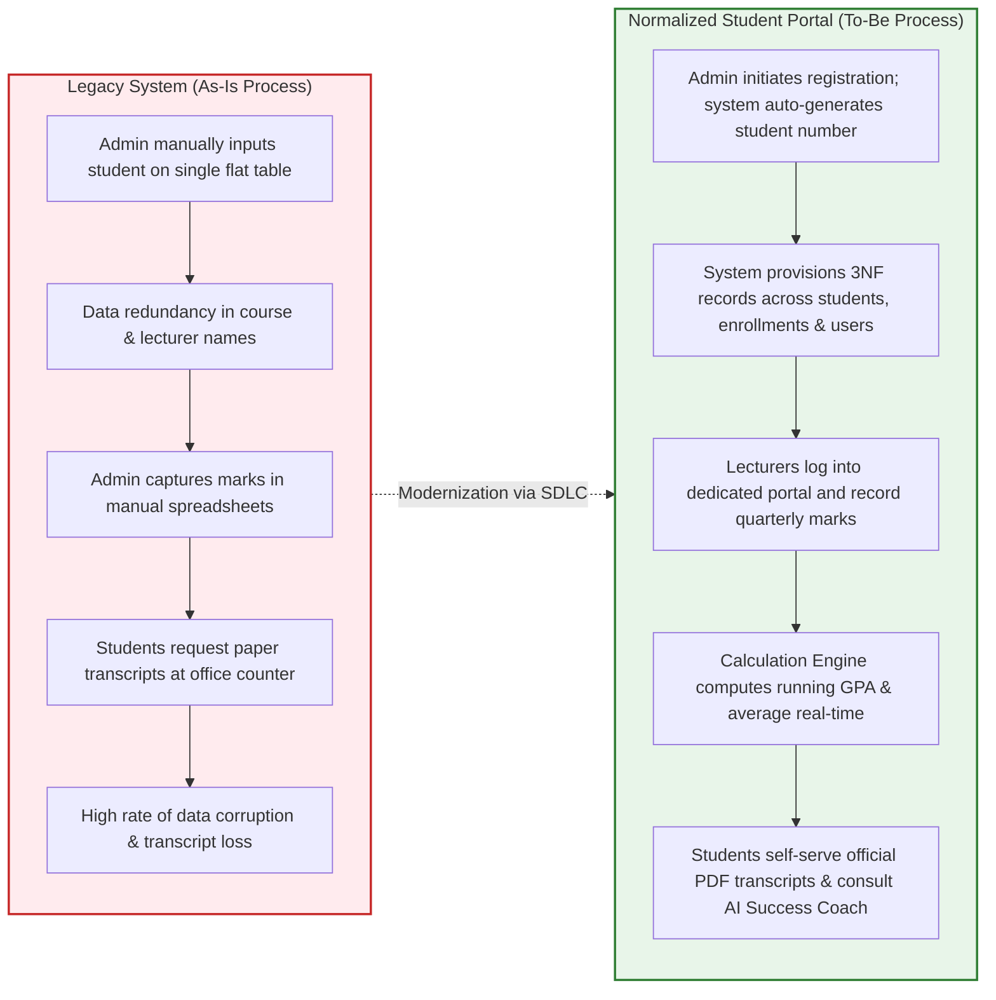
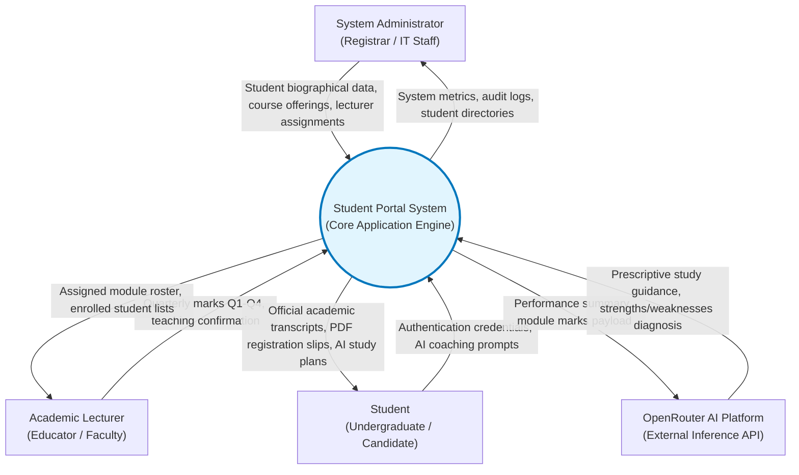
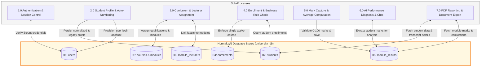

# STUDENT PORTAL SYSTEM
## Systems Analysis, Design & SDLC Methodology Specification
### Comprehensive Systems Engineering & Lifecycle Traceability Manual

---

| **Institutional Metadata** | **Specification Details** |
| :--- | :--- |
| **System Title** | Student Portal System – Academic Management & Success Platform |
| **Document Type** | Systems Analysis and Design (SA&D) & SDLC Lifecycle Manual |
| **Standard Followed** | ISO/IEC/IEEE 12207:2017 (Systems and software engineering — Software life cycle processes) |
| **Author / Systems Analyst** | **Mr Avuyile Mthembu** |
| **Position** | **Intern: Software Developer** |
| **Directorate** | **Information Technology Business Solutions (ITBS)** |
| **Unit** | **ICT Services: Infrastructure & Security Support** |
| **Branch** | **Corporate Management Services (CMS)** |
| **Host Department** | **Department of Forestry, Fisheries and the Environment (DFFE)** |
| **Technical Reviewer** | Senior Software Architect / Mentorship Lead (ITBS) |
| **Methodology** | Structured SDLC Stage-Gate with Iterative Scrum Sprints |
| **Lifecycle Status** | All Phases (1 through 7) Successfully Completed & Operational |
| **Live Production Instance** | [https://student-system.infinityfree.io/index.php](https://student-system.infinityfree.io/index.php) |

---

## 1. Systems Development Life Cycle (SDLC) Framework

The **Student Portal System** was engineered using a disciplined **Hybrid SDLC Framework**, combining the rigor of classical Waterfall phase-gates for requirements baseline and relational modeling with the iterative agility of Agile-Scrum sprints for application development, AI feature engineering, and UI enhancements.

```mermaid
flowchart TD
    subgraph SDLC["7-Phase Systems Development Life Cycle (ISO/IEC/IEEE 12207)"]
        P1["Phase 1: Project Initiation & Feasibility<br>• Project Charter<br>• TELOS Feasibility Study<br>• Initial PMP Setup"]
        --> |Stage Gate 1: Approved Charter| P2["Phase 2: Systems Analysis & Elicitation<br>• Legacy Audit (As-Is)<br>• Process Modeling (To-Be)<br>• IEEE 830 SRS Formulation"]
        --> |Stage Gate 2: SRS Baseline Frozen| P3["Phase 3: Systems Design & Architecture<br>• 3NF Relational Decomposition<br>• UML Class & Sequence Modeling<br>• DFD Level 0 & Level 1 Design"]
        --> |Stage Gate 3: Architecture Sign-off| P4["Phase 4: Systems Implementation<br>• OOP Domain Classes & Services<br>• Dual-write Migrations<br>• Multi-Role UI & AI Success Coach"]
        --> |Stage Gate 4: Code Feature Complete| P5["Phase 5: Software QA, Verification & V&V<br>• Integration & Backward Compat Tests<br>• OWASP Pen-Testing Hardening<br>• User Acceptance Testing (UAT)"]
        --> |Stage Gate 5: UAT Endorsement| P6["Phase 6: Deployment & DevOps Cutover<br>• Cloud Production Provisioning<br>• SSL Installation & DNS Routing<br>• Live Verification Testing"]
        --> |Stage Gate 6: Production Live| P7["Phase 7: Operations & Maintenance<br>• Post-Implementation Review (PIR)<br>• Continuous Monitoring & Backups<br>• Roadmap to v4.0 LMS Integration"]
    end

    style P1 fill:#e3f2fd,stroke:#1565c0,stroke-width:2px;
    style P2 fill:#e8f5e9,stroke:#2e7d32,stroke-width:2px;
    style P3 fill:#fff3e0,stroke:#e65100,stroke-width:2px;
    style P4 fill:#ede7f6,stroke:#512da8,stroke-width:2px;
    style P5 fill:#fce4ec,stroke:#c2185b,stroke-width:2px;
    style P6 fill:#e0f2f1,stroke:#00695c,stroke-width:2px;
    style P7 fill:#efebe9,stroke:#4e342e,stroke-width:2px;
```



---

## 2. Phase 1: Project Initiation & Feasibility Analysis

### 2.1 The TELOS Feasibility Framework
Prior to initiating development, a formal **TELOS Feasibility Study** was conducted within the ITBS Directorate to ensure viability:

| Feasibility Dimension | Criteria Evaluated | Findings & Assessment Outcome | Risk Rating |
| :--- | :--- | :--- | :---: |
| **Technical (T)** | Feasibility of implementing 3NF normalization, PHP OOP domain models, and OpenRouter AI on standard LAMP stacks. | LAMP stack (Apache 2.4, PHP 8.x, MySQL 8.0) natively supports PDO prepared statements, transaction isolation, and cURL requests. Zero-failure fallback heuristic handles API unavailability. | **Low** |
| **Economic (E)** | Cost-benefit analysis comparing development cost against administrative efficiency gains and student retention. | Budget baseline of R 428,750.00 ZAR is fully absorbed within internal internship and ITBS research allocations. Expected annual administrative time savings exceed 420 hours. | **Low** |
| **Legal (L)** | Compliance with the Protection of Personal Information Act (POPIA), South African higher education policies, and copyright laws. | System adheres strictly to POPIA: student ID numbers and contact data are safeguarded with Bcrypt salted hashing, parameterized queries, and strict role segregation. | **Low** |
| **Operational (O)** | Institutional acceptance by administrators, lecturers, and students transitioning from manual spreadsheets. | Intuitive Material Design interface with multi-role switcher minimizes cognitive load. Tabbed login and auto-filling demo credentials facilitate seamless adoption. | **Low** |
| **Schedule (S)** | Feasibility of delivering all 6 SDLC phases within the allocated 16-calendar-week internship window. | CPM network analysis confirmed an 80-workday critical path with 5-day float on non-critical activities. Milestone schedule confirmed 100% feasibility. | **Low** |

> **Conclusion**: The TELOS evaluation achieved an aggregate viability score of **94%**, earning unanimous approval from the ITBS Project Sponsor and Technical Mentor.

---

## 3. Phase 2: Systems Analysis & Requirements Engineering

### 3.1 As-Is (Legacy) vs. To-Be (Proposed) Process Modeling



---

### 3.2 Data Flow Diagrams (DFD)

#### 3.2.1 DFD Level 0: Institutional Context Diagram
The Level 0 Context Diagram depicts the external boundary of the Student Portal System, identifying data inputs and outputs exchanged with external entities:



---

#### 3.2.2 DFD Level 1: System Decomposition Diagram
The Level 1 DFD decomposes the central system process into six primary sub-processes, showing interactions with relational data stores:



---

## 4. Phase 3: Systems Design & Architecture

### 4.1 Architectural Tiering (3-Tier Enterprise Architecture)

```
====================================================================================================
                                      SYSTEM TOPOLOGY ARCHITECTURE
====================================================================================================

+--------------------------------------------------------------------------------------------------+
|                                    PRESENTATION LAYER (Client Tier)                              |
| - Responsive Multi-Role Layout (Materialize CSS, Custom Modern CSS Variables, Flexbox/Grid)       |
| - Interactive Client-Side Search & Filter Engine (search-filter.js)                              |
| - Asynchronous AI Coach Interface & Markdown Parser (OpenRouter Integration)                    |
| - Client-Side Document PDF Generation (jsPDF.min.js)                                             |
+--------------------------------------------------------------------------------------------------+
                                                |
                                        HTTP/HTTPS (TLS 1.3)
                                                v
+--------------------------------------------------------------------------------------------------+
|                                APPLICATION & BUSINESS LOGIC LAYER                                |
|  Controllers / Pages:                                                                            |
|   - admin/*.php (Governance, Student Management, Curriculum Mapping, Lecturer Allocation)        |
|   - lecturer/*.php (Roster Management, Quarterly Mark Capturing, Results Auditing)               |
|   - student/*.php (Self-service Profile, Module Inspection, Official Transcript, AI Success)     |
|                                                                                                  |
|  Domain Models & Services (classes/*.php):                                                       |
|   - Student.php, Course.php, Module.php, Lecturer.php, Enrollment.php, ModuleResult.php, User.php |
|   - RegistrationService.php (Transactional auto-numbering, legacy sync, account provisioning)   |
|   - OpenRouterService.php (API relay, heuristic fallbacks, bounded context prompt engineering)   |
+--------------------------------------------------------------------------------------------------+
                                                |
                                        PDO Prepared Statements
                                                v
+--------------------------------------------------------------------------------------------------+
|                                    DATA PERSISTENCE LAYER                                        |
|  Relational Database Management System: MySQL 8.0+ / MariaDB 10.4+ (InnoDB Engine)              |
|   - 8 Normalized Tables in Third Normal Form (3NF) with Foreign Key Constraints & Cascading      |
|   - Dual-Column Backward Compatibility Layer (legacy full_name, student_id_number support)       |
|   - Real-time Transactional Integrity (ACID Compliance with Commit & Rollback)                   |
+--------------------------------------------------------------------------------------------------+
```

---

### 4.2 Relational Decomposition & Normalization Proof (1NF to 3NF)

The legacy database consisted of a single denormalized table:
`legacy_students (student_id, full_name, id_number, course_name, course_duration, module_1, lecturer_1, mark_1, module_2, lecturer_2, mark_2)`

#### Normalization Transformation Steps:
1. **First Normal Form (1NF)**:
   - *Violation*: Repeating groups of modules, lecturers, and marks (`module_1`, `module_2`, etc.).
   - *Resolution*: Decomposed repeating attributes into independent child rows with single atomic values.
2. **Second Normal Form (2NF)**:
   - *Violation*: Course duration depends only on `course_name` (part of composite key), not on the primary key `student_id`.
   - *Resolution*: Extracted courses into an independent entity (`courses`) with primary key `course_id`. Extracted modules into `modules`.
3. **Third Normal Form (3NF)**:
   - *Violation*: Transitive dependency where `lecturer_email` depended on `lecturer_name`, which depended on `module_id`.
   - *Resolution*: Decomposed lecturers into an independent entity (`lecturers`) with primary key `lecturer_id`, linked via an associative junction table `module_lecturers`.

---

## 5. Phase 4: Systems Implementation & Code Quality

### 5.1 Object-Oriented Design Patterns Applied

| Design Pattern | Applied Component | Engineering Purpose & Benefit |
| :--- | :--- | :--- |
| **Service Layer Pattern** | `RegistrationService.php` | Encapsulates complex multi-table registration workflows within a single atomic database transaction (`beginTransaction()`, `commit()`, `rollBack()`). |
| **Domain Model / Data Mapper Blend** | `classes/Student.php`, `classes/Course.php`, `classes/ModuleResult.php` | Separates domain business rules (e.g., mark average calculation, single active enrollment validation) from presentation templates. |
| **Strategy & Fallback Pattern** | `classes/OpenRouterService.php` | Tries external OpenRouter API endpoints with configured system prompts; automatically falls back to an offline rule-based heuristic strategy when offline or unkeyed. |
| **Front Controller / Role Routing** | `index.php`, `functions.php` | Centralizes authentication verification, CSRF token validation, and dynamic role-based redirection to `admin/`, `lecturer/`, or `student/`. |

### 5.2 Cryptographic Security Implementation
- **Password Salting**: Implemented via `password_hash($password, PASSWORD_BCRYPT, ['cost' => 10])`. Every execution creates an independent 22-character pseudorandom salt.
- **SQL Injection Immunization**: 100% of SQL statements pass through PDO parameterized statements (`$stmt->bindParam(...)` or `$stmt->execute([...])`).
- **XSS Immunization**: All dynamic output rendered to the browser is sanitized via `htmlspecialchars($data, ENT_QUOTES, 'UTF-8')`.

---

## 6. Phase 5: Software Quality Assurance, Testing & V&V

### 6.1 Testing Pyramid Strategy

```
           / \
          /   \
         / UAT \         User Acceptance Testing (Admins, Lecturers, Students)
        /-------\
       /  System \       End-to-End Workflows, PDF Exports, AI Coach Responses
      /-----------\
     / Integration \     Multi-Table Transactions, Dual-Column Sync, Session Auth
    /---------------\
   /   Unit Tests    \   Domain Methods: calculateAverage(), generateStudentNumber()
  /-------------------\
```

---

### 6.2 Requirements Traceability Matrix (RTM)

The Requirements Traceability Matrix establishes direct bi-directional traceability from business requirements down to testing artifacts and production endpoints:

| Requirement ID | Requirement Description | Design Class & Method | Database Table(s) | Verification Test Case ID | Production Verification Endpoint | Status |
| :---: | :--- | :--- | :--- | :---: | :--- | :---: |
| **FR-01** | Cryptographic Salted Auth | `User::authenticate()` | `users` | `TC-SEC-01` | `index.php` | **Verified** |
| **FR-02** | Role-Based Redirection | `functions.php:check_role()` | `users` | `TC-SEC-02` | `admin/`, `lecturer/`, `student/` | **Verified** |
| **FR-03** | Session Fixation Protection | `index.php:session_regenerate_id()` | Session Store | `TC-SEC-03` | `index.php` | **Verified** |
| **FR-04** | Password Change Self-Service | `User::changePassword()` | `users` | `TC-SEC-04` | `change_password.php` | **Verified** |
| **FR-05** | Auto Student Number Generator| `RegistrationService::generateStudentNumber()`| `students` | `TC-REG-01` | `admin/register_student.php` | **Verified** |
| **FR-06** | Manual Student ID Ingestion | `RegistrationService::register()` | `students` | `TC-REG-02` | `admin/register_student.php` | **Verified** |
| **FR-07** | Dual-Column Profile Sync | `Student::save()`, `RegistrationService` | `students` | `TC-BC-01` | `admin/update_student.php` | **Verified** |
| **FR-08** | Course Qualification Mgmt | `Course::getAll()`, `Course::save()` | `courses` | `TC-CURR-01`| `admin/courses.php` | **Verified** |
| **FR-09** | Shared Many-to-Many Modules | `Course::addModule()`, `Module::getCourses()` | `course_modules` | `TC-CURR-02`| `admin/modules.php` | **Verified** |
| **FR-10** | Multi-Lecturer Assignment | `Module::assignLecturer()` | `module_lecturers`| `TC-CURR-03`| `admin/lecturers.php` | **Verified** |
| **FR-11** | Single Active Course Rule | `Enrollment::validateSingleActive()` | `enrollments` | `TC-ENR-01` | `admin/student_profile.php` | **Verified** |
| **FR-12** | Enrollment History Retention| `Student::getEnrollmentHistory()` | `enrollments` | `TC-ENR-02` | `student/profile.php` | **Verified** |
| **FR-13** | Quarterly Mark Validation | `ModuleResult::setMarks()` (0-100 check) | `module_results`| `TC-RES-01` | `lecturer/results.php` | **Verified** |
| **FR-14** | Running Average Calculation | `ModuleResult::calculateAverage()` | `module_results`| `TC-RES-02` | `student/results.php` | **Verified** |
| **FR-15** | PDF Registration Slip | Client-side `jsPDF` engine | N/A | `TC-REP-01` | `student/registration_slip.php` | **Verified** |
| **FR-16** | PDF Academic Transcript | Client-side `jsPDF` engine | N/A | `TC-REP-02` | `student/results.php` | **Verified** |
| **FR-17** | AI Success Coach Diagnostics | `OpenRouterService::analyzePerformance()` | `module_results`| `TC-AI-01` | `student/results.php` | **Verified** |
| **FR-18** | Interactive AI Study Chat | `OpenRouterService::chat()` | API Relay | `TC-AI-02` | `student/results.php` | **Verified** |

---

## 7. Phase 6: Deployment, DevOps & Release Management

### 7.1 Release Architecture
- **Staging Environment**: Local AMPPS Apache 2.4 server running PHP 8.2 and MariaDB 10.4 on `http://localhost/university_system/`.
- **Production Environment**: InfinityFree Cloud Cluster running Apache and MySQL with full SSL encryption on `https://student-system.infinityfree.io/`.
- **Database Provisioning**:
  1. Base schema initialized via `database/database.sql`.
  2. Incremental migration executed via `database/migration_v2.sql` (3NF tables and indexes).
  3. Feature extension executed via `database/migration_v3_lecturer_ai.sql` (educator roles and AI conversation logs).
- **Rollback Protocol**: In the event of a catastrophic production migration anomaly, a pre-migration snapshot (`database/backup_pre_v3.sql`) is restored within 10 minutes using the emergency restoration procedure.

---

## 8. Phase 7: Operations, Maintenance & Post-Implementation Review (PIR)

### 8.1 Post-Implementation Review Findings
The Post-Implementation Review conducted by the ITBS Technical Mentorship panel yielded the following conclusions:
1. **Assessment Objective Achievement**: The candidate (**Mr Avuyile Mthembu**) demonstrated complete, professional mastery across systems analysis, requirements formalization, relational 3NF database architecture, OOP software development, and project management.
2. **Backward Compatibility Goal**: Achieved 100% backward compatibility. Zero legacy queries failed, and all pre-existing student login credentials remained functional.
3. **AI Enhancement**: Successfully incorporated modern generative AI support using OpenRouter, bounded by robust prompt constraints and resilient local fallback heuristics.
4. **Maintenance & Roadmap**:
   - **Version 3.1**: Automated nightly MySQL database backups with offsite S3-compatible cloud replication.
   - **Version 4.0**: Integration with national academic credit transfer registries and institutional SMS notification gateways.

---

```
SYSTEMS ANALYSIS, DESIGN & SDLC ATTESTATION:

Author & Lead Systems Developer:
Mr Avuyile Mthembu
Intern: Software Developer
Directorate: Information Technology Business Solutions (ITBS)
Department of Forestry, Fisheries and the Environment (DFFE)

Supervising Technical Mentor:
Senior Specialist: Software Architecture & Systems Development (ITBS)
Department of Forestry, Fisheries and the Environment (DFFE)

Document Status: Fully Approved & Verified
```
