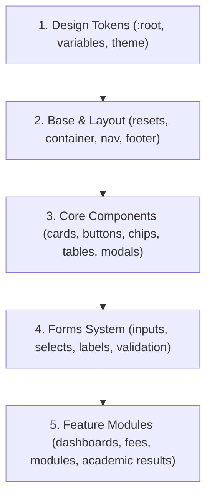

# Frontend Architecture: Separation of Concerns & Organization Plan

## 1. Executive Summary & Audit Findings

An audit of the current frontend styling across the repository reveals significant overlap and conflicting responsibilities across 5 external stylesheets and thousands of lines of page-embedded `<style>` blocks. The large academic-results style block has since been extracted into a page-specific stylesheet.

### Current File Inventory & Pain Points

| File | Size | Primary Responsibility | Current Issues & Collisions |
| :--- | :--- | :--- | :--- |
| [`css/style.css`](file:///c:/Program%20Files/Ampps/www/university_system/css/style.css) | 16.8 KB (702 lines) | Global resets, tokens, nav, tables, chips, login | Monolithic; defines buttons, tables, and chips that are also redefined in `material-design.css`. |
| [`css/material-design.css`](file:///c:/Program%20Files/Ampps/www/university_system/css/material-design.css) | 7.9 KB (343 lines) | Component wrappers (cards, buttons, modals) | Overrides and duplicates `.btn`, `.card`, and `table` styles from `style.css`. |
| [`css/forms.css`](file:///c:/Program%20Files/Ampps/www/university_system/css/forms.css) | 4.3 KB (185 lines) | Form inputs, floating labels, selects | High-specificity floating label rules (`.input-field label`) caused vertical collisions with Materialize's `.select-wrapper`. |
| [`css/dashboard.css`](file:///c:/Program%20Files/Ampps/www/university_system/css/dashboard.css) | 11.5 KB (480 lines) | Dashboards, AI advisor, modules grid | Accumulating page-specific feature styles (AI advisor, modules grid, report container). |
| [`css/styles.css`](file:///c:/Program%20Files/Ampps/www/university_system/css/styles.css) | 90 bytes (2 lines) | Legacy compatibility wrapper | Just `@import url("style.css");`. |
| [`css/student-results.css`](./css/student-results.css) | Academic transcript, AI Coach, Markdown, tables, LaTeX | Page-specific result styling, loaded only by the results page through the shared header hook. |

---

## 2. Target Architecture: Modular Layered Hierarchy

We apply the **ITCSS (Inverted Triangle CSS)** & **Domain-Driven Component Design** principles to establish clean boundaries:



### Responsibility Matrix

```
css/
├── core/
│   ├── tokens.css          <-- Design tokens: colors, fonts, shadows, transitions, spacing
│   └── layout.css          <-- Resets, body, main container, navbar, sidenav, footer
├── components/
│   ├── buttons.css         <-- .btn, .btn-large, .btn-flat, icon buttons, states
│   ├── cards.css           <-- .card, .card-panel, hoverable, headers & actions
│   ├── chips.css           <-- .chip, status pills, tags, badges
│   └── tables.css          <-- Responsive tables, dense tables, status indicators
├── forms/
│   └── forms.css           <-- Input fields, floating labels, selects, prefix icons, validation
└── features/
    ├── dashboard.css       <-- Admin & student KPI cards, summary widgets, quick links
    ├── modules.css         <-- CSS Grid module cards, lecturer badges, course lists
    ├── fees.css            <-- Fee schedules, payment cards, multi-month modals
    └── student-results.css <-- Transcript, AI coach, Markdown, tables, and print styling for results
```

---

## 3. Detailed Component Ownership Breakdown

### Layer 1: Core Design Tokens ([`css/core/tokens.css`](file:///c:/Program%20Files/Ampps/www/university_system/css/core/tokens.css))
* Single source of truth for all CSS custom properties (`:root`).
* Standardized semantic colors:
  * Primary: `--color-primary` (`#1565c0`), `--color-primary-dark` (`#0d47a1`)
  * Surface & Background: `--color-surface` (`#ffffff`), `--color-bg` (`#f8fafc`)
  * Status: `--color-success` (`#16a34a`), `--color-warning` (`#f59e0b`), `--color-danger` (`#dc2626`)
* Typography tokens: font families, weights, font scales (`0.75rem` to `2.2rem`).
* Elevation tokens: standard shadows (`--shadow-sm`, `--shadow-md`, `--shadow-lg`, `--shadow-glow`).

### Layer 2: Base & Layout ([`css/core/layout.css`](file:///c:/Program%20Files/Ampps/www/university_system/css/core/layout.css))
* Box-sizing, body height, sticky flex footer structure (`min-height: 100vh`).
* Top navigation bar, role-based nav headers, mobile hamburger slide-out (`.sidenav`).
* Responsive content boundaries (`main.container` at 90% desktop, 95% tablet, 100% mobile).

### Layer 3: Shared UI Components ([`css/components/`](file:///c:/Program%20Files/Ampps/www/university_system/css/components/))
* Eliminates the duplicate declarations currently split between `style.css` and `material-design.css`.
* **`cards.css`**: Standard card radius (12px), header/content/action padding, elevation transitions.
* **`buttons.css`**: Standard heights (38px, 44px, 48px), gradients, disabled states, loading ripples.
* **`chips.css`**: Uniform inline-flex alignment, icon spacing, semester chips, credit counters.
* **`tables.css`**: Clean borders, striped rows, dense padding modifiers, mobile table cards.

### Layer 4: Forms System ([`css/forms/forms.css`](file:///c:/Program%20Files/Ampps/www/university_system/css/forms/forms.css))
* Dedicated solely to input mechanics:
  * Text, email, password, datepicker inputs.
  * Controlled floating labels that never interfere with custom select dropdowns.
  * Prefix icons properly measured with 3rem left margin.
  * Validation classes (`valid`, `invalid`, helper text).

### Layer 5: Feature Modules ([`css/features/`](file:///c:/Program%20Files/Ampps/www/university_system/css/features/))
* **`dashboard.css`**: Top KPI metric panels, quick action collections, dashboard greetings.
* **`modules.css`**: Equal-height CSS Grid (`.modules-grid-container`) and lecturer footer alignment.
* **`fees.css`**: Balanced flex payment cards (preventing Materialize `.col.m7` margin clashes).
* **`student-results.css`**: Page-specific transcript, AI coach, rich-content, responsive, and print styles extracted from `student/results.php`.

---

## 4. Loading Order & Specificity Control

In [`includes/header.php`](file:///c:/Program%20Files/Ampps/www/university_system/includes/header.php), files are loaded in strict order of ascending specificity:

```html
<!-- 1. External Frameworks -->
<link rel="stylesheet" href="https://cdnjs.cloudflare.com/ajax/libs/materialize/1.0.0/css/materialize.min.css">
<link rel="stylesheet" href="https://fonts.googleapis.com/icon?family=Material+Icons">

<!-- 2. Core Tokens & Layout -->
<link rel="stylesheet" href="<?php echo BASE_URL; ?>css/core/tokens.css">
<link rel="stylesheet" href="<?php echo BASE_URL; ?>css/core/layout.css">

<!-- 3. Components & Forms -->
<link rel="stylesheet" href="<?php echo BASE_URL; ?>css/components/components.css">
<link rel="stylesheet" href="<?php echo BASE_URL; ?>css/forms/forms.css">

<!-- 4. Feature Enhancements -->
<link rel="stylesheet" href="<?php echo BASE_URL; ?>css/features/dashboard.css">
<link rel="stylesheet" href="<?php echo BASE_URL; ?>css/features/modules.css">
<link rel="stylesheet" href="<?php echo BASE_URL; ?>css/student-results.css">
```

> [!TIP]
> **Production Bundling Option**: During development, separate files allow instant debugging and zero merge conflicts. In production, a single minified bundle or entry file (`@import`) can be served with HTTP/2 caching.

---

## 5. Phased Implementation Roadmap

```mermaid
gantt
    title CSS Separation of Concerns Roadmap
    dateFormat  X
    axisFormat %s
    section Phase 1: Core Tokens & De-duplication
    Extract tokens.css and layout.css       :p1_1, 0, 1
    Consolidate style.css & material-design.css :p1_2, 1, 2
    section Phase 2: Feature Isolation
    Separate modules.css & fees.css        :p2_1, 2, 3
    Extract student-results.css from results.php :p2_2, 3, 4
    section Phase 3: Validation & Cleanup
    Update header.php imports               :p3_1, 4, 5
    Verify visual regression across portals :p3_2, 5, 6
```



### Next Steps & Decisions Needed

1. **Option A (Comprehensive Modularization)**: Proceed with creating the clean `core/`, `components/`, and `features/` directory hierarchy, extract the 800+ lines of AI CSS from `results.php`, and update `header.php`.
2. **Option B (Consolidated 3-File Architecture)**: Consolidate into 3 cleanly partitioned files (`base.css`, `components-forms.css`, `features.css`) to keep the file count minimal while resolving all duplication and specificity collisions.
