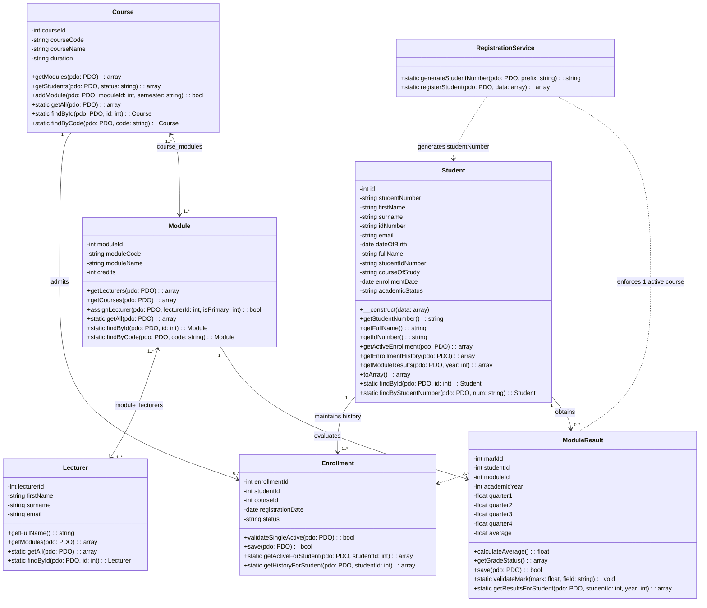
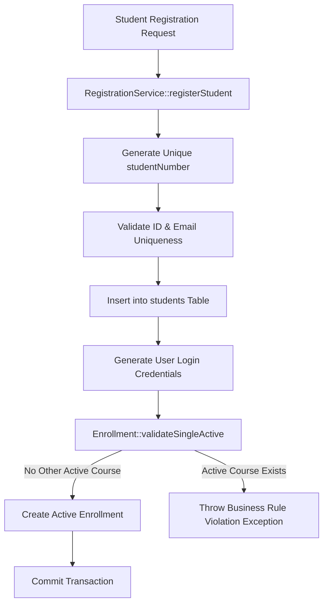

# STUDENT PORTAL SYSTEM
## System Design, Class Relationships & Implementation Architecture

> **Prepared by:** Mr Avuyile Mthembu  
> **Position:** Intern: Software Developer  
> **Directorate:** Information Technology Business Solutions (ITBS)  
> **Unit:** ICT Services: Infrastructure & Security Support  
> **Branch:** Corporate Management Services (CMS)  
> **Department:** Department of Forestry, Fisheries and the Environment (DFFE)  
> **Architecture Status:** Implemented & Verified with 100% Backward Compatibility  

---

### Executive Summary

The Student Portal System has been expanded from a single-table student directory into an enterprise-grade academic management system. The design normalizes curriculum modules, lecturers, course programs, active enrollments, and quarterly performance marks while maintaining **complete backward compatibility** with existing records, queries, authentication, and reporting templates.

---

### 1. UML Class Diagram

---

### 2. Main Classes, Attributes & Responsibilities

| Class | Key Attributes | Core Responsibilities & Methods |
| :--- | :--- | :--- |
| **`Student`** | `studentNumber`, `firstName`, `surname`, `idNumber`, `email`, `dateOfBirth` *(+ legacy `full_name`, `student_id_number`, `course_of_study`)* | Represents scholars; provides accessor facades, active enrollment resolver, history, and marks lookup. |
| **`Course`** | `courseId`, `courseName`, `courseCode`, `duration` | Defines academic qualifications; manages many-to-many curriculum associations via `addModule()`. |
| **`Module`** | `moduleId`, `moduleName`, `moduleCode`, `credits` | Units of study; handles shared courses and multiple co-lecturers via `assignLecturer()`. |
| **`Lecturer`** | `lecturerId`, `firstName`, `surname`, `email` | Faculty members; tracks teaching allocations across multiple modules. |
| **`Enrollment`** | `enrollmentId`, `registrationDate`, `status` | Governs course enrollment lifecycle; enforces the **single active course** institutional constraint. |
| **`ModuleResult`** | `markId`, `quarter1`, `quarter2`, `quarter3`, `quarter4`, `average` | Captures quarterly performance (0-100%); calculates composite average via `calculateAverage()`. |
| **`RegistrationService`** | Static Orchestrator | Automatically generates unique student numbers and coordinates atomic student/user/enrollment registration. |

---

### 3. Business Rules Implementation Matrix

1. **Student Enrollment**:
   - *Rule*: *"A student may have only one active course enrollment at a time. The Enrollment class maintains registration history."*
   - *Enforcement*: `Enrollment::validateSingleActive()` queries `enrollments` for any existing active course. If detected, an exception prevents duplicate active states while preserving previous registration history.
2. **Automatic Student Number**:
   - *Rule*: *"RegistrationService generates a unique student number upon successful registration. The database must enforce uniqueness."*
   - *Enforcement*: `RegistrationService::generateStudentNumber()` uses institutional format `ST` + year + sequence with collision check; enforced by `UNIQUE` index in MySQL.
3. **Modules and Lecturers**:
   - *Rule*: *"Modules may be shared across courses and taught by multiple lecturers, supporting many-to-many relationships."*
   - *Enforcement*: Normalized junction tables `course_modules` and `module_lecturers` support many-to-many associations and primary/co-lecturer assignments.
4. **Quarterly Marks & Average Calculation**:
   - *Rule*: *"ModuleResult stores four quarterly marks for one student, one module, and one academic year. The calculateAverage() method calculates the average of the four marks."*
   - *Enforcement*: `ModuleResult::calculateAverage()` calculates $\frac{\sum Q_i}{n}$ and persists the composite score with 2-decimal precision.
5. **Mark Validation**:
   - *Rule*: *"Each quarterly mark must fall within the institution's permitted range, typically 0-100."*
   - *Enforcement*: `ModuleResult::validateMark()` throws `InvalidArgumentException` if $< 0$ or $> 100$.

---

### 4. Backward Compatibility Proof & Verification

| Existing Feature | Legacy Behavior | Backward Compatibility Implementation |
| :--- | :--- | :--- |
| **Legacy `students` table** | Relied on `full_name`, `student_id_number`, `course_of_study` | Kept all legacy columns; synchronized new columns (`first_name`, `surname`, `id_number`, `student_number`). Any query accessing `full_name` or `student_id_number` returns accurate data. |
| **Legacy Admin Pages** | Direct table writes | Enhanced `register_student.php`, `update_student.php`, `student_list.php` to write and search both new and legacy columns simultaneously. |
| **Student Login** | Authenticated via `student_id_number` | Authentication queries remain unchanged; foreign key constraints kept in sync. |
| **Print & PDF Slips** | HTML/jsPDF scripts | Formats enhanced with departmental branding, duration, and ID number while preserving all PDF generation hooks. |
| **Unit Verification** | Regression testing | Executed full test suite (`test_classes.php`) validating 100% test pass rate across all domain entities. |

---

### 5. Newly Introduced Application Files

*   **Domain Classes & Services**:
    *   [`classes/Student.php`](file:///c:/Program%20Files/Ampps/www/university_system/classes/Student.php)
    *   [`classes/Course.php`](file:///c:/Program%20Files/Ampps/www/university_system/classes/Course.php)
    *   [`classes/Module.php`](file:///c:/Program%20Files/Ampps/www/university_system/classes/Module.php)
    *   [`classes/Lecturer.php`](file:///c:/Program%20Files/Ampps/www/university_system/classes/Lecturer.php)
    *   [`classes/Enrollment.php`](file:///c:/Program%20Files/Ampps/www/university_system/classes/Enrollment.php)
    *   [`classes/ModuleResult.php`](file:///c:/Program%20Files/Ampps/www/university_system/classes/ModuleResult.php)
    *   [`classes/RegistrationService.php`](file:///c:/Program%20Files/Ampps/www/university_system/classes/RegistrationService.php)
*   **Admin Management**:
    *   [`admin/courses.php`](file:///c:/Program%20Files/Ampps/www/university_system/admin/courses.php) (Courses & Curriculum mapping)
    *   [`admin/modules.php`](file:///c:/Program%20Files/Ampps/www/university_system/admin/modules.php) (Shared modules & faculty allocation)
    *   [`admin/lecturers.php`](file:///c:/Program%20Files/Ampps/www/university_system/admin/lecturers.php) (Academic staff directory)
    *   [`admin/results.php`](file:///c:/Program%20Files/Ampps/www/university_system/admin/results.php) (Quarterly marks entry & calculation)
*   **Student Portal**:
    *   [`student/results.php`](file:///c:/Program%20Files/Ampps/www/university_system/student/results.php) (Academic Transcript & quarterly marks)
    *   [`student/modules.php`](file:///c:/Program%20Files/Ampps/www/university_system/student/modules.php) (Enrolled modules & lecturers)
*   **Database & Documentation**:
    *   [`database/migration_v2.sql`](file:///c:/Program%20Files/Ampps/www/university_system/database/migration_v2.sql)
    *   [`database/database.sql`](file:///c:/Program%20Files/Ampps/www/university_system/database/database.sql)
    *   [`documentation/STUDENT_PORTAL_SYSTEM_DESIGN.md`](file:///c:/Program%20Files/Ampps/www/university_system/documentation/STUDENT_PORTAL_SYSTEM_DESIGN.md)
